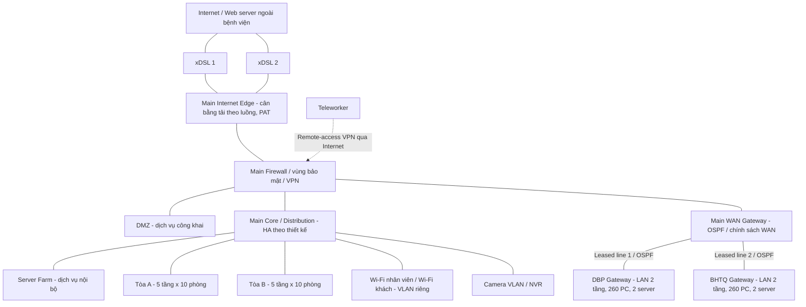

# BTL 2 - Thiết kế và mô phỏng mạng bệnh viện 3 site

Tài liệu quản lý và định hướng kỹ thuật cho hệ thống bệnh viện gồm **Main Site tại TP.HCM**, **Auxiliary Site DBP** và **Auxiliary Site BHTQ**. Đầu ra cuối cùng là **báo cáo chính thức PDF, nguồn báo cáo có thể chỉnh sửa và mô phỏng Packet Tracer hoặc GNS3**. Nhóm có **5 thành viên**, thực hiện **4 giai đoạn, mỗi giai đoạn đúng 1 tuần**, từ **Thứ Hai 26/10/2026**.

**Trạng thái:** Đã lập kế hoạch; chưa triển khai mô phỏng, chạy kiểm thử hoặc nghiệm thu. Các subnet, tên nhóm phòng ban, cấu hình, số lượng thiết bị đề xuất và ngưỡng thiết kế dưới đây là baseline để nhóm kiểm chứng, không phải dữ kiện bổ sung từ đề bài.

## 1. Điều hướng và nguồn đặc tả

- [Cấu trúc repository và quy trình GitHub](github-project-structure.md).
- [Công việc dự án](TASKS.md).
- [Hướng dẫn mô phỏng](simulation/README.md) và [ma trận kiểm thử](test_results/test-matrix.md).
- [Checklist theo giai đoạn và từng thành viên](tasks-assignment.md) - nguồn checklist chính thức.
- [Kế hoạch chi tiết TV1](docs/00-management/tv1-execution-plan.md) và [tình trạng sau review](docs/00-management/tv1-review-status.md): có cấu hình tham chiếu hiệu chỉnh, chưa có project/evidence mô phỏng; đọc trạng thái trước khi dùng.
- `Assignment 2-Network Design For A Company.pdf` (tài liệu local, không đưa vào Git), ký hiệu **[A]**: 5 trang; yêu cầu 7 bước ở trang 3-4, sơ đồ minh họa ở trang 5.
- `Reference Multi-site network.pdf` (tài liệu local, không đưa vào Git), ký hiệu **[R]**: 11 trang; ví dụ NAT/PAT, DHCP, OSPF và packet tracing cho **2 site LTK/DiAn**.

Tên file [A] có chữ “Company”, nhưng nội dung chính là **bệnh viện**; HIS, RIS/PACS, LIS và yêu cầu an toàn bệnh viện là căn cứ thiết kế. [R] là bài thực hành kỹ thuật, không thay quy mô 3 site của [A]. Không coi thiết bị, tên phòng ban hoặc số lượng kết nối trong hình minh họa trang 5 [A] là bảng thiết bị bắt buộc.

**Quy ước ưu tiên:** Quy mô và yêu cầu kỹ thuật theo [A]; tham khảo cách kiểm chứng theo [R]; nhân sự, lịch và việc không làm slide theo yêu cầu mới của nhóm. [A] ghi nhóm 2-3 người và hạn tương đối 4 tuần; kế hoạch này dùng **5 người**, 4 tuần triển khai và các mốc năm 2026 bên dưới. Ngày BKeL **11/12/2026 do người giao việc cung cấp**, không được ghi trực tiếp trong PDF. Báo cáo cần sẵn sàng in nếu môn học yêu cầu bản cứng; không lập đầu việc làm slide.

## 2. Lịch trình và trách nhiệm

| Mốc | Thời gian | Kết quả cần đạt |
| --- | --- | --- |
| Giai đoạn 1 - Quy hoạch & Tính toán | 26/10/2026 - 01/11/2026 | Khảo sát, kiến trúc, VLAN/IP, BOM/cabling, tính tải và chọn WAN sơ bộ |
| Giai đoạn 2 - Mô phỏng cơ bản | 02/11/2026 - 08/11/2026 | Tích hợp 3 site, VLAN, DHCP, OSPF, Internet tập trung và NAT cơ bản |
| Giai đoạn 3 - Bảo mật & Kiểm thử | 09/11/2026 - 15/11/2026 | ACL/firewall/VPN trong khả năng công cụ; đủ bằng chứng 6 kịch bản bắt buộc |
| Giai đoạn 4 - Tổng hợp Báo cáo & Đóng gói | 16/11/2026 - 22/11/2026 | TV5 hoàn thiện báo cáo; TV1 duyệt chót báo cáo và mô phỏng; đóng gói bản ứng viên |
| Dự phòng rà soát, không phải giai đoạn 5 | 23/11/2026 - 06/12/2026 | Sửa lỗi phát hiện sau đóng gói, chạy lại test bị ảnh hưởng và tái duyệt |
| **Target Completion nội bộ** | **Chủ Nhật 06/12/2026** | Khóa bản nộp đã được TV1 duyệt |
| Bàn giao/nộp BKeL | 07/12/2026 - trước hạn 11/12/2026 | TV1 nộp, TV5 lưu xác nhận; không chờ ngày cuối |

| Thành viên | Vai trò | Phần việc kỹ thuật và quản lý | Sản phẩm chịu trách nhiệm |
| --- | --- | --- | --- |
| **TV1** | Trưởng nhóm, WAN & Routing Lead | Quy hoạch subnet tổng thể; WAN 3 site, OSPF, đánh giá SD-WAN/MPLS; cân bằng tải 2 xDSL; quản lý repo và tiến độ | IP/WAN/routing, so sánh chi phí; **duyệt chót PDF và mô phỏng**, nộp BKeL |
| **TV2** | LAN & Wireless Engineer | LAN A/B và 2 chi nhánh; VLAN phòng ban; Wi-Fi nhân viên/khách; thiết bị; GPON/Ethernet | Logical/physical topology, VLAN, BOM, sơ đồ đi dây và phương án Wi-Fi |
| **TV3** | Security & Systems Specialist | Server Farm, DMZ, NAT/PAT, firewall, ACL khách, VPN, IDS/IPS và hướng dẫn bảo mật | Ma trận truy cập, cấu hình/chính sách bảo mật, thiết kế server/camera phối hợp TV2 |
| **TV4** | Simulation & Testing Lead | Tính tải Step 3; dựng và ghép mô phỏng tổng; quản lý test và ảnh/log 6 kịch bản | Bảng tính thông lượng, file mô phỏng tích hợp, test matrix và bằng chứng |
| **TV5** | Documentation & Report Specialist | Chủ trì khảo sát Step 1; đánh giá Step 6; theo dõi nguồn, bảng biểu và truy vết | **Thu thập nội dung, tổng hợp bản thô, căn chỉnh và xuất báo cáo chính thức**; hồ sơ đóng gói |

TV5 chủ trì biên tập nhưng **mỗi người phải giao phần nội dung kỹ thuật của mình**, có cấu hình, bảng số liệu và minh chứng. TV4 tích hợp file mô phỏng; TV1 duyệt hai sản phẩm cuối, không chuyển trách nhiệm biên soạn chính từ TV5 sang TV1.

## 3. Quy mô và thông số phải bảo toàn

| Hạng mục | Yêu cầu gốc | Nguồn |
| --- | --- | --- |
| Vị trí | Main Site ở TP.HCM; 2 Auxiliary Sites ở đường DBP và BHTQ | [A] tr.1 |
| Tòa A và B | **Mỗi tòa 5 tầng, mỗi tầng 10 phòng**; tổng 10 tầng, 100 phòng | [A] tr.1 |
| Phòng trung tâm Main | Data center, IT và Cabling Central Local/patch panel ở phòng riêng, cách A/B **50 m** | [A] tr.1 |
| Main | **600 workstation, 10 server, 12 thiết bị mạng hoặc nhiều hơn** khi cần thiết bị bảo mật | [A] tr.1 |
| Mỗi Aux Site | **2 tầng**; tầng 1 có **1 phòng IT và 1 Cabling Central Local**; **260 workstation, 2 server, ít nhất 5 thiết bị mạng** | [A] tr.2 |
| Tổng hệ thống | **1.120 workstation, 14 server** theo cách hiểu quy mô trên là cho từng chi nhánh | Suy ra từ [A] tr.1-2 |
| Hạ tầng | Có dây và không dây; cáp quang **GPON**; Ethernet **1GbE/10GbE/40GbE**; VLAN theo phòng ban | [A] tr.1 |
| Wi-Fi | Phủ toàn Main Site; quy hoạch Wi-Fi chi nhánh theo khảo sát, tách khách khỏi nội bộ | [A] tr.1, 3-4 |
| WAN | **2 leased lines**, mỗi tuyến nối Main với một Aux Site; xem xét SD-WAN, MPLS và phương án thay thế theo chi phí | [A] tr.2-3 |
| Internet | **2 đường xDSL có load balancing**; Internet của cả 3 site **đều đi qua Main** | [A] tr.2 |
| Ứng dụng | Licensed + open source; HIS, RIS/PACS, LIS, CRM, văn phòng, client-server, multimedia, database | [A] tr.2 |
| Bảo mật và vận hành | Khả năng mở rộng, security, firewall, IDS/IPS, chống phishing, HA, chịu lỗi, dễ nâng cấp | [A] tr.2-4 |
| VPN và camera | Đề xuất **site-to-site VPN**, **teleworker VPN** và **hệ thống camera giám sát** | [A] tr.2 |
| Tăng trưởng | **20% trong 5 năm** về người dùng, tải mạng, mở rộng site; không phải 20% mỗi năm | [A] tr.3 |

Quy hoạch 5 năm: Main **720** workstation; DBP **312**; BHTQ **312**; tổng **1.344**. Với server, tính theo từng site và làm tròn lên cho kết quả **12 + 3 + 3 = 18 server**, thay vì làm tròn tổng 14 × 1,2 thành 17 rồi phân bổ thiếu ở chi nhánh. Đây là lượng dự trù, không tự thêm server vào quy mô ban đầu.

## 4. Kiến trúc 3 site đề xuất



Sơ đồ là kiến trúc logic; ranh giới bảo mật Server Farm được thực thi bằng firewall/ACL giữa các vùng tại core hoặc firewall phân đoạn. Sơ đồ vật lý phải tách rõ MDF, IDF, uplink, port và vị trí firewall; không diễn giải một đường logic thành một dây duy nhất.

- **Main:** core/distribution tập trung tại phòng trung tâm; backbone quang đến IDF A/B, access theo tầng/phòng. Dự kiến 1GbE đến máy trạm, 10GbE uplink/distribution, 40GbE cho core hoặc aggregation khi tính tải và thiết bị cho thấy cần thiết. TV2 phân biệt phương án GPON (OLT/ODN/splitter/ONT) với Ethernet quang (switch/transceiver); không nối ONT thẳng vào cổng Ethernet quang như OLT.
- **Chi nhánh:** kiến trúc collapsed core/access, rack tầng 1 và IDF nếu khảo sát yêu cầu. VLAN ID có thể lặp giữa site nhưng subnet phải khác nhau; không kéo dài miền broadcast qua WAN.
- **WAN:** baseline mô phỏng là leased Ethernet/L3 transit có OSPF trên các đường hỗ trợ adjacency. Với MPLS L3VPN, phải mô tả PE/CE và giao thức handoff; với SD-WAN, phải mô tả controller, overlay và underlay. Không gọi một topology OSPF thông thường là đã triển khai MPLS hoặc SD-WAN.
- **Đường ra Internet:** DBP/BHTQ nhận default route hướng Main; không có local Internet breakout. OSPF quảng bá mạng nội bộ cần thiết và default có điều kiện khi Main còn đường ra, không quảng bá giao diện Internet vào miền nội bộ. Routed WAN/VPN nội bộ không áp dụng PAT; Internet PAT thực hiện tập trung tại Main cho cả 3 site.
- **Hai xDSL:** load balancing theo phiên/luồng, gắn NAT với đúng egress và kiểm tra chiều về. Hai tuyến đi hai chi nhánh khác nhau không phải cặp dự phòng cho nhau. Hai xDSL cũng không cộng tốc độ cho một phiên TCP; mất một tuyến có thể làm đứt phiên NAT cũ.
- **VPN:** đề xuất IPsec site-to-site bảo vệ lưu lượng 2 chi nhánh qua hạ tầng WAN hỗ trợ IP; teleworker kết thúc VPN tại Main và chỉ được vào subnet/dịch vụ đã cấp quyền. Không giả định có tuyến Internet dự phòng tại chi nhánh khi đề chưa cấp.

## 5. Baseline VLAN và subnet

**Đề xuất, cần khóa sau khảo sát:** Main dùng khối `10.10.0.0/16`; DBP `10.20.0.0/16`; BHTQ `10.30.0.0/16`; WAN transit dành `10.255.0.0/24`. Các khối /16 là vùng địa chỉ dự trữ; chỉ tạo các subnet sử dụng bên dưới, không cấu hình đồng thời /16 trên interface LAN.

Phân bổ 6 nhóm Main × 100 PC và 3 nhóm mỗi Aux (90/90/80 PC) là giả định quản lý ban đầu. Tên nhóm là nhãn nghiệp vụ gợi ý, chưa phải danh sách phòng ban khảo sát được. VLAN gắn phòng ban; cổng access và SSID được map theo nhu cầu, không mặc định mỗi tầng là một phòng ban.

| Site | VLAN | Nhóm/vùng | Subnet/CIDR | Gateway | PC hiện tại → 5 năm |
| --- | --- | --- | --- | --- | --- |
| Main | 10 | Tiếp nhận/khám bệnh | `10.10.10.0/25` | `10.10.10.1` | 100 → 120 |
| Main | 20 | Điều trị/nội trú | `10.10.20.0/25` | `10.10.20.1` | 100 → 120 |
| Main | 30 | Chẩn đoán hình ảnh | `10.10.30.0/25` | `10.10.30.1` | 100 → 120 |
| Main | 40 | Xét nghiệm | `10.10.40.0/25` | `10.10.40.1` | 100 → 120 |
| Main | 50 | Dược/nghiệp vụ | `10.10.50.0/25` | `10.10.50.1` | 100 → 120 |
| Main | 60 | Hành chính/điều hành | `10.10.60.0/25` | `10.10.60.1` | 100 → 120 |
| Main | 70 | Server Farm | `10.10.70.0/27` | `10.10.70.1` | Dự kiến 8/10 server Main |
| Main | 80 | DMZ | `10.10.80.0/27` | `10.10.80.1` | Dự kiến 2/10 server Main |
| Main | 90 | Quản trị thiết bị | `10.10.90.0/24` | `10.10.90.1` | Theo BOM |
| Main | 100 | Wi-Fi khách | `10.10.100.0/23` | `10.10.100.1` | Chưa có số lượng khách |
| Main | 110 | Camera/NVR | `10.10.110.0/24` | `10.10.110.1` | Theo khảo sát |
| Main | 120 | Wi-Fi nhân viên | `10.10.120.0/24` | `10.10.120.1` | Chưa có số lượng thiết bị riêng |
| DBP | 10 | Nghiệp vụ 1 | `10.20.10.0/25` | `10.20.10.1` | 90 → 108 |
| DBP | 20 | Nghiệp vụ 2 | `10.20.20.0/25` | `10.20.20.1` | 90 → 108 |
| DBP | 30 | Nghiệp vụ 3 | `10.20.30.0/25` | `10.20.30.1` | 80 → 96 |
| DBP | 70 | Server cục bộ | `10.20.70.0/28` | `10.20.70.1` | 2 → 3 server |
| DBP | 90 | Quản trị thiết bị | `10.20.90.0/24` | `10.20.90.1` | Theo BOM |
| DBP | 100 | Wi-Fi khách dự kiến | `10.20.100.0/23` | `10.20.100.1` | Xác nhận phạm vi phủ sóng |
| DBP | 110 | Camera/NVR | `10.20.110.0/24` | `10.20.110.1` | Theo khảo sát |
| DBP | 120 | Wi-Fi nhân viên | `10.20.120.0/24` | `10.20.120.1` | Theo khảo sát |
| BHTQ | 10 | Nghiệp vụ 1 | `10.30.10.0/25` | `10.30.10.1` | 90 → 108 |
| BHTQ | 20 | Nghiệp vụ 2 | `10.30.20.0/25` | `10.30.20.1` | 90 → 108 |
| BHTQ | 30 | Nghiệp vụ 3 | `10.30.30.0/25` | `10.30.30.1` | 80 → 96 |
| BHTQ | 70 | Server cục bộ | `10.30.70.0/28` | `10.30.70.1` | 2 → 3 server |
| BHTQ | 90 | Quản trị thiết bị | `10.30.90.0/24` | `10.30.90.1` | Theo BOM |
| BHTQ | 100 | Wi-Fi khách dự kiến | `10.30.100.0/23` | `10.30.100.1` | Xác nhận phạm vi phủ sóng |
| BHTQ | 110 | Camera/NVR | `10.30.110.0/24` | `10.30.110.1` | Theo khảo sát |
| BHTQ | 120 | Wi-Fi nhân viên | `10.30.120.0/24` | `10.30.120.1` | Theo khảo sát |

| Kết nối | Subnet | Đầu Main | Đầu chi nhánh |
| --- | --- | --- | --- |
| Leased line 1 Main-DBP | `10.255.0.0/30` | `10.255.0.1` | `10.255.0.2` |
| Leased line 2 Main-BHTQ | `10.255.0.4/30` | `10.255.0.5` | `10.255.0.6` |

TV1 cấp riêng các subnet transit core/firewall/edge và VPN pool trong vùng chưa dùng trước khi tích hợp; không lấy địa chỉ từ pool DHCP của người dùng. Hai /30 trên mô tả handoff logic; topology có PE/CE cần thêm subnet riêng cho từng đoạn thực tế.

- Mask: `/25 = 255.255.255.128`, `/27 = 255.255.255.224`, `/28 = 255.255.255.240`, `/24 = 255.255.255.0`, `/23 = 255.255.254.0`, `/30 = 255.255.255.252`.
- VLAN PC /25 có 126 địa chỉ host: dự trữ `.1-.6` cho gateway/HA và hạ tầng, DHCP `.7-.126` có **120 địa chỉ**, đủ nhóm lớn nhất Main sau tăng trưởng. Không dành thêm IP tĩnh trong pool này mà không tính lại sức chứa.
- /27 có 30 host, /28 có 14 host. Server IP tĩnh ở vùng server; không dùng DHCP cấp ngẫu nhiên cho server. Wi-Fi /23 có 510 host, còn 509 sau một gateway; khả năng đáp ứng phải kiểm lại theo **số thiết bị đồng thời**, lease và dự phòng hạ tầng.
- Thiết bị Wi-Fi nhân viên đã nằm trong thống kê workstation không được tính tải hai lần. Điện thoại, tablet, thiết bị y tế, camera và khách ngoài thống kê cần được ghi riêng. Nếu vượt sức chứa, chia thêm subnet từ khối dự trữ và cập nhật ACL, DHCP, OSPF cùng lúc.

## 6. Step 3 - Lưu lượng, công thức và lựa chọn băng thông

### 6.1. Dữ liệu gốc và giả định phải chốt

| Dữ liệu | Download | Upload | Cách sử dụng |
| --- | --- | --- | --- |
| Workstation | **500 MB/ngày/máy** | **100 MB/ngày/máy** | Nhân với 600/260/260 máy |
| Server | **1.000 MB/ngày** | **2.000 MB/ngày** | [A] tr.2 ghi “Servers ... total”; phải tính cả cách hiểu tổng và mỗi server |
| Thiết bị khách Wi-Fi | **500 MB/ngày/thiết bị** | Không được cung cấp | Giả định theo thiết bị; giữ biến số và kịch bản nếu 500 MB là tổng khách |
| Giờ cao điểm | Khoảng **80% tải**, **09:00-11:00 và 15:00-16:00** | Tổng cửa sổ **3 giờ/ngày** | Giả định 80% dung lượng ngày nằm trong hai cửa sổ này |
| Tăng trưởng | **20% trong 5 năm** | Cùng hệ số 1,2 | Không dùng lũy thừa 1,2⁵ |

Không có số lượng khách hoặc tỷ lệ đồng thời trong [A]. Đặt `N_M`, `N_D`, `N_B` là số thiết bị khách/ngày tại Main, DBP, BHTQ; `N = N_M + N_D + N_B`. Số thiết bị/ngày dùng tính dung lượng; số thiết bị **đồng thời** dùng tính AP/subnet, không hoán đổi hai đại lượng. Upload khách, camera, PACS và sao lưu chưa định lượng phải thành các hạng mục bổ sung, không gán bằng 0 trong thiết kế cuối.

### 6.2. Kịch bản tính toán bảo thủ theo từng server

Dùng MB thập phân: `1 MB = 10^6 byte`, `1 byte = 8 bit`. Các con số dưới đây là phép tính từ giả định, không phải kết quả đo. Giả sử lưu lượng download/upload đã cho đi qua ISP để có một envelope dự trù; cần khảo sát tỷ lệ LAN/WAN/Internet và đích server để tránh cộng trùng giao dịch nội bộ.

```text
D_down = 1120 × 500 + 14 × 1000 + 500N = 574000 + 500N MB/ngày
D_up   = 1120 × 100 + 14 × 2000        = 140000 MB/ngày + tải upload chưa biết
B_peak(D) = D × 8 × 0,8 / (3 × 3600) Mbps
B_design  = B_peak × 1,2 / 0,70
```

Hệ số sử dụng mục tiêu **70%** là giả định thiết kế tạo dư địa, không có trong đề. `B_peak` là **trung bình trong cửa sổ cao điểm**, chưa bao gồm đột biến tức thời, overhead giao thức/mã hóa, camera và workload bệnh viện chưa khảo sát.

| Phạm vi, chưa có khách | Download MB/ngày | Upload MB/ngày | Peak down/up Mbps | Design down/up Mbps |
| --- | --- | --- | --- | --- |
| Main: 600 PC + 10 server | 310.000 | 80.000 | 183,70 / 47,41 | 314,92 / 81,27 |
| DBP: 260 PC + 2 server | 132.000 | 30.000 | 78,22 / 17,78 | 134,10 / 30,48 |
| BHTQ: 260 PC + 2 server | 132.000 | 30.000 | 78,22 / 17,78 | 134,10 / 30,48 |
| Tổng ra Main Internet | **574.000** | **140.000** | **340,15 / 82,96** | **583,11 / 142,22** |

Mỗi thiết bị khách/ngày thêm khoảng **0,2963 Mbps peak down**, hoặc **0,5079 Mbps design down** theo cùng giả định. Ví dụ minh họa **N = 300**, không phải số đề bài: tổng nhu cầu thiết kế khoảng **735,49 Mbps down / 142,22 Mbps up**, chưa gồm upload khách và các tải bổ sung.

**Kịch bản server là tổng toàn hệ thống:** dùng `D_down = 561000 + 500N`, `D_up = 114000`, cho peak **332,44 / 67,56 Mbps** khi N = 0. Nếu số tổng là cho từng site thì dùng 3 lần định mức server: `D_down = 563000 + 500N`, `D_up = 118000`. Nếu 500 MB khách là tổng thay vì mỗi thiết bị, thay `500N` bằng `500` tại đúng phạm vi được xác nhận. TV4 phải lưu các kịch bản, lý do chọn baseline và người duyệt; không im lặng biến chữ “total” thành số liệu chắc chắn trên từng máy.

### 6.3. Điều kiện chọn ISP và WAN

- Hai xDSL tại Main cần tổng năng lực **hiệu dụng** down/up đáp ứng `B_design` theo kịch bản đã duyệt, có QoS cho ứng dụng bệnh viện. Không coi tốc độ download danh nghĩa là tốc độ upload. Chưa đủ dữ liệu để kết luận một gói xDSL cụ thể đáp ứng; nếu không đủ, ghi rõ khoảng thiếu và phương án nâng cấp quang ngoài baseline để xin xác nhận khi triển khai thực tế.
- WAN mỗi chi nhánh cần mang lưu lượng Internet của chi nhánh cộng giao dịch đến Main và lưu lượng liên site liên quan, xét **riêng từng chiều**. Mức **134,10 Mbps down / 30,48 Mbps up** mỗi Aux trước khách chỉ là envelope theo giả định trên, không phải định mức leased line đã chốt. Tránh cộng lại một giao dịch vừa tính ở client vừa tính ở server.
- Khi mất một xDSL, tuyến còn lại phải đạt tải dịch vụ thiết yếu đã ưu tiên; nếu yêu cầu đủ tải như bình thường thì **mỗi tuyến** phải đáp ứng tải đó. Ghi SLA, tải bị giảm và giới hạn failover, không tự ghi “HA đạt 100%”.

## 7. Thiết bị, khảo sát và so sánh phương án WAN

### 7.1. Khảo sát và BOM

TV5 chủ trì checklist khảo sát: sơ đồ phòng/tầng, mật độ người dùng theo phòng ban, vị trí phòng trung tâm cách A/B 50 m, tuyến cáp thực tế, rack/patch panel/IDF, điện/UPS/tiếp địa/làm mát, chống cháy, đường ống và mỹ quan; nguồn điện PoE; nhiễu/suy hao RF, vật cản, vùng đông khách; camera, vùng riêng tư, thời gian lưu; SLA/băng thông/upload/public IP của ISP; yêu cầu HIS/RIS-PACS/LIS/CRM, backup, RTO/RPO và quyền truy cập. Chưa khảo sát thực địa thì ghi **giả định/chưa xác nhận**, không tạo kết quả đo giả.

TV2 lập BOM với cột **site, số lượng, model hoặc đặc tính tối thiểu, port/speed, PoE budget, uplink, quang/SFP, license, công suất, chi phí nguồn và ngày lấy giá**. Bao gồm router WAN, Internet edge/load balancer, firewall, core/distribution/access, OLT/splitter/ONT nếu dùng GPON, AP/controller, switch DMZ/server, patch panel, rack, cáp đồng/quang, UPS và camera/NVR. IDS/IPS là thiết bị hoặc chức năng có throughput khi bật kiểm tra, không chỉ tốc độ interface.

Các mốc **12 thiết bị Main và ≥5 thiết bị mỗi Aux** là quy mô tham chiếu của đề, không phải giới hạn trên. Chỉ xét port 48 cổng cho workstation, không tính uplink/AP/camera/server: Main cần tối thiểu **13 switch cho 600 PC**, **15 cho 720 PC**; mỗi Aux cần **6 cho 260 PC**, **7 cho 312 PC**. Vị trí theo tầng và dự phòng port có thể làm số switch cao hơn. Với GPON, phải tính lại port OLT, tỉ lệ chia, ONT và số cổng phía người dùng; không dùng phép chia 48 cổng để đại diện cho GPON.

Số AP phải dựa trên vùng phủ, dung lượng và khảo sát RF; số camera dựa trên góc nhìn, bitrate, PoE và lưu trữ. Không suy ra số AP/camera từ số phòng một cách máy móc. Kèm bảng port budget cho hiện tại và 5 năm; đối chiếu server Main tổng 10 và mỗi Aux tổng 2, không cộng thêm DMZ như server ngoài đề mà không ghi giả định.

### 7.2. Danh mục phương án và mô hình chi phí

| Phương án cần khảo sát | Điểm mạnh | Điểm yếu/điều kiện | Chi phí cần tính |
| --- | --- | --- | --- |
| **2 leased Ethernet/Metro-E**, routed OSPF tại handoff phù hợp | Đường riêng, mô hình dễ giải thích và mô phỏng | Khả dụng hạ tầng và SLA do nhà mạng; hai nhánh chưa có dự phòng tuyến | `C_E + 2L_E/tháng` |
| **MPLS L3VPN** đến 3 site | Tách mạng, hỗ trợ nhiều site theo dịch vụ nhà cung cấp | Phụ thuộc nhà mạng/PE-CE; MPLS không tự mã hóa payload | `C_M + (L_Main + L_DBP + L_BHTQ)/tháng` |
| **SD-WAN overlay** trên leased/MPLS | Chính sách ứng dụng, quản lý tập trung; có thể thêm underlay sau | License/controller, độ phức tạp; SD-WAN không thay đường truyền vật lý | `C_S + license + chi phí underlay` |
| **IPsec routed overlay** trên 2 leased lines | Mã hóa liên site, giữ baseline truyền dẫn | Overhead, CPU, MTU và quản lý khóa; không có đầy đủ tính năng SD-WAN | `C_V + phí 2 leased lines + license nếu có` |
| Internet business + IPsec/SD-WAN | Có thể phù hợp phương án tối ưu ngân sách | Chỉ là phương án thay thế cần phê duyệt vì đề yêu cầu 2 leased lines; vẫn backhaul qua Main | `C_I + cước 3 site + license` |
| 4G/5G hoặc radio/microwave dự phòng | Đa dạng đường truyền nếu khảo sát cho phép | Sóng/LOS, quota, IP và vận hành; chưa nằm trong hạ tầng đã cho | `C_backup + cước/thiết bị + dữ liệu phát sinh` |

`C_*` là CAPEX/khởi tạo; `L_*` là cước dịch vụ theo kỳ. **Các biến là ô chờ báo giá, không phải giá thị trường đã xác thực.** TV1 cùng TV2 lấy đơn giá, loại thuế, thời hạn hợp đồng, tốc độ đối xứng, SLA, IP tĩnh, phí lắp đặt/license, nguồn và ngày báo giá; dùng `TCO 5 năm = CAPEX + 60 × OPEX tháng + bảo trì/license chưa nằm trong OPEX`. Khi so sánh, giữ cùng băng thông/SLA và không tính trùng phí underlay. Không thể liệt kê tất cả gói nhà mạng nếu chưa biết địa chỉ khảo sát; bảng này là danh mục công nghệ để lấy phương án khả dụng và chi phí ở Step 2-3.

**Quyết định baseline:** giữ 2 leased lines và OSPF để triển khai chức năng; lựa chọn thương mại MPLS/SD-WAN được TV1 chốt sau so sánh kỹ thuật và chi phí. Phần chưa mô phỏng được phải có thiết kế, lý do và giới hạn công cụ.

## 8. Server, NAT/PAT và bảo mật

- Server Farm nội bộ chứa các vai trò HIS/RIS-PACS/LIS/CRM, database, DHCP/DNS, cập nhật và backup tùy phân bổ 10/2/2 server; có thể gom nhiều dịch vụ trên một server trong mô phỏng. DMZ chỉ chứa dịch vụ cần công khai; database và hồ sơ bệnh án không đặt công khai.
- Chỉ cho phép liên VLAN theo ma trận truy cập. Wi-Fi khách được DHCP/DNS cần thiết và Internet qua Main; **chặn vào PC, server nội bộ, mạng quản trị và chi nhánh**, đặt ACL/firewall đúng hướng và bổ sung chặn tại mỗi site. VLAN riêng không tự bảo đảm cách ly nếu inter-VLAN routing vẫn mở.
- NAT/PAT tập trung tại Main; site-to-site và liên LAN có route hai chiều, không NAT nội bộ. Static NAT/port forwarding DMZ chỉ mở cổng được duyệt, có rule firewall chiều vào tương ứng. ACL chọn nguồn NAT không thay thế ACL bảo mật.
- Quản trị qua SSH/AAA theo khả năng công cụ, tài khoản riêng, quyền tối thiểu, secret/config đã che dữ liệu nhạy cảm, tắt cổng/dịch vụ không dùng, NTP/syslog, backup/restore và cập nhật. Thiết kế chống phishing qua lọc mail/web/DNS, cập nhật và hướng dẫn người dùng; mức triển khai phải ghi rõ.
- Đề xuất Wi-Fi nhân viên WPA2/WPA3-Enterprise và AAA phù hợp thiết bị, Wi-Fi khách tách SSID/VLAN và client isolation nếu hỗ trợ. Packet Tracer thiếu chức năng nào thì ghi rõ mô phỏng thay thế, không ghi là đã kiểm thử tính năng đó.
- Camera ở VLAN riêng; chỉ NVR và máy quản trị được phép truy cập theo vai trò; tính bitrate tổng, dung lượng lưu và giới hạn xem từ xa. Xác nhận yêu cầu riêng tư trước bố trí camera ở khu vực nhạy cảm.
- [A] tr.4 yêu cầu thêm với **chương trình kỹ sư tài năng**: triển khai và test security plan, firewall, ACL, IDS/IPS, security best-practice guide (đề in “IDS/ISP”). Kế hoạch có phần thiết kế cho các mục này; nếu áp dụng chương trình đó thì IDS/IPS phải được chạy trên nền tảng hỗ trợ, không lấy ACL hoặc mô tả lý thuyết thay bằng chứng IDS/IPS.

### Áp dụng và hiệu chỉnh tài liệu Multi-site

[R] tr.2-7 minh họa DHCP, router inside/outside, PAT overload, static TCP port mapping và kiểm tra bằng `show ip nat statistics`, `show ip nat translations`, `show access-lists`. [R] tr.8-11 yêu cầu quan sát địa chỉ/cổng ở PC, gateway nguồn, router trung gian, gateway đích và server. TV3/TV4 áp dụng cách kiểm chứng này cho TC04/TC06 và viết chú thích ảnh trước/sau NAT.

| Nội dung trong [R] | Cách dùng trong dự án |
| --- | --- |
| LTK `192.168.110.0/24`, server `.5`, gateway `.1`; DiAn `192.168.120.0/24`, server `.5`, gateway `.1` | Ví dụ học tập; đổi sang bảng IP 3 site ở mục 5, không thay quy mô bệnh viện bằng 2 campus |
| DHCP start `.100`, max 100 user, mask `/24` ở mỗi site | Minh họa cách cấp DHCP; dự án dùng pool theo subnet và sức chứa đã tính, không giữ pool 100 cho site 260/600 máy |
| DHCP gateway DiAn ở bảng tr.3 ghi `192.168.110.1` | Không khớp subnet DiAn; khi tái hiện lab phải dùng `192.168.120.1`, khi triển khai dự án dùng gateway trong bảng IP tương ứng |
| Transit `172.28.16.0/30`, `172.28.18.0/30` được gọi “public” | Đây là địa chỉ private trong dải `172.16.0.0/12`; chỉ coi là WAN lab, không khẳng định là IP Internet công cộng |
| `172.28.16.1:1111 → 192.168.110.5:80`; `172.28.18.2:2222 → 192.168.120.5:80` | Là static PAT/port forwarding, không phải NAT 1:1 toàn bộ địa chỉ; chứng minh bằng HTTP và translation table |
| OSPF process `6000`, area `0` | Process ID cục bộ; bổ sung quảng bá route LAN/VLAN và default theo thiết kế, không chỉ chép hai network transit |
| Có cả `ip nat inside source static tcp` và `ip nat outside source static tcp` | Không sao chép cặp lệnh một cách mặc định; xác định loại NAT, nền tảng và chiều gói, kiểm tra bằng translation thực tế; ánh xạ DMZ thông thường được thiết kế từ rule inside-source static phù hợp |
| Gọi NAT tại gateway của mỗi campus | Dự án điều chỉnh thành NAT Internet tại Main, giữ route liên site; chỉ tái hiện hai NAT gateway trong lab tham khảo tách riêng nếu cần |

## 9. Truy vết đầy đủ 7 bước

Repository đã có cấu trúc thư mục, mẫu quản lý/thiết kế/kiểm thử, sơ đồ nguồn và kiểm tra tài liệu tự động. Các sản phẩm kỹ thuật cuối trong bảng dưới đây vẫn **chưa được triển khai/nghiệm thu**; chưa có báo cáo PDF hoặc file mô phỏng chính thức.

| Bước | Điểm | Nội dung và điều kiện nghiệm thu | Chủ trì / phối hợp | Sản phẩm dự kiến |
| --- | --- | --- | --- | --- |
| Step 1 | 1 | Phân tích 3 site; checklist khảo sát; vùng tải cao/load balancer; kiến trúc phù hợp tòa nhà/mỹ quan; wireless và phân vùng server/DMZ/firewall | TV5 / TV1, TV2, TV3, TV4 | `docs/01-survey/`, `docs/02-design/architecture.md` |
| Step 2 | 1 | BOM/spec; IP plan; sơ đồ vật lý/cabling; WAN và OSPF; phương án có chi phí và ưu/nhược | TV2 / TV1, TV3 | `docs/02-design/`, `configs/` |
| Step 3 | 1 | Tính down/up, 80% trong 3 giờ, kịch bản Wi-Fi/server, tăng trưởng; đề xuất ISP và cấu hình theo tải | TV4 / TV1, TV2 | `docs/03-capacity/throughput.md` |
| Step 4 | 2 | Mô phỏng tích hợp 3 site; file mở lại được, IP/VLAN/config khớp thiết kế, ghi rõ phần mô hình hóa | TV4 / TV1, TV2, TV3 | `simulation/packet-tracer/hospital-3sites.pkt` hoặc GNS3 |
| Step 5 | 2 | Chạy 6 nhóm test bắt buộc bên dưới; có expected/actual, ảnh/log, môi trường và liên hệ phiên bản | TV4 / TV1, TV2, TV3 | `test_results/test-matrix.md`, `test_results/TC01-*/` đến `TC06-*/` |
| Step 6 | 2 | Đánh giá tin cậy, dễ nâng cấp, đa dạng phần mềm, an toàn và bảo mật; vấn đề còn lại, hướng phát triển | TV5 / tất cả | `docs/05-evaluation/evaluation.md`, `docs/05-evaluation/risks.md` |
| Step 7 | 1 | Báo cáo PDF và mô phỏng được TV1 duyệt, đóng gói, nộp BKeL, lưu bằng chứng nộp | TV1 / TV5, TV4 | `docs/06-report/final/report.pdf`, `submission/` |
| **Tổng** | **10** | **Không bỏ bước đánh giá hoặc bước nộp bài** | | |

## 10. Sáu kịch bản test bắt buộc

| ID | Kịch bản [A] tr.4 | Cách kiểm chứng tối thiểu | Kết quả mong đợi | Chuẩn bị kỹ thuật / lưu bằng chứng |
| --- | --- | --- | --- | --- |
| TC01 | PC cùng VLAN | Hai PC cùng subnet nhưng ở access switch khác nhau nếu có; `ipconfig`, ping; kiểm tra VLAN/MAC | Liên lạc được, đúng VLAN/subnet | TV2 / TV4 |
| TC02 | PC khác VLAN | Ping/traceroute giữa hai VLAN được ma trận cho phép, kiểm tra gateway/SVI và ACL | Routed path hoạt động theo quyền được cấp | TV2, TV3 / TV4 |
| TC03 | Main với **cả DBP và BHTQ** | Ping/traceroute Main↔DBP và Main↔BHTQ, ghi đủ chiều về; route/OSPF neighbor | Cả hai chi nhánh liên thông theo chính sách, không chỉ test một nhánh | TV1 / TV4 |
| TC04 | Kết nối server DMZ | Từ mạng được phép truy cập HTTP/HTTPS mô phỏng vào DMZ; nếu công bố ra ngoài, thêm client Internet qua static PAT; chụp NAT/firewall | Truy cập đúng dịch vụ; nhìn được mapping nếu qua NAT | TV3 / TV4 |
| TC05 | **Khách không được vào PC LAN** | Khách thử ping và TCP/HTTP tới host nội bộ đang bật dịch vụ, thực hiện tại các site có guest; thêm ca đối chứng khách ra Internet và host nội bộ truy cập dịch vụ đó | Truy cập LAN bị chặn có ACL/firewall hit; DHCP/DNS và Internet khách vẫn hoạt động | TV3, TV2 / TV4 |
| TC06 | Truy cập Web server Internet | PC tại **mỗi site** và Wi-Fi khách mở Web ngoài hệ thống; traceroute và NAT table tại Main | Thành công, đường đi qua Main; có PAT đúng nguồn/egress | TV4, TV1, TV3 / TV4 |

Mỗi test có **điều kiện trước, nguồn/đích, IP/VLAN, lệnh/bước chạy, expected, actual, PASS/FAIL/NOT RUN, ảnh/log, người chạy, ngày chạy, phiên bản file mô phỏng và lỗi liên quan**. Mặc định trạng thái hiện tại là **NOT RUN**. Không dùng một ảnh ping thất bại để kết luận ACL đúng nếu chưa loại trừ lỗi route, DHCP hoặc server.

Kiểm tra bổ sung: DHCP từng VLAN; default route và NAT cả hai ISP; nhiều phiên độc lập để chứng minh load balancing; tắt từng xDSL để quan sát failover và phiên mới; VPN/site-to-site/teleworker theo tính năng công cụ; backup/restore, lỗi uplink/core nếu có dự phòng. OSPF nhanh hội tụ không chứng minh hệ thống dự phòng khi không có đường thay thế. Tính năng SD-WAN/MPLS, GPON, 40GbE, IDS/IPS chưa chạy được phải ghi **DESIGN ONLY/MODELED**, tách khỏi PASS test chức năng.

## 11. Hướng dẫn mở và kiểm tra mô phỏng

**Hiện chưa có file mô phỏng trong bộ tài liệu quản lý này.** TV4 sẽ ghi phiên bản phần mềm và thiết bị đã thực sự dùng vào `simulation/README.md`; không tự điền một phiên bản Packet Tracer chưa kiểm chứng.

### Packet Tracer - lựa chọn mặc định của kế hoạch

1. Lấy bản release/commit do TV1 duyệt và phần mềm đúng phiên bản ghi trong `simulation/README.md`.
2. Mở **File → Open → `simulation/packet-tracer/hospital-3sites.pkt`**. Lưu bản làm việc riêng trước khi sửa, chờ cổng/STP/OSPF và DHCP ổn định.
3. Đối chiếu nhãn Main/DBP/BHTQ, VLAN, IP, hai leased lines và hai xDSL với báo cáo. Các PC đại diện phải có bảng ánh xạ số lượng thật; không cần vẽ 1.120 PC để chứng minh quy mô.
4. Dùng Realtime cho kiểm tra kết nối; dùng Simulation, bộ lọc ICMP/ARP/DNS/HTTP và xem PDU để chụp đường đi/NAT. Server Internet trong lab là **Web server mô phỏng**, không phải chứng minh Packet Tracer đã truy cập Internet thật.
5. Chạy TC01-TC06 theo test matrix, dùng địa chỉ đích ghi trong release. Trong PC dùng `ping`, `tracert`; trên IOS dùng `ping`, `traceroute`, `show ip route`, `show ip ospf neighbor`, `show vlan brief`, `show interfaces trunk`, `show access-lists`, `show ip nat translations` và `show ip nat statistics` theo thiết bị hỗ trợ.
6. Ghi kết quả/ảnh/log và lưu file; mở lại file đã lưu để xác nhận cấu hình persist. Không ghi đè bản đã duyệt chỉ để thử lệnh.

### GNS3 - phương án thay thế

Nếu chọn GNS3, TV4 bàn giao `simulation/gns3/` gồm project `.gns3`, cấu hình, hướng dẫn appliance/node, phiên bản GNS3 và dependency; mở project theo hướng dẫn đó và kiểm tra interface/link trước khi chạy test. Bản đóng gói phải đủ cấu hình và tài nguyên được phép chia sẻ; người dùng tự cung cấp image có license khi cần. Chỉ cần **một nền tảng chính hoạt động đầy đủ**; không bắt nhóm làm cả `.pkt` và GNS3. Kiểm tra khả năng nền tảng sớm trong tuần 1, nhất là nếu phải chạy IDS/IPS thực sự.

## 12. Quy tắc cộng tác và nghiệm thu

- Dùng checklist trong [tasks-assignment.md](tasks-assignment.md); `TASKS.md` là trang trỏ tới checklist này để tránh hai bản trạng thái khác nhau. Issue chứa task ID, chủ trì, hạn, Step, dependency và tiêu chí Done; PR gắn issue, thay đổi thiết kế và bằng chứng liên quan.
- Branch theo `feat/tvN-chu-de` hoặc `docs/tvN-chu-de`; chỉ TV4 ghép mô phỏng tổng vì `.pkt` không merge theo dòng. Mỗi người giao cấu hình/chunk và ghi thay đổi; TV1 duyệt merge theo khả năng quyền của repo.
- **Done một đầu việc:** có sản phẩm đúng đường dẫn, có kiểm tra phù hợp, cập nhật tài liệu liên quan và được reviewer xác nhận. Không tích xong chỉ vì đã nhận việc.
- **Đóng gói 22/11:** TV5 đã xuất PDF, TV4 đã kiểm tra mở mô phỏng, đủ 7 Step và bằng chứng 6 test, danh sách giới hạn được công khai; TV1 ký duyệt chót cả PDF và mô phỏng, có manifest phiên bản/checksum.
- **Khóa bản nộp 06/12:** mọi sửa đổi sau bản đóng gói đã chạy lại test liên quan và được TV1 tái duyệt; không còn lỗi chặn nộp. TV1 nộp BKeL trước hạn 11/12, TV5 lưu xác nhận vào hồ sơ theo quyền riêng tư phù hợp.
- Báo cáo phải đánh giá rõ tin cậy/SPOF và SLA, port/uplink/subnet cho tăng trưởng, tương thích phần mềm, bảo mật, vận hành, chi phí và rủi ro. Packet Tracer chứng minh logic kết nối, **không đo được hiệu năng xDSL/GPON hoặc tải HIS/PACS thực tế**.

Không yêu cầu slide. Nguồn báo cáo có thể là `.docx`, LaTeX hoặc công cụ soạn thảo khác; PDF chính thức, file mô phỏng và bằng chứng là trọng tâm bàn giao.
