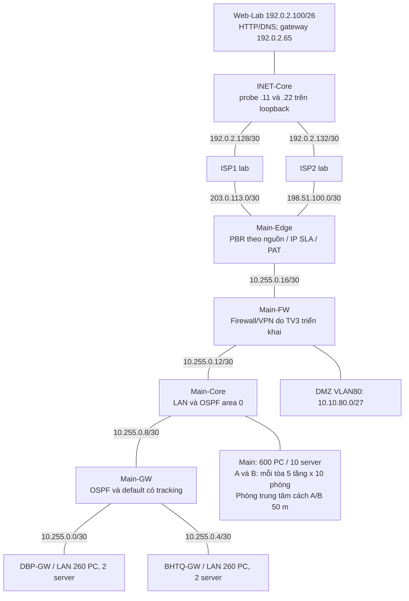

# Kiến trúc 3 site và thiết kế WAN/routing

**Chủ trì:** TV1; TV2 đọc chéo LAN, TV3 đọc chéo security, TV4 tích hợp. **Cập nhật:** 26/10/2026. **Trạng thái:** BẢN THIẾT KẾ ĐÃ HIỆU CHỈNH / CHƯA NGHIỆM THU MÔ PHỎNG.

## 1. Kiến trúc và phạm vi

Giữ hai leased lines Main–DBP/Main–BHTQ, Internet cả ba site đi qua Main và hai đường xDSL theo yêu cầu [A] tr.2 được tổng hợp trong [README](../../README.md). Nhánh không có local Internet breakout. FTTH/DIA là phương án nâng cấp cần chấp thuận khi xDSL không đáp ứng tải; chưa chọn gói dịch vụ hoặc nhà mạng thương mại.

Đây là kiến trúc logic. TV2 giữ thiết kế MDF/IDF, GPON/Ethernet, Wi-Fi, port/PoE và thiết bị theo quy mô thật. Lab WAN dùng PC đại diện; không chứng minh tốc độ 1/10/40GbE, xDSL hay chất lượng dịch vụ nhà mạng. Camera, số AP, khách đồng thời và lưu lượng PACS còn phải khảo sát. Server Farm tại core cần chính sách phân đoạn của TV3; các cấu hình routing tham chiếu chưa thực thi chính sách này.

## 2. Interface mapping để dựng lab WAN

Cấu hình tham chiếu IOS dùng router 2911, có Serial module tại ba WAN gateway; Main-Core dùng router-on-a-stick trong lab tối thiểu. TV2 có thể thay Core bằng switch L3 và map lại tên cổng, SVI. Main-FW tham chiếu là **router chỉ định tuyến**, chưa phải firewall bảo mật. Không nạp cấu hình IOS này trực tiếp vào ASA.

| Link | Đầu A / interface / IP | Đầu B / interface / IP |
| --- | --- | --- |
| Main–DBP | Main-GW S0/0/0 `10.255.0.1/30` | DBP-GW S0/0/0 `10.255.0.2/30` |
| Main–BHTQ | Main-GW S0/0/1 `10.255.0.5/30` | BHTQ-GW S0/0/0 `10.255.0.6/30` |
| Core–WAN | Main-Core G0/1 `10.255.0.9/30` | Main-GW G0/0 `10.255.0.10/30` |
| Core–FW | Main-Core G0/2 `10.255.0.13/30` | Main-FW G0/0 `10.255.0.14/30` |
| FW–Edge | Main-FW G0/1 `10.255.0.17/30` | Main-Edge G0/0 `10.255.0.18/30` |
| DMZ | Main-FW G0/2 `10.10.80.1/27` | DMZ switch/server, ví dụ `10.10.80.10/27` |
| Edge–ISP1 | Main-Edge G0/1 `203.0.113.2/30` | ISP1 G0/0 `203.0.113.1/30` |
| Edge–ISP2 | Main-Edge G0/2 `198.51.100.2/30` | ISP2 G0/0 `198.51.100.1/30` |
| ISP1–INET | ISP1 G0/1 `192.0.2.129/30` | INET-Core G0/0 `192.0.2.130/30` |
| ISP2–INET | ISP2 G0/1 `192.0.2.133/30` | INET-Core G0/1 `192.0.2.134/30` |
| Web LAN | INET-Core G0/2 `192.0.2.65/26` | Web-Lab `192.0.2.100/26`, gateway `.65` |
| Main LAN trunk | Main-Core G0/0.x, gateway `10.10.x.1` | Switch TV2, VLAN theo [IP plan](ip-vlan-plan.md), trừ DMZ80 |
| Aux LAN trunk | DBP/BHTQ G0/0.x, gateway `10.20.x.1`/`10.30.x.1` | Switch TV2; hai tầng/site |

Loopback router ID: Main-Core `10.10.255.1/32`, Main-GW `10.10.255.2/32`, DBP `10.20.255.1/32`, BHTQ `10.30.255.1/32`; Main-Edge `10.255.255.1/32` dùng định danh lab, không chạy OSPF. INET-Core có hai probe endpoints `192.0.2.11/32` và `192.0.2.22/32` phía sau các ISP. Các dải TEST-NET chỉ dùng trong lab.

## 3. OSPF và route nội bộ

- Single area 0 giữa Main-Core, Main-GW, DBP-GW và BHTQ-GW. Ba adjacency mong đợi là Core–Main-GW, Main-GW–DBP, Main-GW–BHTQ.
- `passive-interface default`; chỉ mở trên ba link cần adjacency. Core–GW khai báo `ip ospf network point-to-point` ở cả hai đầu; Serial dùng mạng point-to-point. Passive giảm bề mặt hình thành láng giềng nhưng không thay xác thực OSPF, ACL hoặc hardening.
- WAN link đặt OSPF cost 10, Core–GW cost 1. `bandwidth 2000`/`clock rate 2000000` là mô hình Serial 2 Mbps; chỉ đặt clock trên đầu DCE Main-GW sau khi kiểm cáp. Năng lực leased line 150–200 Mbps là dự trù riêng, chưa đo trong lab.
- `network 10.20.0.0 0.0.255.255 area 0` chọn interface tham gia OSPF; không tự tạo route tổng hợp /16. Route học được là các subnet /25, /28, /23, /24 và loopback /32 thực sự hoạt động.
- DMZ80 kết thúc tại FW. Core có static `10.10.80.0/27` tới FW và chỉ redistribute đúng prefix này vào OSPF bằng prefix-list/route-map; không redistribute default hoặc các static khác.
- Không bật OSPF trên ISP/Edge/FW. FW có route cụ thể tới ba khối site qua Core; Edge có route trả về ba khối site qua FW. Không dùng route quay về `10/8` để tránh vòng lặp với default FW cho các địa chỉ nội bộ chưa cấp.

Các prefix /16 trong route trả về là static tổng hợp phục vụ chuyển tiếp, không phải prefix /16 học từ OSPF. Core có discard `10.10/16` và route `10.20/16`, `10.30/16` tới Main-GW; Main-GW discard ba /16, mỗi Aux discard /16 của mình bằng Null0 AD254. Subnet connected/OSPF cụ thể ưu tiên theo longest-prefix. Nhờ đó địa chỉ chưa cấp trong khối site hoặc subnet mất route không bị quay vòng giữa Core–FW hay Core–GW qua default. Chỉ DMZ static được redistribute, không quảng bá các discard/tổng hợp này.

## 4. Default route và cơ chế phục hồi

**Tại Edge:** IP SLA 1 probe `.11` qua ISP1, IP SLA 2 probe `.22` qua ISP2. Mỗi probe có static /32 chỉ định interface/next hop và Null0 /32 AD254 dự phòng. Khi link local mất, probe không được chạy nhờ default qua ISP còn lại. Khi link upstream ISP–INET mất nhưng Edge–ISP vẫn up, probe cũng mất liên lạc với đích phía sau ISP.

Hai default tại Edge gắn track1/track2. PBR chọn ISP theo nhóm nguồn, dùng ISP còn sống làm phương án tiếp theo. Không có cam kết tỷ lệ tải 50/50; nguồn Main còn lại dùng RIB nếu chưa được phân nhóm. PAT chọn interface egress tương ứng; ACL NAT loại luồng tới `10/8`. ACL chọn NAT không phải firewall cho phép truy cập.

**Tại Main-GW và Main-Core:** IP SLA10 probe `192.0.2.100` với source Loopback0. Mỗi node có /32 cố định tới Web qua Core/FW, độc lập với default có tracking, để có thể phục hồi khi default đã bị thu hồi. Default GW gắn track10; `default-information originate metric 10` **không có `always`**. Khi probe mất khả năng tới Web qua cả hai ISP và track chuyển down, default GW bị gỡ, OSPF thu hồi default tới hai Aux. Core không phát sinh default OSPF riêng. Khôi phục ISP cho phép probe /32 chạy lại và tái cài default.

`frequency 3`, `timeout 1000`, `delay down 6 up 6` là tham số cấu hình, không phải số đo SLA: delay là thời gian trì hoãn trạng thái, không phải bộ đếm ba probe thất bại. Cần đo thời gian thực tế; rút route không tức thời. Hai lớp tracking/OSPF có thể làm thời gian hội tụ dài hơn một chu kỳ probe.

Đích Web duy nhất là health target của lab: Web hoặc ICMP tại đích bị hỏng cũng có thể làm mất default dù ISP còn tốt. Thiết kế vận hành cần nhiều đích độc lập/chính sách sức khỏe phù hợp. Phiên PAT cũ có thể mất khi đổi IP egress; test phân biệt phiên mới và phiên cũ. Không khẳng định ứng dụng tự nối lại trong một thời gian cố định.

## 5. Bảng route kỳ vọng theo chức năng

| Node | Route cần có khi bình thường | Khi cả hai ISP mất |
| --- | --- | --- |
| DBP/BHTQ | Các subnet nội bộ từ OSPF; `O*E2 0/0` về Main-GW, metric external 10 | Default OSPF được thu hồi sau hội tụ; route nội bộ còn nếu leased lines hoạt động |
| Main-GW | Subnet Main/Aux qua OSPF; `/32` Web qua `.9`; default track10 qua `.9` | Không default; `/32` Web còn để probe phục hồi |
| Main-Core | Main connected; Aux qua OSPF; DMZ qua `.14`; `/32` Web và default track10 qua `.14` | Không default sau tracking; `/32` Web phục hồi vẫn còn |
| Main-FW | Ba site qua `.13`; DMZ connected; default qua `.18` | Default FW vẫn tồn tại nhưng không tạo default OSPF; đây là stand-in routing |
| Main-Edge | Ba site qua `.17`; probe /32 được ghim từng ISP; hai default tracked | Hai default mất; probe /32/Null0 vẫn có; không còn đường ra Web |
| ISP1/2 | Web/probe prefix qua INET-Core; public transit connected | Link hỏng ảnh hưởng đúng nhánh tương ứng |
| INET-Core | Web/probe connected; public NAT prefix trở về đúng ISP | Phục hồi từng nhánh không cần đổi địa chỉ Web |

Các hàng là expected, không phải output CLI thu được. Kiểm lệnh và feature support trong [hướng dẫn module](../../simulation/modules/tv1-wan/README.md); hồ sơ [TC03](../../test_results/TC03-inter-site/result.md), [TC06](../../test_results/TC06-internet-web/result.md), [dual ISP](../../test_results/supplemental/dual-isp-failover.md) hiện NOT RUN.

## 6. Nguồn kỹ thuật và giới hạn

- [Cisco: OSPF default route](https://www.cisco.com/c/en/us/support/docs/ip/open-shortest-path-first-ospf/13692-21.html): điều kiện originate khi có default trong RIB.
- [Cisco: ISP failover/IP SLA](https://www.cisco.com/c/en/us/support/docs/ip/ip-routing/200785-ISP-Failover-with-default-routes-using-I.html): tracked defaults và NAT theo egress.
- [Cisco: Enhanced Object Tracking](https://www.cisco.com/en/US/docs/ios-xml/ios/ipapp/configuration/15-0s/iap-eot.html): delay up/down.
- [Cisco: bandwidth](https://www.cisco.com/E-Learning/bulk/public/tac/cim/cib/using_cisco_ios_software/cmdrefs/bandwidth.htm): thông số bandwidth không đổi tốc độ vật lý.

Chưa thử IOS parser/Packet Tracer cho model cụ thể. Cấu hình sử dụng IP SLA, tracking, PBR verify-availability, NAT route-map và selective redistribution; nếu nền tảng không nhận lệnh, giữ mục đó BLOCKED/DESIGN ONLY và dùng môi trường có image hợp pháp hỗ trợ chức năng. Mỗi nhánh có một leased line; Edge/FW/Core tham chiếu cũng là thiết bị đơn, nên hai ISP không loại bỏ mọi SPOF.
