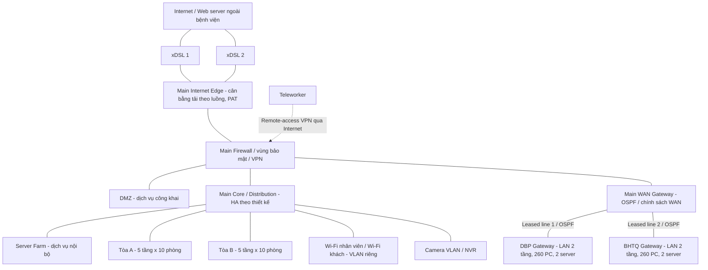

# Kiến trúc 3 site

**Chủ trì:** TV1 + TV2 + TV3. **Trạng thái:** BASELINE / CHƯA NGHIỆM THU.

Sơ đồ là kiến trúc logic; ranh giới bảo mật Server Farm được thực thi bằng firewall/ACL giữa các vùng tại core hoặc firewall phân đoạn. Sơ đồ vật lý phải tách rõ MDF, IDF, uplink, port và vị trí firewall; không diễn giải một đường logic thành một dây duy nhất.

- **Main:** core/distribution tập trung tại phòng trung tâm; backbone quang đến IDF A/B, access theo tầng/phòng. Dự kiến 1GbE đến máy trạm, 10GbE uplink/distribution, 40GbE cho core hoặc aggregation khi tính tải và thiết bị cho thấy cần thiết. TV2 phân biệt phương án GPON (OLT/ODN/splitter/ONT) với Ethernet quang (switch/transceiver); không nối ONT thẳng vào cổng Ethernet quang như OLT.
- **Chi nhánh:** kiến trúc collapsed core/access, rack tầng 1 và IDF nếu khảo sát yêu cầu. VLAN ID có thể lặp giữa site nhưng subnet phải khác nhau; không kéo dài miền broadcast qua WAN.
- **WAN:** baseline mô phỏng là leased Ethernet/L3 transit có OSPF trên các đường hỗ trợ adjacency. Với MPLS L3VPN, phải mô tả PE/CE và giao thức handoff; với SD-WAN, phải mô tả controller, overlay và underlay. Không gọi một topology OSPF thông thường là đã triển khai MPLS hoặc SD-WAN.
- **Đường ra Internet:** DBP/BHTQ nhận default route hướng Main; không có local Internet breakout. OSPF quảng bá mạng nội bộ cần thiết và default có điều kiện khi Main còn đường ra, không quảng bá giao diện Internet vào miền nội bộ. Routed WAN/VPN nội bộ không áp dụng PAT; Internet PAT thực hiện tập trung tại Main cho cả 3 site.
- **Hai xDSL:** load balancing theo phiên/luồng, gắn NAT với đúng egress và kiểm tra chiều về. Hai tuyến đi hai chi nhánh khác nhau không phải cặp dự phòng cho nhau. Hai xDSL cũng không cộng tốc độ cho một phiên TCP; mất một tuyến có thể làm đứt phiên NAT cũ.
- **VPN:** đề xuất IPsec site-to-site bảo vệ lưu lượng 2 chi nhánh qua hạ tầng WAN hỗ trợ IP; teleworker kết thúc VPN tại Main và chỉ được vào subnet/dịch vụ đã cấp quyền. Không giả định có tuyến Internet dự phòng tại chi nhánh khi đề chưa cấp.

## Theo dõi cập nhật

- [ ] Xác nhận giả định và thông số với người phụ trách.
- [ ] Cập nhật kết quả triển khai/bằng chứng thực tế.
- [ ] Ghi reviewer, ngày rà soát và quyết định vào issue/PR liên quan.
