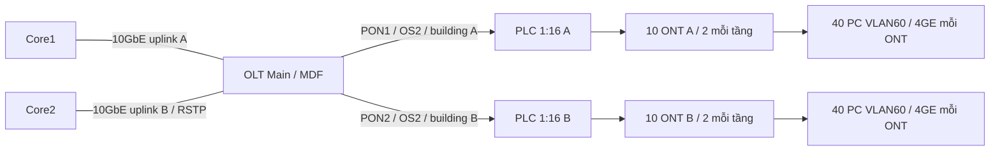

# GPON trong thiết kế hạ tầng Main

**Bổ sung ngày 02/11/2026. Trạng thái: thiết kế kỹ thuật; chưa đo quang hoặc triển khai thiết bị thật.** Đề gốc trang 1 yêu cầu GPON cùng 1/10/40GbE. Bản này đưa GPON vào phương án hybrid, không loại yêu cầu GPON khỏi thiết kế. GNS3 kiểm chức năng IP/VLAN, không mô phỏng OMCI, DBA, bước sóng, ranging hoặc suy hao quang.

## Phạm vi và sơ đồ

Chọn GPON cho **80 PC hành chính của VLAN60 tại Main**; 20 PC VLAN60 còn lại và các VLAN nghiệp vụ/medical, AP, camera, server dùng Ethernet. Sau tăng trưởng 20%: 96 PC qua GPON và 24 PC qua Ethernet, tổng VLAN60 vẫn 120 PC. Các PC này nằm trong tổng 600→720 của Main, không cộng thêm vào quy mô bệnh viện.

Mỗi tòa 5 tầng, mỗi tầng 2 ONT x4 cổng GE =8 PC; 10 tầng =80 PC. Năm thứ 5 thêm 2 ONT mỗi tòa (phân phối sau khảo sát), tổng 24 ONT x4GE =96 PC. Hai splitter hiện có 32 nhánh, dùng 20 hiện tại/24 tương lai; không phải thêm splitter chỉ vì tăng 20%. Một OLT là SPOF của nhánh hành chính, chưa triển khai bảo vệ PON Type B/C hoặc hai chassis.

## Yêu cầu thiết bị và tích hợp VLAN

| Hạng mục bổ sung | Hiện tại | 5 năm / tiêu chí |
| --- | --- | --- |
| OLT campus | 1 chassis, tối thiểu 2 PON và 2x10GbE uplink | Dự phòng slot/PSU; xác nhận VLAN, OMCI, DBA, quản trị và license |
| PON optics/ONT tương thích | 2 cổng GPON class B+ và 20 ONT 4GE | 24 ONT, xác nhận serial/LOID provisioning, không coi ONT nhà mạng khóa là dùng được |
| PLC splitter 1:16 | 2 | 2, nhánh không dùng được bịt/nắp bảo vệ |
| ODF/OS2/SC-APC | 2 feeder đến A/B và 20 drop ONT | Chốt chiều dài, lõi dự phòng, connector/patch cord/nhãn theo khảo sát |
| Uplink OLT–Core | 2 link 10GbE; 4 transceiver phù hợp môi trường | Core mỗi chiếc thêm 1 cổng: baseline 28→29 trên tối thiểu32 |
| UPS/nguồn ONT | 20 điểm cấp điện | 24; ONT không cấp PoE cho AP/camera trong phương án này |

Uplink hai core độc lập dùng trunk/RSTP, không ghép LACP xuyên chassis khi chưa có stack/virtual chassis. ONT user port là access VLAN60; uplink OLT chỉ cho VLAN60 và VLAN90 quản trị, không bridge VLAN80/Server Farm/Guest. VLAN translation/GEM/T-CONT theo CLI nhà sản xuất được chọn; không tự tạo lệnh vendor chưa kiểm. ONT isolation, chống rogue ONU và ngắt cổng chưa provision là điều kiện FAT. Quản trị chỉ từ Main-Admin10.10.90.11; thay tài khoản mặc định, tắt quản trị từ user port, log về giám sát.

Bảng campus hiện dành 810/960 cổng Main theo cách **giữ toàn bộ chỗ Ethernet dự phòng**, bao gồm PC sẽ chuyển sang GPON. Vì vậy còn đủ cổng nếu rollback GPON; không diễn giải 810 là cổng Ethernet đang cắm sau di chuyển 80 PC. 72 uplink Ethernet hiện có vẫn là bảng riêng; hai uplink OLT và ODN trong tài liệu này là phần bổ sung, không được bỏ sót khi báo giá. Dự toán Cat6 giữ mức trên dự phòng, không phải khảo sát khối lượng đã nghiệm thu.

## Băng thông và ngân sách quang

ITU-T G.984.2 mô tả GPON 2,488 Gbit/s xuống và 1,244 Gbit/s lên; đây là dung lượng **chia sẻ mỗi PON**, không phải tốc độ bảo đảm mỗi PC. Một ONT 4GE có 4 cổng1GbE nhưng không bảo đảm 4Gbps đồng thời qua GPON. Năm thứ5 mỗi PON phục vụ tối đa48 PC hành chính; cần đo lưu lượng, DBA và QoS trước chốt cấu hình. PACS/backup không được chuyển sang nhánh này chỉ từ tính tải Web bình quân.

Ví dụ kỹ thuật để kiểm công thức, **không phải kết quả khảo sát**: tuyến dài0,5km, suy hao sợi0,35dB/km, splitter1:16 tối đa13,5dB giả định, 4 đầu nối x0,5dB, 4 mối hàn x0,1dB.

`L_ODN = 0,5×0,35 + 13,5 + 4×0,5 + 4×0,1 = 16,075 dB`.

Với dự phòng3dB: `L_design =19,075dB`; so với class B+13–28dB, ví dụ nằm trong cửa sổ, dư8,925dB ở đầu suy hao cao. Phải thay bằng Tx min/max, Rx sensitivity/overload, insertion loss của thiết bị thực; đo cả tuyến ngắn để tránh quá tải receiver. Dự phòng3dB không thay suy hao thật khi kiểm overload. Đo OTDR, optical power tại OLT/ONT, connector cleanliness, lưu sơ đồ và báo cáo trước nghiệm thu.

Nguồn chuẩn: [ITU-T G.984.2 (08/2019), PMD và Annex A](https://www.itu.int/rec/dologin_pub.asp?id=T-REC-G.984.2-201908-I%21%21PDF-E&lang=e&type=items). Giá OLT/ONT/ODN/UPS/license chưa có báo giá; bổ sung CAPEX riêng và đối soát phần cáp/SFP bị trùng trước tổng hợp TCO.
