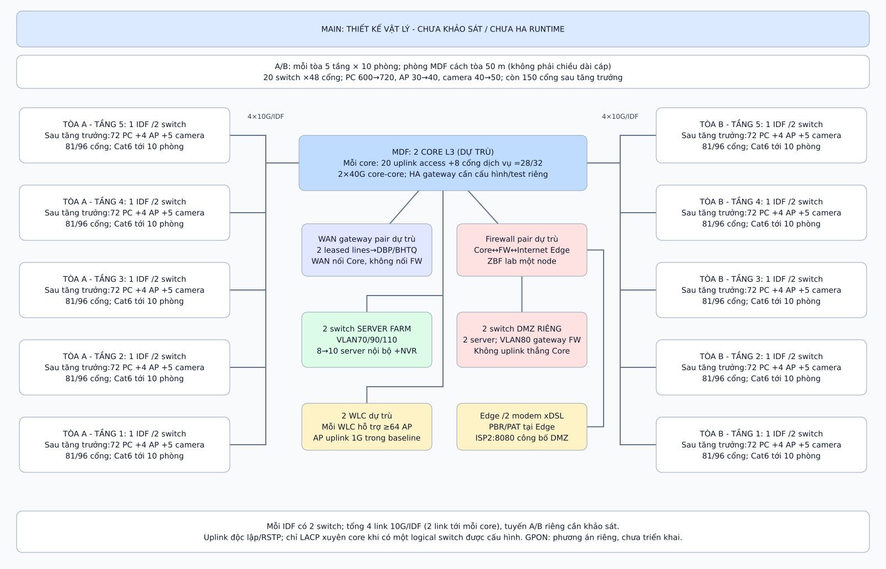
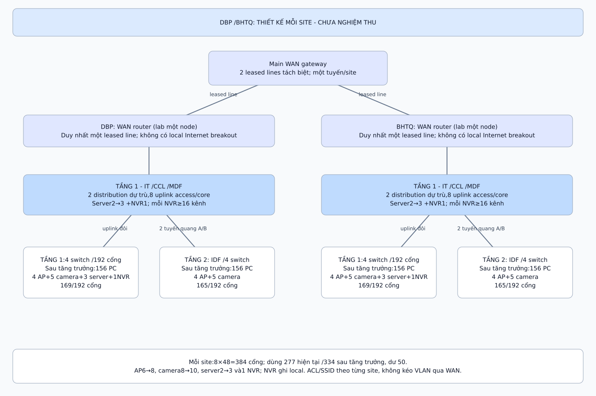

\clearpage

# Phụ lục C - Bảng IP/VLAN và kết nối

Các bảng dưới dùng địa chỉ của bộ cấu hình bàn giao. Gateway là địa chỉ .1 trong subnet tương ứng; subnet mask được xác định từ prefix. Server, quản trị và camera dùng địa chỉ tĩnh. Dải .2-.6 của VLAN máy trạm được giữ cho hạ tầng; pool .7-.126 có 120 lease. Số máy mô phỏng chỉ đại diện chức năng.

## Main Site

| VLAN | Phân vùng | Subnet | Cấp phát / quy mô |
|:---------|:--------------------------|:---------------------|:-----------------------------------|
| 10 | Tiếp nhận, khám bệnh | `10.10.10.0/25` | DHCP .7-.126; 100 lên 120 PC |
| 20 | Điều trị, nội trú | `10.10.20.0/25` | DHCP .7-.126; 100 lên 120 PC |
| 30 | Chẩn đoán hình ảnh | `10.10.30.0/25` | DHCP .7-.126; 100 lên 120 PC |
| 40 | Xét nghiệm | `10.10.40.0/25` | DHCP .7-.126; 100 lên 120 PC |
| 50 | Dược, nghiệp vụ y | `10.10.50.0/25` | DHCP .7-.126; 100 lên 120 PC |
| 60 | Hành chính | `10.10.60.0/25` | DHCP .7-.126; 100 lên 120 PC |
| 70 | Server Farm | `10.10.70.0/27` | Tĩnh .10-.30; 8 lên 10 server |
| 80 | DMZ, gateway trên FW | `10.10.80.0/27` | Tĩnh .10-.30; 2 server |
| 90 | Quản trị thiết bị | `10.10.90.0/24` | Tĩnh .11-.254 |
| 100 | Wi-Fi khách | `10.10.100.0/23` | DHCP .100.11-.101.254; 500 lease |
| 110 | Camera/NVR | `10.10.110.0/24` | Tĩnh theo camera plan; không cấp DHCP trong lab |
| 120 | Wi-Fi nhân viên | `10.10.120.0/24` | DHCP .11-.254; 244 lease |

DNS nội bộ Main là `10.10.70.10`. Khách dùng DNS lab `192.0.2.100`. HIS .70.11, PACS .70.12, LIS .70.13, CRM .70.14, DB .70.15, Backup .70.16, Monitor .70.17; DMZ Web .80.10 và Proxy .80.11. Main-Admin dùng .90.11, Main-NVR dùng .110.11. Các địa chỉ rút gọn giữ tiền tố `10.10`.

## Hai cơ sở phụ DBP và BHTQ

Đặt S=20 cho DBP và S=30 cho BHTQ. Mỗi site dùng gateway `10.S.VLAN.1`; DNS/Infra `10.S.70.6`, Local server `10.S.70.7`. Các subnet là các mạng riêng tại từng site, không kéo VLAN lớp 2 qua WAN.

| VLAN | Phân vùng | Subnet mỗi site | Cấp phát / quy mô |
|:---------|:--------------------------|:---------------------|:-----------------------------------|
| 10 | Khám bệnh | `10.S.10.0/25` | DHCP .7-.126; 90 lên 108 PC |
| 20 | Điều trị | `10.S.20.0/25` | DHCP .7-.126; 90 lên 108 PC |
| 30 | Hành chính | `10.S.30.0/25` | DHCP .7-.126; 80 lên 96 PC |
| 70 | Server cục bộ | `10.S.70.0/28` | Tĩnh .6-.14; 2 lên 3 server |
| 90 | Quản trị | `10.S.90.0/24` | Tĩnh .11-.254 |
| 100 | Wi-Fi khách | `10.S.100.0/23` | DHCP .100.11-.101.254; 500 lease |
| 110 | Camera/NVR | `10.S.110.0/24` | Tĩnh; NVR .11 |
| 120 | Wi-Fi nhân viên | `10.S.120.0/24` | DHCP .11-.254; 244 lease |

\clearpage

## Transit, ISP và VPN đề xuất

| Kết nối | Subnet | Hai đầu / phạm vi |
|:--------------------------|:----------------------|:-------------------------------------------|
| Main-GW - DBP-GW | `10.255.0.0/30` | Main .1; DBP .2 |
| Main-GW - BHTQ-GW | `10.255.0.4/30` | Main .5; BHTQ .6 |
| Main-Core - Main-GW | `10.255.0.8/30` | Core .9; GW .10 |
| Main-Core - Main-FW | `10.255.0.12/30` | Core .13; FW .14 |
| Main-FW - Main-Edge | `10.255.0.16/30` | FW .17; Edge .18 |
| Main-Edge - ISP1 | `203.0.113.0/30` | ISP1 .1; Edge .2 |
| Main-Edge - ISP2 | `198.51.100.0/30` | ISP2 .1; Edge .2 |
| ISP1 - INET-Core | `192.0.2.128/30` | ISP1 .129; INET .130 |
| ISP2 - INET-Core | `192.0.2.132/30` | ISP2 .133; INET .134 |
| Web Internet mô phỏng | `192.0.2.64/26` | INET .65; Web/DNS .100 |
| Teleworker, đề xuất | `10.255.100.0/24` | Kết thúc trên FW; chưa chạy crypto |

OSPF area 0 chạy Core-Main-GW-hai Aux, interface người dùng passive; không NAT lưu lượng liên site. GNS3 dùng PBR và health probe để chọn ISP; Packet Tracer dùng ISP2 mặc định và kiểm chuyển ISP1 thủ công. Tất cả Internet của Aux đi qua Main. Các dải TEST-NET chỉ phục vụ lab.

## Chính sách truy cập dùng trong demo

| Nguồn | Đích | Hành vi cần chứng minh |
|:------------------------|:---------------------------|:----------------------------------|
| PC cùng VLAN | PC cùng VLAN | Ping hai chiều |
| PC nghiệp vụ | VLAN khác được phép / HIS | Ping/HTTP theo ACL |
| Main PC, Aux PC | PC khác site | Ping hai chiều; traceroute qua WAN |
| PC được phép | DMZ Web | HTTP tới `10.10.80.10` |
| Web-Lab bên ngoài | ISP2 TCP8080 | PAT tới DMZ Web TCP80 |
| Guest mỗi site | PC/HIS/DMZ nội bộ | Chặn; ACL deny tăng |
| PC/Guest mỗi site | Web-Lab | DNS và HTTP thành công |

Khách vẫn được DHCP/DNS; kiểm Internet thành công trước khi dùng HTTP/ping thất bại để kết luận bị chặn. VPN đề xuất chỉ mở quyền ứng dụng đã duyệt; không mở toàn bộ LAN cho teleworker. Cùng VLAN cần biện pháp lớp 2/host firewall riêng.

\clearpage

# Phụ lục D - Danh mục thiết bị và vật tư

Đây là số lượng và tiêu chí chọn thiết bị cho thiết kế học thuật. Giá WAN/TCO là kịch bản minh họa đã nêu ở Step 3; các model, license, giá mua, nguồn điện và SLA sản xuất phải được xác nhận bằng báo giá cùng phạm vi. Số lượng HA dưới đây là đề xuất; lab dùng thiết bị đại diện.

## Main Site

| Hạng mục | Số lượng | Thông số / mục đích |
|:--------------------------|:-----------|:------------------------------------------------------|
| Core L3 | 2 | Tối thiểu 32 cổng 1/10G, 2 cổng 40G; OSPF/SVI/ACL; 29/32 cổng khi thêm OLT |
| Access switch | 20 | 48 cổng 1G PoE+, 4 uplink 10G; C9200L-48P-4X tham chiếu; PSU 1kW/budget 740W |
| Switch Server Farm | 2 | Tối thiểu 24 cổng 10G; server/NVR, uplink core; dual NIC theo cấu hình hỗ trợ |
| Switch DMZ | 2 | Tối thiểu 24 cổng 1/10G; chỉ kết nối DMZ và FW, không bridge campus |
| Firewall | 2 | HA đề xuất; ít nhất 4 cổng 10G; kiểm throughput khi bật IPS/crypto |
| WAN gateway | 2 | OSPF, handoff hai leased line, IPsec nếu chọn; lab dùng một gateway |
| Edge và modem | 2 + 2 | Hai ISP xDSL, PAT/PBR/tracking; sizing theo tải down/up và khi lỗi |
| WLC | 2 | Mỗi WLC hỗ trợ ít nhất 64 AP; license/HA/compatibility cần xác nhận |
| AP Wi-Fi 6 | 30 lên 40 | 3 lên 4 AP/tầng; uplink 1G trong baseline, PoE dự trù 30W/AP |
| Server | 10 lên 12 | 8 nội bộ + 2 DMZ hiện tại; dual NIC 10G nếu chọn; CPU/RAM theo workload |
| Camera | 40 lên 50 | PoE, 4MP/H.265 giả định, 4Mbps/camera; không đặt ở vùng riêng tư |
| NVR | 1 hệ | Ít nhất 64 kênh; video 200Mbps năm 5 trước headroom; usable ít nhất 85.050GB |
| OLT GPON | 1 | Ít nhất 2 PON class B+, 2 uplink 10G; nguồn/slot/VLAN/OMCI cần xác nhận |
| ONT 4GE | 20 lên 24 | 80 lên 96 PC hành chính trong tổng 600 lên 720; 20 lên 24 điểm nguồn/UPS |
| Splitter PLC 1:16 | 2 | Hai nhánh A/B, dùng 20 lên 24 trong 32 cổng nhánh |

\clearpage

## Mỗi cơ sở phụ

| Hạng mục | Số lượng/site | Thông số / mục đích |
|:--------------------------|:----------------|:--------------------------------------------------|
| Distribution L3 | 2 | Ít nhất 16 cổng 10G; SVI/ACL/OSPF; HA đề xuất |
| Access switch | 8 | 48 cổng 1G PoE+, 4 uplink 10G; 4 switch/tầng |
| WAN router | 1 | Leased line về Main, OSPF; một tuyến vẫn là SPOF |
| Server cục bộ | 2 lên 3 | Infra và Local; CPU/RAM/storage theo ứng dụng |
| AP | 6 lên 8 | 3 lên 4 AP/tầng; VLAN Staff/Guest, Internet qua Main |
| Camera | 8 lên 10 | 4Mbps/camera giả định, ghi local |
| NVR | 1 | Ít nhất 16 kênh; usable ít nhất 17.010GB năm 5 |

## Cáp, quang, tủ và nguồn

| Hạng mục | Main | Mỗi Aux | Cơ sở tính |
|:---------------------------|:-------------|:--------------|:---------------------------------|
| Uplink access 10G | 40 link | 16 link | Hai uplink mỗi access switch |
| SFP+ access có dự phòng | 88 module | 36 module | Hai module/link, thêm 10% làm tròn |
| Cat6, thùng 305m | 88 | 37 | 30m/drop và 10% hao hụt giả định |
| Patch panel 48 cổng | 20 | 8 | Theo tổng cổng access dự trù |
| Tuyến quang trục | 20 tuyến 12 sợi | 2 tuyến 12 sợi | Main hai tuyến/IDF; Aux lên tầng 2 |
| GPON ODN và uplink | OS2/ODF/SC-APC | Theo khảo sát | Hai feeder, 20 lên 24 drop; 4 module uplink OLT |
| Rack/UPS/tiếp địa | MDF và 10 IDF | MDF và 1 IDF | Chọn theo công suất, runtime và mặt bằng |

SFP/DAC cho Server Farm, FW, WLC, core 40G và GPON được bóc riêng; 88/36 module chỉ tính access. Dự toán Cat6 giữ chỗ Ethernet để rollback GPON, không cộng thêm 80 PC vào quy mô. Tuyến A/B phải đi đường vật lý độc lập; hai sợi của cùng cáp duplex không được coi là hai tuyến dự phòng.

\clearpage

# Phụ lục E - Sơ đồ vật lý Main Site

{width=100%}

\clearpage

## Sơ đồ vật lý cho mỗi cơ sở DBP/BHTQ

{width=100%}


\clearpage

# Phụ lục F - Kịch bản trình bày và phạm vi bằng chứng

## Trình tự demo sáu nhóm bắt buộc

1. **Cùng VLAN:** Main-PC10-A ping `10.10.10.11` và chiều ngược lại.
2. **Giữa VLAN:** Main-PC10-A ping `10.10.20.10`, mở HTTP HIS `10.10.70.11`.
3. **Liên site:** Main-PC10-A ping `10.20.10.10`, `10.30.10.10`; Aux ping ngược Main và traceroute liên site.
4. **DMZ:** PC được phép mở `http://10.10.80.10`; Web-Lab mở `http://198.51.100.2:8080`.
5. **Cách ly khách:** Guest truy cập Web-Lab thành công nhưng ping PC/mở HIS thất bại; đối chiếu bộ đếm ACL deny tăng.
6. **Internet:** PC/Guest cả ba site mở `http://web.hospital.test`; kiểm DNS và NAT tại Main.

## Chứng minh phần mở rộng

GNS3 là nền tảng demo **PBR hai nhóm, lỗi upstream ISP1/ISP2, mất cả hai và phục hồi**, cùng **Suricata IDS alert/IPS drop**. Dùng runbook `simulation/gns3/demo-guide.md` và bộ thử `scripts/test_gns3_runtime.py --failover`. Khi mất cả hai ISP, Internet mất nhưng liên lạc nội bộ liên site vẫn phải hoạt động. Phiên NAT cũ có thể mất; phép thử HTTP mới không chứng minh giữ nguyên phiên.

Packet Tracer đã có Wi-Fi thật trong lab: sáu association, DHCP và HTTP. ISP2 là đường chính, chuyển ISP1 bằng thao tác thủ công rồi trả lại cấu hình. Không gọi thao tác này là load balancing hay failover tự động. Dùng Packet Tracer 9.0.1.0858 và file `simulation/packet-tracer/hospital-3sites.pkt` đã đối chiếu provenance.

MPLS riêng chứng minh LDP/MP-BGP/VRF và gói hai nhãn qua PCAP trong Linux namespaces/QEMU. Không gán 28+28 quan sát đó cho project native GNS3 chưa chạy. VPN site-to-site/teleworker, GPON PHY, RF thực, HA chassis và tải đủ 1.120 PC là phạm vi thiết kế/chưa đo; trình bày đúng giới hạn này khi được hỏi.

## Chọn file nộp

**Báo cáo chính:** `docs/06-report/final/report.pdf`. **Nguồn LaTeX:** `docs/06-report/final/report-latex.zip`. PDF `packet-tracer-validation.pdf` là phụ lục kiểm thử ngắn hai trang, có nội dung khác báo cáo chính. Các PDF trong thư mục `build/` hoặc `output/pdf/` là sản phẩm biên dịch local.

Nộp kèm cả mô hình Packet Tracer, GNS3, source dựng image và bằng chứng qua gói `submission/hospital-network-delivery.zip`. Giải nén gói và kiểm trước khi dùng:

```bash
python3 scripts/verify.py
python3 scripts/package_submission.py --check
```

Máy demo GNS3 phải có image được build/load trên compute. Việc nộp BKeL và biên nhận do nhóm thực hiện.
