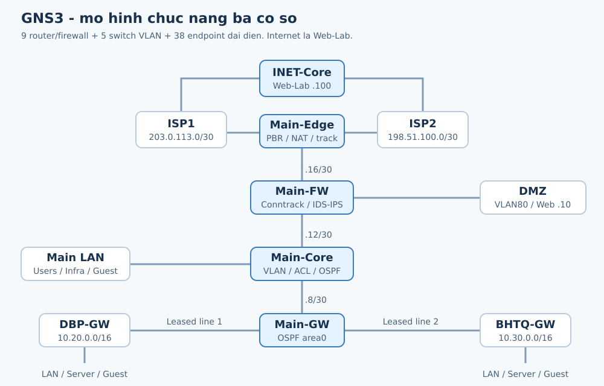
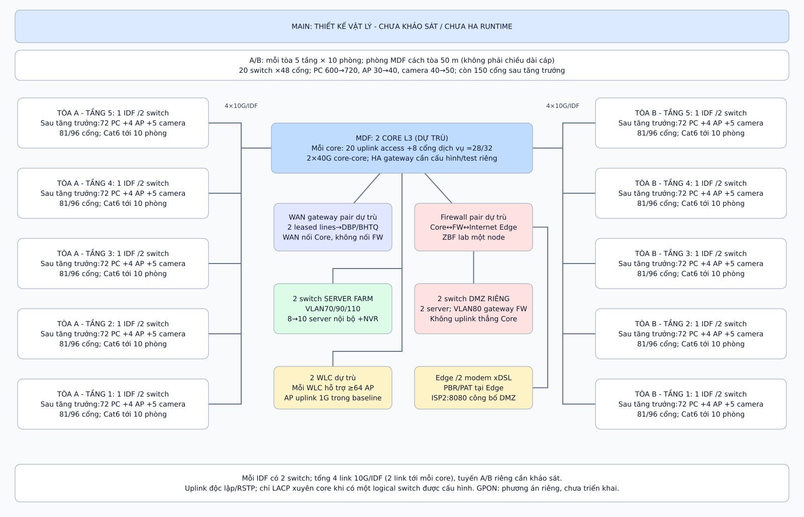
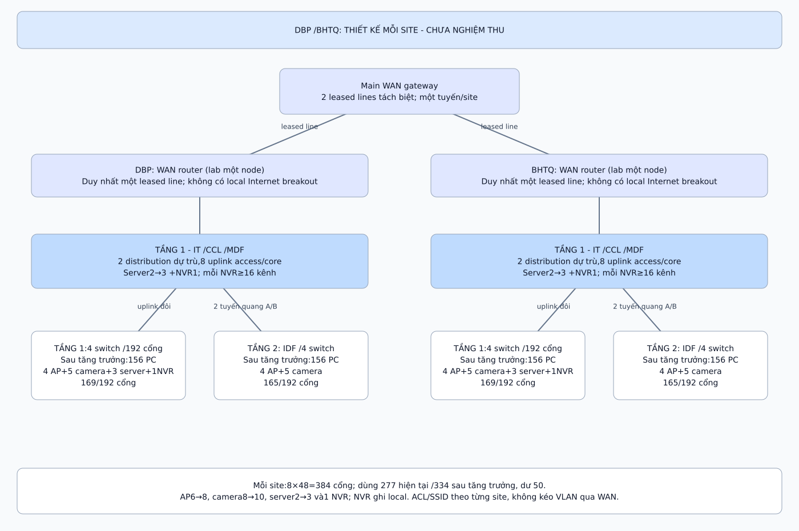

\clearpage

# Giới thiệu

## Bối cảnh và mục đích

Hệ thống mạng bệnh viện kết nối các bộ phận tiếp nhận, khám chữa bệnh, xét nghiệm, chẩn đoán hình ảnh và quản lý. Một giao dịch tra cứu hồ sơ có thể bắt đầu tại máy trạm ở chi nhánh, đi qua đường WAN và kết thúc tại máy chủ ở cơ sở chính. Do đó, thiết kế phải xem xét đồng thời khả năng kết nối, phân quyền truy cập, dung lượng đường truyền và tác động khi một thành phần gặp sự cố.

Trong bài tập lớn này, nhóm thiết kế mạng cho bệnh viện có ba cơ sở gồm Main Site tại Thành phố Hồ Chí Minh, cơ sở Điện Biên Phủ (DBP) và cơ sở Bà Huyện Thanh Quan (BHTQ). Phương án sử dụng phân tầng LAN, VLAN theo nhóm nghiệp vụ, hai leased line kết nối chi nhánh và hai đường Internet tập trung tại Main. Server Farm, DMZ, quản trị, camera và người dùng không dây được tổ chức thành các vùng riêng.

Báo cáo trình bày từ yêu cầu, giả định khảo sát và tính toán đến cấu hình, kiểm thử và đánh giá. Kết quả chính của dự án là mô hình liên thông ba cơ sở, cấp phát địa chỉ, định tuyến, NAT/PAT và kiểm soát truy cập đã có bằng chứng thực thi. GNS3 được sử dụng để kiểm thêm PBR hai ISP, chuyển tuyến khi lỗi và IDS/IPS; Cisco Packet Tracer thể hiện cấu hình Cisco và kết nối Wi-Fi. Phần thiết kế triển khai thực tế được phân biệt với các chức năng đã kiểm trong phòng lab.

## Tình huống và quy mô hệ thống

Đề bài giao cho đơn vị tư vấn Computer & Construction Consultant thiết kế và mô phỏng mạng của một bệnh viện lớn [1]. Main có hai tòa A và B; mỗi tòa năm tầng, mỗi tầng mười phòng. Phòng Data Center, IT và điểm tập trung cáp MDF được bố trí riêng, cách hai tòa khoảng 50 m. Mỗi cơ sở phụ có một tòa hai tầng, với phòng IT và điểm tập trung cáp ở tầng một.

| Hạng mục | Main | DBP | BHTQ |
|:---------------------------|:--------------------|:----------------|:----------------|
| Công trình | 2 tòa, 5 tầng mỗi tòa | 1 tòa, 2 tầng | 1 tòa, 2 tầng |
| Máy trạm hiện tại | 600 | 260 | 260 |
| Máy chủ hiện tại | 10 | 2 | 2 |
| Thiết bị mạng tối thiểu theo đề | 12 hoặc nhiều hơn | 5 hoặc nhiều hơn | 5 hoặc nhiều hơn |
| Kết nối liên cơ sở | Trung tâm WAN | 1 leased line về Main | 1 leased line về Main |
| Kết nối Internet | 2 xDSL có chia tải | Đi qua Main | Đi qua Main |

Toàn hệ thống có 1.120 máy trạm và 14 máy chủ ở thời điểm ban đầu. Các số thiết bị mạng tối thiểu trong đề không thay thế bảng bóc tách cổng thực tế: riêng nhu cầu máy trạm, AP và camera đã đòi hỏi nhiều switch access hơn mức tối thiểu đó. Thiết kế vì vậy được tính theo số cổng, uplink, nguồn và vai trò thiết bị.

Đề yêu cầu dự phòng tăng trưởng 20% trong toàn bộ năm năm. Nhóm tính số máy trạm năm thứ năm là 720 tại Main và 312 tại mỗi chi nhánh, tổng cộng 1.344. Máy chủ được làm tròn lên theo từng cơ sở: 12 tại Main và 3 tại mỗi Aux, tổng cộng 18. Không áp dụng lãi kép 20% mỗi năm và không cộng các máy đại diện trong lab vào số máy của bệnh viện.

## Yêu cầu chức năng và tiêu chí thiết kế

Các ứng dụng mục tiêu gồm HIS, RIS/PACS, LIS, CRM, cơ sở dữ liệu, văn phòng và trao đổi đa phương tiện. HIS/LIS cần truy cập ổn định, trong khi PACS và sao lưu có thể tạo luồng dữ liệu lớn. Vì đề chưa cung cấp kích thước ảnh, số phiên đồng thời hay lịch backup, những tải này được ghi nhận là đầu vào cần khảo sát, chưa quy thành một kết quả benchmark ứng dụng.

Về kết nối, người dùng được phép phải truy cập được các dịch vụ tại site của mình và các site khác. Internet của DBP/BHTQ phải đi qua Main; mỗi cơ sở có subnet riêng để định tuyến qua WAN. Về bảo mật, khách không được truy cập mạng nghiệp vụ; dịch vụ công khai đặt trong DMZ; quản trị thiết bị và camera được tách vùng. Đề còn yêu cầu đề xuất VPN liên site, VPN cho người làm việc từ xa và giải pháp IDS/IPS [1].

Về hạ tầng, nhóm kết hợp Ethernet 1/10/40 GbE theo từng tầng chức năng, cáp quang backbone và một nhánh GPON phục vụ nhóm hành chính. Khả năng mở rộng được xem xét bằng địa chỉ, cổng, PoE, uplink và dung lượng lưu trữ, thay vì chỉ bằng việc có thể vẽ thêm node. Tính sẵn sàng được đánh giá theo sự cố cụ thể và các điểm lỗi đơn còn tồn tại.

## Phương pháp thực hiện và phạm vi kiểm chứng

Nhóm thực hiện bảy bước theo đề và tổ chức nội dung thành bốn chương để dễ theo dõi. Các bảng địa chỉ, số lượng thiết bị và phép tính dùng chung nguồn cấu hình của dự án; kết quả kiểm được tổng hợp từ hồ sơ đã lưu. Lần biên soạn này cập nhật cách trình bày ngày 07/11/2026; các kết quả mạng được ghi theo ngày thực thi ban đầu, không xem việc xuất lại PDF là một lần chạy mạng mới.

| Bước trong đề | Nội dung thực hiện | Vị trí trong báo cáo |
|:---------------|:-------------------------------------|:------------------------|
| Step 1 | Khảo sát và chọn kiến trúc | Mục 2.1 và 2.2 |
| Step 2 | Thiết bị, IP và nối dây | Mục 2.3 đến 2.6 |
| Step 3 | Tính thông lượng và chọn WAN | Mục 2.7 và 2.8 |
| Step 4 | Xây dựng mô phỏng | Mục 3.1 và 3.2 |
| Step 5 | Kiểm thử kết nối và cấu hình | Mục 3.3 đến 3.6 |
| Step 6 | Đánh giá hệ thống và bảo mật | Chương 4 |
| Step 7 | Báo cáo và bộ bàn giao | Mục 4.4 và Phụ lục B |

Có ba loại căn cứ trong báo cáo. Yêu cầu quy mô và chức năng lấy từ đề bài; thiết kế cổng, địa chỉ, tải và chi phí có các giả định được nêu rõ; kết quả thực thi lấy từ GNS3, Packet Tracer và module MPLS riêng. Khảo sát công trình, đo RF, đo quang, VPN mã hóa, HA chassis và tải đầy đủ của 1.120 máy trạm chưa được thực hiện. Vì vậy, kết nối thành công trong lab chỉ chứng minh hành vi đã thử ở quy mô đại diện.

Báo cáo nhóm 3 được tham khảo về bố cục bốn chương, cách trình bày bảng và tổ chức minh chứng [2]. Địa chỉ, thiết bị, nhân sự và kết quả dưới đây sử dụng dữ liệu của nhóm 2. Những phép tính lưu lượng và giải thích về VLAN được đối chiếu lại với cấu hình và đơn vị đo trước khi đưa vào báo cáo.

# Phân tích và thiết kế hệ thống

## Phân tích yêu cầu và kế hoạch khảo sát

Việc khảo sát cần bắt đầu từ số người và thiết bị theo phòng, thay vì giả định mỗi tầng là một phòng ban. Sáu nhóm nghiệp vụ tại Main tạm chia đều 100 PC; mỗi Aux chia 90, 90 và 80 PC. Đây là cách phân bổ để kiểm tra địa chỉ và mô hình truy cập, chưa phải danh sách khoa phòng đã được bệnh viện xác nhận. Tên VLAN có thể điều chỉnh sau khảo sát trong khi vẫn giữ nguyên nguyên tắc tách vùng.

| Nhóm khảo sát | Dữ liệu cần thu thập | Tác động đến thiết kế |
|:---------------------|:------------------------------------|:------------------------------------|
| Người dùng và thiết bị | PC theo phòng, máy in, thiết bị y tế, khách đồng thời | VLAN, DHCP, số cổng và AP |
| Ứng dụng | HIS/LIS, kích thước ảnh PACS, phiên đồng thời, backup | Băng thông LAN/WAN, QoS, server |
| Công trình | MDF/IDF, tuyến máng cáp, khoảng cách và xuyên tầng | Loại cáp, ODF, rack và tuyến dự phòng |
| Điện và môi trường | UPS, tải điện, làm mát, tiếp địa, phòng cháy | Công suất nguồn, thời gian duy trì |
| Không dây | Vật liệu tường, nhiễu, vùng đông người, roaming | Vị trí AP, kênh, công suất và mật độ |
| An ninh và vận hành | Vai trò truy cập, camera, lưu trữ, RPO/RTO | ACL, VPN, log, backup và khôi phục |
| Nhà cung cấp | Handoff, down/up cam kết, SLA, tuyến và phí | Loại WAN/ISP, thiết bị biên và chi phí |

Những yêu cầu này được ghi trong checklist dự án nhằm chuẩn bị cho quá trình khảo sát hiện trường trước thi công. Để phục vụ công tác thiết kế sơ bộ và tính toán dung lượng cho hệ thống, nhóm tiến hành lập bảng phân bổ giả định các khoa/phòng/ban chức năng tại ba cơ sở theo đúng quy mô đề bài:

### Bảng phân bố khoa/phòng/ban và mức lưu lượng tại Main Site

| STT | Khoa / Phòng / Ban chức năng | Tòa nhà & Tầng | Số lượng máy trạm | Lưu lượng mạng | Mục đích & Nghiệp vụ chính |
|:---:|:-----------------------------|:--------------:|:-----------------:|:--------------:|:---------------------------|
| 1 | Khoa Khám bệnh & Tiếp nhận | Tòa A - Tầng 1 | 40 PC | Trung bình | Tiếp đón bệnh nhân, đăng ký khám bệnh |
| 2 | Khoa Cấp cứu | Tòa A - Tầng 1 | 60 PC | Trung bình | Tiếp nhận cấp cứu 24/7, hồ sơ khẩn |
| 3 | Hồi sức tích cực (ICU / CCU) | Tòa A - Tầng 2 | 50 PC | Trung bình | Giám sát bệnh nhân nặng, thiết bị y tế |
| 4 | Khoa Chẩn đoán hình ảnh | Tòa A - Tầng 2 | 50 PC | Rất cao | Phim X-quang, CT, MRI, hệ thống RIS/PACS |
| 5 | Khoa Xét nghiệm | Tòa A - Tầng 3 | 40 PC | Cao | Trả kết quả sinh hóa, huyết học (LIS) |
| 6 | Khoa Nội soi | Tòa A - Tầng 3 | 30 PC | Trung bình | Lưu trữ hình ảnh nội soi tiêu hóa |
| 7 | Khoa Ngáy & Rối loạn giấc ngủ| Tòa A - Tầng 3 | 30 PC | Trung bình | Đo điện não, thăm dò chức năng |
| 8 | Phòng Hành chính & Tổng hợp | Tòa A - Tầng 4 | 30 PC | Thấp | Nghiệp vụ văn phòng, văn bản (GPON) |
| 9 | Phòng Tài chính Kế toán | Tòa A - Tầng 4 | 25 PC | Thấp | Thu viện phí, kế toán, hóa đơn điện tử |
| 10 | Phòng Tổ chức Cán bộ & Nhân sự| Tòa A - Tầng 5 | 25 PC | Thấp | Quản lý nhân sự, chấm công |
| 11 | Phòng Quản trị thiết bị y tế | Tòa A - Tầng 5 | 20 PC | Thấp | Theo dõi bảo trì máy móc bệnh viện |
| 12 | Khoa Dược & Nghiệp vụ Y | Tòa B - Tầng 1 | 35 PC | Trung bình | Cấp phát thuốc, quản lý kho dược |
| 13 | Khoa Cơ - Xương - Khớp | Tòa B - Tầng 1 | 25 PC | Thấp | Khám chuyên khoa cơ xương khớp |
| 14 | Khoa Nhi | Tòa B - Tầng 1 | 20 PC | Thấp | Khám và điều trị bệnh nhi |
| 15 | Dị ứng Miễn dịch Lâm sàng | Tòa B - Tầng 2 | 20 PC | Thấp | Xét nghiệm dị nguyên, điều trị |
| 16 | Khoa Hô hấp | Tòa B - Tầng 2 | 20 PC | Thấp | Điều trị bệnh lý đường hô hấp |
| 17 | Khoa Tiêu hóa Gan mật | Tòa B - Tầng 3 | 20 PC | Thấp | Khám và điều trị nội trú tiêu hóa |
| 18 | Khoa Sản Phụ | Tòa B - Tầng 3 | 20 PC | Thấp | Sản khoa, chăm sóc trước và sau sinh |
| 19 | Khoa Tai - Mũi - Họng | Tòa B - Tầng 4 | 20 PC | Thấp | Khám chuyên khoa TMH |
| 20 | Khoa Mắt & Răng Hàm Mặt | Tòa B - Tầng 4 | 20 PC | Thấp | Khám và thủ thuật chuyên khoa |
| 21 | Khoa Tim mạch & Nội tiết | Tòa B - Tầng 5 | 20 PC | Thấp | Khám tim mạch, tiểu đường, nội tiết |
| 22 | Khoa Ngoại & Tâm thần kinh | Tòa B - Tầng 5 | 20 PC | Thấp | Điều trị ngoại khoa và sức khỏe tâm thần |
| 23 | Phòng IT & Trung tâm Data Center| Nhà riêng (50m)| 10 Server | Rất cao | Trung tâm dữ liệu HIS, PACS, LIS, Core |
| -- | **Tổng cộng Main Site** | **2 tòa 10 tầng** | **600 PC + 10 Server**| -- | **Quy mô ban đầu đáp ứng yêu cầu đề bài** |

### Bảng phân bố khoa/phòng tại mỗi cơ sở phụ (DBP và BHTQ)

| Khu vực / Tầng | Khoa / Phòng chức năng | Số lượng máy trạm | Lưu lượng mạng | Vai trò & Kết nối |
|:--------------:|:----------------------|:-----------------:|:--------------:|:------------------|
| Tầng 1 | Khoa Khám bệnh & Tiếp nhận ban đầu | 50 PC | Trung bình | Tiếp nhận bệnh nhân, viện phí |
| Tầng 1 | Khoa Cấp cứu & Tiểu phẫu | 40 PC | Trung bình | Cấp cứu ban đầu, sơ cứu |
| Tầng 1 | Phòng IT, MDF & Cabling Central | 5 PC + 2 Server | Cao | Router WAN, Switch Core, Local Server |
| Tầng 2 | Các khoa Điều trị nội trú & Chuyên khoa| 110 PC | Trung bình | Khám và điều trị bệnh nhân tại chi nhánh |
| Tầng 2 | Phòng Hành chính, Dược & Xét nghiệm nhanh| 55 PC | Thấp | Nghiệp vụ chi nhánh, nhận thuốc |
| -- | **Tổng cộng mỗi cơ sở phụ** | **260 PC + 2 Server**| -- | **Kết nối Leased Line về Main Site** |

Từ các bảng phân bổ trên, nhóm dễ dàng xác định các khu vực có mật độ và lưu lượng cao như phòng Data Center/IT, Khoa Chẩn đoán hình ảnh (PACS), Xét nghiệm (LIS), Cấp cứu và Hồi sức tích cực để ưu tiên chọn cổng mạng tốc độ cao (10GbE), cấp nguồn PoE+ và áp dụng các cơ chế bảo mật thích hợp.

Những yêu cầu này được ghi trong checklist dự án nhưng chưa có biên bản khảo sát hiện trường thực tế. Do đó, số lượng AP, camera, chiều dài cáp và giá trị tải bổ sung trong báo cáo là các thông số đầu vào thiết kế sơ bộ (baseline design). Trước thi công thực tế cần khảo sát hiện trường để xác nhận lại đặc biệt ba vấn đề then chốt: (1) danh mục tải và ứng dụng y tế thiết yếu khi mất một ISP, (2) khả năng đi hai tuyến quang độc lập vật lý vào tòa nhà, và (3) mật độ khách thực tế đồng thời sử dụng Wi-Fi trong các khung giờ cao điểm.

## Kiến trúc mạng tổng thể

### Phân tầng LAN và liên kết ba cơ sở

Main sử dụng kiến trúc core, distribution và access về mặt chức năng. Access nối máy trạm, AP và camera; distribution tập hợp các access và thực hiện chính sách liên VLAN; core nối các miền campus, Server Farm và WAN với dung lượng cao. Trong mô hình đại diện, một số chức năng core/distribution được gộp để giảm số node; không xem một switch lab là toàn bộ thiết bị cần mua cho công trình.

Hai cơ sở phụ có quy mô nhỏ hơn nên sử dụng collapsed core/access: tầng distribution và core được gộp, còn access được bố trí theo hai tầng. Mỗi site có gateway riêng và miền địa chỉ riêng. OSPF truyền các mạng nội bộ qua leased line; frame broadcast của một VLAN không được kéo dài sang chi nhánh khác.

{width=100%}

Hai leased line lần lượt nối Main với DBP và BHTQ. Hai tuyến phục vụ hai đích khác nhau nên không tự tạo dự phòng cho nhau. Tại Main, đường ra Internet đi qua firewall và Internet Edge, sau đó qua ISP1 hoặc ISP2. Luồng từ Aux tới Internet vẫn theo chuỗi Aux, WAN, Main, firewall và Edge; không có Internet breakout tại chi nhánh.

### Phân vùng và đường đi lưu lượng

Server Farm chứa các dịch vụ nội bộ, tách với DMZ dành cho Web/proxy công khai. DMZ chỉ kết thúc trên firewall, không bridge vào core hay trunk campus. VLAN quản trị dành cho tài khoản và thiết bị vận hành; VLAN camera/NVR hạn chế luồng tự khởi tạo vào mạng nghiệp vụ. Wi-Fi khách và nhân viên dùng hai VLAN riêng, với quyền truy cập khác nhau.

Ví dụ, máy trạm DBP truy cập HIS tại Main giữ địa chỉ nguồn nội bộ khi qua WAN. Nếu cùng máy trạm truy cập Web-Lab bên ngoài, Edge tại Main thực hiện PAT theo ISP được chọn. Trường hợp người ngoài truy cập dịch vụ công khai sử dụng static PAT từ địa chỉ ISP2 cổng 8080 tới Web DMZ cổng 80. Việc tách ba loại luồng này giúp kiểm tra đúng vị trí định tuyến, firewall và NAT.

Đối với hai máy cùng subnet và cùng VLAN lớp 2, switch chuyển tiếp frame dựa trên địa chỉ MAC; gói IP không cần qua router và TTL không bị giảm bởi switch lớp 2. Khi qua router hoặc gateway liên VLAN, TTL mới giảm theo hop lớp 3. Việc dùng cùng VLAN ID ở hai site không làm hai subnet trở thành một mạng lớp 2.

## Quy hoạch VLAN và địa chỉ IP

### Nguyên tắc phân bổ

Nhóm dành `10.10.0.0/16` cho Main, `10.20.0.0/16` cho DBP và `10.30.0.0/16` cho BHTQ. Các /16 là khối quy hoạch dự trữ; interface chỉ cấu hình subnet con cần dùng. Gateway mỗi VLAN là địa chỉ .1, server và thiết bị hạ tầng dùng địa chỉ tĩnh, còn máy trạm và client Wi-Fi dùng DHCP.

VLAN máy trạm dùng /25, có 126 địa chỉ host. Sau khi giữ .1 cho gateway và .2 đến .6 cho hạ tầng, pool .7 đến .126 còn đúng 120 lease. Tại Main, pool này đủ mức 100 PC tăng lên 120 nhưng hết phần dư DHCP ở năm thứ năm; khi tăng vượt mức đó phải mở rộng subnet hoặc bổ sung VLAN. Tại Aux, cùng pool đủ cho các nhóm tương lai 108, 108 và 96 PC.

### Bảng địa chỉ Main Site

| VLAN ID | Phân vùng chức năng | Subnet / CIDR | Subnet Mask | Default Gateway | Cấp phát DHCP / Quy mô dự phòng |
|:---:|:------------------------|:----------------|:----------------|:----------------|:-----------------------------------|
| **10** | Tiếp nhận & Khám bệnh | `10.10.10.0/25` | `255.255.255.128` | `10.10.10.1` | DHCP .7--.126 (100 lên 120 PC) |
| **20** | Điều trị & Nội trú | `10.10.20.0/25` | `255.255.255.128` | `10.10.20.1` | DHCP .7--.126 (100 lên 120 PC) |
| **30** | Chẩn đoán hình ảnh (PACS)| `10.10.30.0/25` | `255.255.255.128` | `10.10.30.1` | DHCP .7--.126 (100 lên 120 PC) |
| **40** | Xét nghiệm (LIS) | `10.10.40.0/25` | `255.255.255.128` | `10.10.40.1` | DHCP .7--.126 (100 lên 120 PC) |
| **50** | Dược & Nghiệp vụ Y | `10.10.50.0/25` | `255.255.255.128` | `10.10.50.1` | DHCP .7--.126 (100 lên 120 PC) |
| **60** | Hành chính & Quản trị | `10.10.60.0/25` | `255.255.255.128` | `10.10.60.1` | DHCP .7--.126 (100 lên 120 PC, GPON) |
| **70** | Server Farm (Nội bộ) | `10.10.70.0/27` | `255.255.255.224` | `10.10.70.1` | IP Tĩnh .10--.30 (8 lên 10 server) |
| **80** | Vùng DMZ (Công khai) | `10.10.80.0/27` | `255.255.255.224` | `10.10.80.1` | IP Tĩnh .10--.30 (2 server Web, Proxy) |
| **90** | Quản trị thiết bị | `10.10.90.0/24` | `255.255.255.0` | `10.10.90.1` | IP Tĩnh .11--.254 (Switch, Router, FW) |
| **100** | Wi-Fi Khách (Guest) | `10.10.100.0/23` | `255.255.254.0` | `10.10.100.1` | DHCP .100.11--.101.254 (500 lease) |
| **110** | Camera giám sát & NVR | `10.10.110.0/24` | `255.255.255.0` | `10.10.110.1` | IP Tĩnh; NVR .11, IP Cam .12--.61 |
| **120** | Wi-Fi Nhân viên (Staff) | `10.10.120.0/24` | `255.255.255.0` | `10.10.120.1` | DHCP .11--.254 (244 lease) |

*Danh mục IP cụm máy chủ nội bộ:* DNS Server `10.10.70.10`, HIS Server `10.10.70.11`, PACS Server `10.10.70.12`, LIS Server `10.10.70.13`, CRM Server `10.10.70.14`, Database Server `10.10.70.15`, Backup Server `10.10.70.16`, NMS Monitor `10.10.70.17`. Vùng DMZ gồm Web Server `10.10.80.10` và Reverse Proxy `10.10.80.11`.

### Bảng địa chỉ DBP và BHTQ

| VLAN ID | Phân vùng chức năng | Subnet mỗi site ($S=20$: DBP, $S=30$: BHTQ) | Subnet Mask | Default Gateway | Cấp phát DHCP / Quy mô dự phòng |
|:---:|:------------------------|:-------------------------------------------|:----------------|:----------------|:-----------------------------------|
| **10** | Nghiệp vụ Khám bệnh 1 | `10.S.10.0/25` | `255.255.255.128` | `10.S.10.1` | DHCP .7--.126 (90 lên 108 PC) |
| **20** | Nghiệp vụ Điều trị 2 | `10.S.20.0/25` | `255.255.255.128` | `10.S.20.1` | DHCP .7--.126 (90 lên 108 PC) |
| **30** | Nghiệp vụ Hành chính 3 | `10.S.30.0/25` | `255.255.255.128` | `10.S.30.1` | DHCP .7--.126 (80 lên 96 PC) |
| **70** | Server cục bộ | `10.S.70.0/28` | `255.255.255.240` | `10.S.70.1` | IP Tĩnh .6--.14 (2 lên 3 server) |
| **90** | Quản trị thiết bị | `10.S.90.0/24` | `255.255.255.0` | `10.S.90.1` | IP Tĩnh .11--.254 |
| **100** | Wi-Fi Khách (Guest) | `10.S.100.0/23` | `255.255.254.0` | `10.S.100.1` | DHCP .100.11--.101.254 (500 lease) |
| **110** | Camera giám sát & NVR | `10.S.110.0/24` | `255.255.255.0` | `10.S.110.1` | IP Tĩnh; NVR .11, IP Cam .12--.21 |
| **120** | Wi-Fi Nhân viên (Staff) | `10.S.120.0/24` | `255.255.255.0` | `10.S.120.1` | DHCP .11--.254 (244 lease) |

*Danh mục IP cơ sở phụ:* Cơ sở DBP sử dụng $S=20$ (ví dụ: VLAN 10 là `10.20.10.0/25`), cơ sở BHTQ sử dụng $S=30$ (ví dụ: VLAN 10 là `10.30.10.0/25`). Mỗi cơ sở phụ có một máy chủ hạ tầng Infra/DNS `10.S.70.6` và một máy chủ dữ liệu cục bộ Local Server `10.S.70.7`.

### Transit và định tuyến

| Liên kết mạng / Điểm--Điểm (P2P) | Subnet / CIDR | Subnet Mask | Địa chỉ hai đầu liên kết | Mục đích sử dụng |
|:--------------------------------|:----------------|:----------------|:-------------------------|:-------------------------------------------|
| Main-GW -- DBP-GW | `10.255.0.0/30` | `255.255.255.252` | Main .1; DBP .2 | Kênh thuê riêng Leased Line Main -- DBP |
| Main-GW -- BHTQ-GW | `10.255.0.4/30` | `255.255.255.252` | Main .5; BHTQ .6 | Kênh thuê riêng Leased Line Main -- BHTQ |
| Main-Core -- Main-GW | `10.255.0.8/30` | `255.255.255.252` | Core .9; GW .10 | Định tuyến OSPF giữa Core và WAN Gateway |
| Main-Core -- Main-FW | `10.255.0.12/30` | `255.255.255.252` | Core .13; FW .14 | Kết nối mạng nội bộ vào Inside Firewall |
| Main-FW -- Main-Edge | `10.255.0.16/30` | `255.255.255.252` | FW .17; Edge .18 | Kết nối Outside Firewall ra Edge Router |
| Main-Edge -- ISP1 | `203.0.113.0/30` | `255.255.255.252` | ISP1 .1; Edge .2 | Đường Internet chính DSL 1 |
| Main-Edge -- ISP2 | `198.51.100.0/30` | `255.255.255.252` | ISP2 .1; Edge .2 | Đường Internet dự phòng DSL 2 |
| ISP1 -- INET-Core | `192.0.2.128/30` | `255.255.255.252` | ISP1 .129; INET .130 | Hạ tầng định tuyến Internet mô phỏng |
| ISP2 -- INET-Core | `192.0.2.132/30` | `255.255.255.252` | ISP2 .133; INET .134 | Hạ tầng định tuyến Internet mô phỏng |
| Web Internet mô phỏng | `192.0.2.64/26` | `255.255.255.192` | INET .65; Web/DNS .100 | Máy chủ kiểm thử Internet công cộng |
| Teleworker VPN Pool (Đề xuất) | `10.255.100.0/24` | `255.255.255.0` | Gateway trên Firewall | Cấp phát IP động cho Client VPN từ xa |

OSPF area 0 chạy trên Main-Core, Main-GW và hai gateway chi nhánh. Các interface người dùng đặt passive để quảng bá mạng mà không tạo neighbor với máy trạm. Interface ISP không tham gia miền OSPF nội bộ. Firewall và Edge sử dụng route cụ thể; Main chỉ phát default hợp lệ khi còn đường Internet theo cơ chế kiểm tra của lab. Các route discard của khối dự trữ hạn chế vòng lặp tới địa chỉ chưa phân bổ.

Việc gộp thông tin địa chỉ theo site giúp kiểm tra trùng subnet và mở rộng sau này. Tuy nhiên, khả năng summary thực tế còn phụ thuộc vị trí biên định tuyến và cách triển khai; không tự cấu hình /16 trên interface chỉ vì khối đó đã được cấp trong bảng quy hoạch.

Đối với các subnet /25 của máy trạm nghiệp vụ, số địa chỉ khả dụng là 126; sau khi dành địa chỉ .1 cho default gateway và các địa chỉ tĩnh hạ tầng (.2--.6), pool cấp phát DHCP (.7--.126) cung cấp đúng 120 lease. Tại Main Site, quy mô ban đầu 100 PC/VLAN sau 5 năm tăng trưởng 20% sẽ đạt đúng 120 PC ($100 \times 1{,}2 = 120$), tức vừa chạm ngưỡng bão hòa 100% dung lượng pool DHCP. Đây là một điểm giới hạn quan trọng đã được nhận diện trong thiết kế: nếu quy mô vượt quá 120 PC, quản trị viên bắt buộc phải mở rộng subnet sang /24 hoặc tách thêm VLAN chuyên môn mới, đồng thời cập nhật lại bảng định tuyến OSPF và chính sách ACL tương ứng.

Về hạ tầng dịch vụ tên miền (DNS), các máy trạm nghiệp vụ và Wi-Fi nhân viên được chỉ định phân giải qua máy chủ DNS nội bộ của từng cơ sở (`10.10.70.6` tại Main, `10.20.70.6` tại DBP, `10.30.70.6` tại BHTQ) nhằm phục vụ tra cứu tên miền bệnh viện và chuyển tiếp (forward) các truy vấn Internet. Ngược lại, phân vùng Wi-Fi khách (`10.x.100.0/23`) được cấp phát DHCP cấu hình trỏ thẳng về máy chủ DNS công cộng bên ngoài (`192.0.2.100`), ngăn chặn tuyệt đối việc người dùng vãng lai gửi bản tin DNS nội bộ nhằm dò quét cấu trúc mạng hoặc đầu độc bộ nhớ đệm (DNS cache poisoning). Ngoài ra, dải địa chỉ `10.255.100.0/24` được quy hoạch dự trữ riêng cho nhóm y bác sĩ làm việc từ xa (Teleworker VPN), trong đó `10.255.100.1` là cổng kết thúc VPN trên Main-Edge và 253 địa chỉ (`.2--.254`) phục vụ cấp phát động cho phiên kết nối từ xa an toàn.

## Danh sách thiết bị và dự phòng tài nguyên

### Thiết bị tại Main

| STT | Thiết bị / Hạng mục | Số lượng | Model đề xuất | Thông số kỹ thuật & Chức năng chính |
|:---:|:--------------------------|:---:|:------------------------|:------------------------------------------------------|
| 1 | Switch Core L3 | 2 | Cisco Catalyst 9500 / 9300 | 32 cổng 10G SFP+, 2 cổng 40G QSFP+; OSPF, SVI, ACL, EtherChannel L3 |
| 2 | Switch Access 48-port | 20 | Cisco Catalyst 9200L-48P-4X | 48 cổng 1G PoE+ (budget 740W), 4 uplink 10G SFP+; 2 switch/tầng |
| 3 | Switch Server Farm | 2 | Cisco Catalyst 9300-24S | 24 cổng 10G SFP+; kết nối cụm máy chủ nội bộ và hệ thống NVR |
| 4 | Switch DMZ | 2 | Cisco Catalyst 9200-24T | 24 cổng 1G/10G; phân vùng cách ly cho Web/Proxy DMZ |
| 5 | Tường lửa (Firewall) | 2 | Fortinet FortiGate 601F | Cụm HA Active/Standby; NGFW throughput > 5 Gbps, IPS, Antivirus, SSL |
| 6 | WAN Gateway Router | 2 | Cisco ISR 4451 | 2 cổng Leased Line, định tuyến OSPF, hỗ trợ mã hóa IPsec VPN |
| 7 | Internet Edge Router | 2 | Cisco ISR 4451 | Kết nối 2 nhà mạng ISP1/ISP2, cấu hình PBR, NAT/PAT và IP SLA tracking |
| 8 | Wireless Controller (WLC) | 2 | Cisco Catalyst 9800-L | Quản lý tập trung tối thiểu 64 AP; xác thực WPA2/WPA3 Enterprise |
| 9 | Access Point Wi-Fi 6 | 30 lên 40 | Cisco Catalyst 9115AX | Dual-band 2.4/5GHz, 802.11ax, OFDMA, MU-MIMO, PoE+ (30W); 3--4 AP/tầng |
| 10 | Máy chủ Server | 10 lên 12 | Dell PowerEdge R750 | 8 Server nội bộ (HIS, PACS, LIS...) + 2 Server DMZ; Dual NIC 10GbE |
| 11 | Camera IP giám sát | 40 lên 50 | Hikvision/Bosch 4MP | Chuẩn nén H.265, PoE 15.4W, độ phân giải 2K; 4--5 camera/tầng |
| 12 | Hệ thống lưu trữ NVR | 1 hệ | NVR Enterprise 64-channel | Hỗ trợ 64 luồng video đồng thời, mảng RAID 6 dung lượng 85 TB usable |
| 13 | Thiết bị OLT GPON | 1 | Cisco/Huawei GPON OLT | 2 cổng PON Class B+, 2 uplink 10GbE; cấp quang cho khối Hành chính |
| 14 | Thiết bị ONT GPON | 20 lên 24 | Huawei/Cisco 4GE ONT | Đầu cuối 4 cổng Gigabit Ethernet; 2 ONT/tầng cho PC hành chính |
| 15 | Bộ chia quang Splitter | 2 | Optical PLC Splitter 1:16 | Bộ chia thụ động tỉ lệ 1:16 bố trí tại hộp ODF Tòa A và Tòa B |

Các cặp core, firewall, WAN gateway, Edge và WLC trong bảng là phương án triển khai có dự phòng. Lab đại diện sử dụng ít thiết bị hơn và chưa kiểm cơ chế HA của các cặp này. Khi chọn sản phẩm, cần đối chiếu đồng thời số cổng, module quang, license và throughput khi bật inspection hoặc mã hóa; tên model đơn lẻ chưa đủ xác nhận một cấu hình đáp ứng.

### Thiết bị tại mỗi cơ sở phụ

| STT | Thiết bị / Hạng mục | Số lượng / site | Model đề xuất | Thông số kỹ thuật & Chức năng chính |
|:---:|:--------------------------|:---:|:------------------------|:--------------------------------------------------|
| 1 | Switch Distribution/Core L3 | 2 | Cisco Catalyst 9300-24T | 24 cổng 1G/10G SFP+, định tuyến L3 SVI, OSPF, ACL, StackWise-480 |
| 2 | Switch Access 48-port | 8 | Cisco Catalyst 9200L-48P-4X | 48 cổng 1G PoE+ (budget 740W), 4 uplink 10G; 4 switch/tầng |
| 3 | WAN Router | 1 | Cisco ISR 4331 / 4451 | Kết nối kênh Leased Line về Main Site, định tuyến OSPF liên cơ sở |
| 4 | Máy chủ cục bộ (Server) | 2 lên 3 | Dell PowerEdge R650 | 1 Server Infra (DHCP Relay, Local DNS) + 1 Server Local File/Cache |
| 5 | Access Point Wi-Fi 6 | 6 lên 8 | Cisco Catalyst 9115AX | Dual-band 802.11ax, cấp SSID Staff và Guest; 3--4 AP/tầng |
| 6 | Camera IP giám sát | 8 lên 10 | Hikvision/Bosch 4MP | Chuẩn nén H.265, PoE; 4--5 camera/tầng |
| 7 | Đầu ghi NVR cục bộ | 1 | NVR 16-channel | Đầu ghi mạng 16 kênh, lưu trữ độc lập 17 TB usable (RAID 6) |

### Cổng access và nguồn PoE

| Chỉ tiêu | Main | Mỗi Aux |
|:--------------------------------|:----------------|:----------------|
| Switch access 48 cổng | 20 | 8 |
| Tổng cổng downlink | 960 | 384 |
| Cổng dùng hiện tại | 670 | 277 |
| Cổng dự kiến năm thứ năm | 810 | 334 |
| Cổng còn lại năm thứ năm | 150 | 50 |
| AP hiện tại và năm thứ năm | 30 và 40 | 6 và 8 |
| Camera hiện tại và năm thứ năm | 40 và 50 | 8 và 10 |

Main bố trí hai switch access mỗi tầng; mỗi Aux bố trí bốn switch mỗi tầng. Cổng dùng được tính cho PC, AP, camera và các thiết bị kết nối tại access theo vị trí trong bảng kế hoạch. Các máy chủ nối vào switch Server Farm được bóc riêng để tránh cộng lặp. Tổng cổng còn dư chưa bảo đảm từng tầng đều có đủ cổng nếu người dùng phân bố lệch, nên cần đối chiếu sơ đồ phòng trước thi công.

Với giả định AP 30 W và camera 15,4 W, mỗi tầng hiện có ba AP và bốn camera, tổng PoE là 151,6 W. Khi tăng lên bốn AP và năm camera, tổng là 197 W. Switch tham chiếu C9200L-48P-4X dùng nguồn 1 kW với budget PoE 740 W theo cấu hình đã chọn [6]; không áp số này cho mọi cấu hình nguồn. Tải thực, hệ số dự phòng và UPS cần được kiểm lại theo thiết bị được mua.

Về giải pháp nguồn, thiết bị chuyển mạch truy nhập được lựa chọn là Cisco Catalyst 9200L-48P-4X đi kèm bộ nguồn công suất cao PWR-C5-1KWAC (1.000W AC), mang lại ngân sách cấp nguồn PoE+ thực tế lên tới 740 W trên mỗi switch. Lựa chọn này khắc phục triệt để hạn chế của bộ nguồn tiêu chuẩn 600W (chỉ cung cấp 370 W PoE), đảm bảo cấp nguồn ổn định đồng thời cho các Access Point Wi-Fi 6 (yêu cầu PoE+ lên tới 30 W/cổng) và camera hồng ngoại ban đêm (15,4 W -- 25 W/cổng) mà không lo quá tải hay ngắt cổng đột ngột.

Về kết nối quang, hệ thống sử dụng 72 tuyến uplink quang 10GbE từ các switch access về tầng Core/Distribution (Main có 40 link, mỗi cơ sở phụ có 16 link). Để đảm bảo tính sẵn sàng cao, toàn bộ các tuyến dùng cáp quang đa mốt OM3 và module quang SFP+ 10GBASE-SR (850nm), với số lượng trang bị là 88 module tại Main (80 cổng sử dụng + 10% dự phòng) và 36 module tại mỗi cơ sở phụ (32 cổng sử dụng + 10% dự phòng).

AP tham chiếu C9115AXI hỗ trợ uplink mGig 2,5 GbE nhưng cổng downlink access trong baseline là 1 GbE, do đó đường nối này hoạt động ở mức thương lượng chuẩn 1 GbE. Giữa hai core độc lập, thiết kế sử dụng liên kết trunk độc lập chạy giao thức Rapid Spanning Tree (RSTP); cơ chế gom kênh LACP xuyên hai chassis (Multi-chassis EtherChannel) chỉ được áp dụng khi hệ thống trang bị công nghệ StackWise hoặc Virtual Switching System (VSS). Hai link vật lý cùng kết thúc trên một core vật lý sẽ không tạo được dự phòng nếu bản thân chassis core đó gặp sự cố.

## Hạ tầng vật lý và GPON

### Cáp đồng và backbone quang

Máy trạm dùng Ethernet 1 GbE; uplink access và Server Farm dự trù 10 GbE; liên core dự trù 40 GbE khi thiết bị được chọn hỗ trợ. Mỗi IDF có patch panel, quản lý nhãn, uplink quang và UPS. Chiều dài Cat6 phải được khảo sát theo tuyến đi thực và giới hạn hệ thống cáp, không suy từ khoảng cách đường thẳng giữa phòng.

| Hạng mục hạ tầng vật lý | Trụ sở chính (Main Site) | Mỗi chi nhánh phụ | Cơ sở tính toán & Tiêu chuẩn kỹ thuật |
|:---------------------------|:-------------------------|:-------------------|:---------------------------------------|
| Tuyến Uplink quang Access | 40 link 10GbE | 16 link 10GbE | 2 uplink 10GbE độc lập cho mỗi Switch Access |
| Module quang SFP+ 10G | 88 module | 36 module | 2 SFP+/link + 10% module dự phòng thay thế |
| Cáp xoắn đôi Cat6 UTP (thùng 305m)| 88 thùng | 37 thùng | 30m trung bình/drop, thêm 10% uốn lượn/thi công |
| Thanh đấu nối Patch Panel 48-port | 20 panel | 8 panel | 1 Patch Panel 48 cổng Cat6 cho mỗi Switch Access |
| Cáp quang trục (Backbone) | 20 tuyến cáp (12 sợi OM3)| 2 tuyến cáp (12 sợi OM3) | Main: 2 tuyến độc lập/IDF; Aux: liên tầng 1--2 |
| Hạ tầng GPON ODN | Cáp quang đơn mốt OS2, SC-APC | Không áp dụng | Tuyến sợi Feeder từ OLT MDF đến 2 Splitter 1:16 |
| Tủ Rack mạng & Nguồn UPS | 1 MDF 42U + 10 IDF 27U; UPS 3kVA/IDF | 1 MDF 42U + 1 IDF 27U; UPS 2kVA/IDF | Duy trì hệ thống mạng tối thiểu 30 phút khi mất điện |

Ethernet access có tổng cộng 72 uplink quang: 40 tại Main, 16 tại DBP và 16 tại BHTQ. Một link duplex dùng hai sợi nhưng vẫn có thể cùng nằm trong một cáp hoặc một ống. Vì vậy, dự phòng tuyến đòi hỏi hai đường vật lý độc lập, không chỉ hai sợi quang. Số SFP+ 88 tại Main và 36 tại mỗi Aux chỉ tính phần access sau dự phòng; quang cho server, firewall, core và OLT được bóc riêng.

```{=latex}
\clearpage
\begin{landscape}
```

### Sơ đồ vật lý Main Site

{width=100% height=124mm keepaspectratio=true}

```{=latex}
\clearpage
```

### Sơ đồ vật lý cơ sở phụ

{width=100% height=124mm keepaspectratio=true}

```{=latex}
\end{landscape}
```

### Nhánh GPON cho nhóm hành chính

Để đáp ứng yêu cầu khảo sát GPON, nhóm đề xuất một nhánh hybrid phục vụ 80 PC hành chính tại Main, tăng lên 96 PC trong năm thứ năm. Một OLT tại MDF có hai cổng PON nối tới hai splitter 1:16 dành cho tòa A và B. Mỗi tòa ban đầu có mười ONT 4GE, tương đương hai ONT mỗi tầng; tổng 20 ONT tăng lên 24, vẫn nằm trong 32 nhánh splitter. Các PC này đã thuộc tổng 600 PC Main, không tính thêm lần nữa.

OLT có hai uplink 10 GbE tới hai core. Khi thêm OLT, nhu cầu cổng mỗi core tăng từ 28 lên 29 trên thiết bị tối thiểu 32 cổng. Budget Ethernet vẫn giữ chỗ cho các PC hành chính để có thể quay lại Ethernet nếu GPON không phù hợp. Đây là dự phòng phương án, không phải lượng PC mới.

Nhánh GPON sử dụng chuẩn ITU-T G.984.2 với băng thông đường truyền chia sẻ là 2,488 Gbit/s hướng xuống (bước sóng 1490 nm) và 1,244 Gbit/s hướng lên (bước sóng 1310 nm) trên mỗi cổng PON [5]. Bài toán tính toán ngân sách suy hao quang (Optical Link Loss Budget) cho tuyến cáp từ OLT tại Data Center đến các ONT tầng 4 Tòa A được xác lập như sau: chiều dài tuyến cáp đơn mốt OS2 là 0,5 km (suy hao 0,35 dB/km); 4 đầu nối quang SC/APC chuẩn (suy hao 0,5 dB/đầu nối); 4 mối hàn suy hao thấp (0,1 dB/mối); và bộ chia quang thụ động PLC Splitter 1:16 (suy hao chèn 13,5 dB). Tổng suy hao kỹ thuật của mạng phân phối quang (ODN) là:

$$L_{\mathrm{ODN}} = (0{,}5\ \mathrm{km} \times 0{,}35\ \mathrm{dB/km}) + (4 \times 0{,}5\ \mathrm{dB}) + 13{,}5\ \mathrm{dB} + (4 \times 0{,}1\ \mathrm{dB}) = 16{,}075\ \mathrm{dB}.$$

Cộng thêm biên độ an toàn kỹ thuật (safety margin) là 3,0 dB nhằm dự phòng cho sự lão hóa của sợi quang và các lần hàn nối bảo trì trong tương lai, tổng suy hao thiết kế là:

$$L_{\mathrm{design}} = 16{,}075\ \mathrm{dB} + 3{,}0\ \mathrm{dB} = 19{,}075\ \mathrm{dB}.$$

Đối chiếu với tiêu chuẩn ITU-T G.984.2 Class B+, dải động công suất quang cho phép dao động trong khoảng từ 13,0 dB đến 28,0 dB. Giá trị suy hao thiết kế 19,075 dB nằm hoàn toàn ở vùng tối ưu của dải động, đảm bảo tín hiệu quang thu được tại các bộ ONT luôn đạt độ nhạy tốt mà không bị bão hòa quang (overload) hay suy giảm chất lượng tín hiệu. Khi triển khai thực tế, đơn vị thi công cần đo kiểm kiểm tra bằng máy đo công suất quang (Optical Power Meter) và máy đo phản xạ quang học (OTDR). Trong mô hình mô phỏng, GNS3 và Packet Tracer đóng vai trò kiểm thử chuyển tiếp gói tin IP lớp 3, không giả lập các lớp vật lý DBA, OMCI hay bước sóng quang học; OLT đơn tại MDF vẫn là một điểm lỗi đơn (SPOF) cần có kế hoạch dự phòng module nguồn và card chuyển mạch.

## Wi Fi camera và máy chủ

### Mạng không dây

Thiết kế dự trù 30 AP tại Main và sáu AP tại mỗi Aux, tăng tương ứng lên 40, tám và tám. Mức tăng được làm tròn theo tầng, tổng cộng 42 AP ban đầu và 56 AP tương lai. Các con số này phục vụ cấp cổng và nguồn, chưa chứng minh phủ sóng. Số AP cuối cùng phải đáp ứng đồng thời diện tích, số client đồng thời và tải airtime đo được.

| Thành phần | VLAN | Quyền và phương án |
|:----------------------|:---------|:-------------------------------------------|
| Wi-Fi nhân viên | 120 | HIS/CRM theo vai trò, Enterprise AAA khi hỗ trợ |
| Wi-Fi khách | 100 | DHCP/DNS và Internet, chặn mạng nội bộ |
| Quản trị AP và WLC | 90 | Chỉ thiết bị và tài khoản quản trị |

Phương án triển khai dùng WPA2/WPA3 Enterprise tùy client, 802.1X/RADIUS, WLC và cách ly client khách ở lớp 2. Mỗi WLC cần khả năng quản lý ít nhất 64 AP để chứa 56 AP tương lai theo thiết kế. Trong Packet Tracer, sáu AP đơn SSID dùng WPA2-PSK/AES và cổng access VLAN tương ứng; đây là mô hình kiểm SSID, DHCP và truy cập, chưa có WLC/AAA hoặc đo roaming. GNS3 chỉ dùng host có dây đại diện VLAN Staff/Guest.

### Camera và lưu trữ

Hệ thống camera an ninh giám sát được cô lập hoàn toàn trong VLAN 110. Main Site bố trí 40 camera (tăng lên 50 camera ở năm thứ năm); mỗi cơ sở phụ bố trí 8 camera (tăng lên 10 camera). Tiêu chuẩn kỹ thuật áp dụng camera IP độ phân giải 4 MP (1440p), chuẩn nén hình ảnh H.265 tối ưu, luồng dữ liệu liên tục 24/7 với bitrate ổn định 4 Mbps/camera, thời gian lưu trữ bắt buộc 30 ngày. Để đảm bảo an toàn dữ liệu và tuổi thọ ổ cứng, dung lượng tính toán được cộng thêm 5% phụ phí hệ thống file và giới hạn ngưỡng ghi tối đa 80% dung lượng hữu dụng (usable storage) nhằm tránh phân mảnh ổ đĩa. Công thức xác định dung lượng lưu trữ cần thiết cho $N$ camera là:

$$S_{\mathrm{GB}}=\frac{N\times(4\times10^6\ \mathrm{bps})\times(86400\ \mathrm{s/ngày})\times30\ \mathrm{ngày}}{8\times10^9\ \mathrm{bit/GB}}\times\frac{1{,}05}{0{,}8} = N \times 1{,}701\ \mathrm{GB}.$$

Áp dụng công thức trên:
- **Main Site:** Ban đầu cần $40 \times 1{,}701 = 68{,}040\ \mathrm{GB}$; năm thứ năm cần $50 \times 1{,}701 = 85{,}050\ \mathrm{GB}$ (xấp xỉ 85 TB usable). Để đáp ứng, Main Site trang bị 01 hệ thống NVR Enterprise 64 kênh, mảng đĩa RAID 6 gồm 12 ổ cứng Enterprise dung lượng 10 TB (tổng dung lượng thô 120 TB, khả dụng lý thuyết $(12 - 2) \times 10 = 100\ \mathrm{TB}$, sau định dạng đạt khoảng 90 TB usable và có ổ dự phòng nóng Hot Spare).
- **Mỗi cơ sở phụ (DBP và BHTQ):** Ban đầu cần $8 \times 1{,}701 = 13{,}608\ \mathrm{GB}$; năm thứ năm cần $10 \times 1{,}701 = 17{,}010\ \mathrm{GB}$ (xấp xỉ 17 TB usable). Mỗi cơ sở phụ trang bị 01 đầu ghi NVR 16 kênh, cấu hình RAID 6 gồm 4 ổ cứng 12 TB (khả dụng lý thuyết $(4 - 2) \times 12 = 24\ \mathrm{TB}$, đảm bảo lưu trữ an toàn độc lập tại chỗ).

Toàn bộ luồng video được ghi trực tiếp vào NVR tại chỗ qua mạng LAN nội bộ, không truyền liên tục qua kênh WAN nhằm bảo vệ băng thông leased line cho các nghiệp vụ khám chữa bệnh.

### Dịch vụ máy chủ

Cụm máy chủ nội bộ và công khai được phân định chức năng và gán địa chỉ IP tĩnh rõ ràng:
- **Tại Main Site (10 Server gồm 8 Server nội bộ + 2 Server DMZ):**
  1. `10.10.70.6` (Main-Infra): Máy chủ hạ tầng quản trị, điều phối DHCP Relay, Active Directory và phân giải DNS nội bộ.
  2. `10.10.70.11` (Main-HIS): Hệ thống thông tin bệnh viện (Hospital Information System), quản lý hồ sơ bệnh nhân điện tử (EMR) và điều phối viện phí (port TCP 80, 443).
  3. `10.10.70.12` (Main-PACS): Hệ thống lưu trữ và truyền hình ảnh y khoa (Picture Archiving and Communication System), hỗ trợ chuẩn DICOM (port TCP 11112) và web viewer (port 80).
  4. `10.10.70.13` (Main-LIS): Hệ thống thông tin xét nghiệm (Laboratory Information System), tiếp nhận và trả kết quả tự động từ các máy huyết học, sinh hóa (port TCP 80, 443).
  5. `10.10.70.14` (Main-CRM): Cổng thông tin chăm sóc khách hàng, quản lý lịch hẹn và điều phối dịch vụ y tế.
  6. `10.10.70.15` (Main-DB): Hệ thống cơ sở dữ liệu quan hệ trung tâm (RDBMS Master), lưu trữ an toàn toàn bộ dữ liệu y khoa.
  7. `10.10.70.16` (Main-Backup): Máy chủ sao lưu dữ liệu tập trung, lưu trữ bản snapshot và backup định kỳ từ các máy chủ nghiệp vụ.
  8. `10.10.70.17` (Main-Monitor): Máy chủ giám sát mạng và hệ thống (NMS, Syslog, SNMP, NetFlow).
  9. `10.10.80.10` (Main-WebDMZ): Cổng thông tin bệnh viện công khai phục vụ tra cứu lịch khám và dịch vụ trực tuyến.
  10. `10.10.80.11` (Main-Proxy): Máy chủ chuyển tiếp ủy quyền (Reverse Proxy / Security Gateway) kiểm soát luồng truy cập vào vùng DMZ.
- **Tại mỗi cơ sở phụ (02 Server nội bộ):**
  1. `10.x.70.6` (Aux-Infra): Máy chủ hạ tầng chi nhánh, đảm nhiệm chuyển tiếp DHCP Relay và DNS đệm tại chỗ.
  2. `10.x.70.7` (Aux-Local): Máy chủ tệp và bộ nhớ đệm cục bộ (Local Cache/File Server), hỗ trợ phân phối nhanh các biểu mẫu nghiệp vụ và đệm dữ liệu tạm thời khi xảy ra nghẽn WAN.

Các dịch vụ HIS/PACS/LIS trong môi trường mô phỏng trả về thông điệp HTTP JSON có chứa định danh node và client để xác thực đường đi định tuyến; quy trình triển khai thực tế sẽ tích hợp các ứng dụng y khoa thương mại chuyên dụng cùng các giải pháp mã hóa TLS và bảo mật cơ sở dữ liệu.

## Tính toán lưu lượng và băng thông

### Dữ liệu và giả định

Đề cho tải server 1.000 MB download và 2.000 MB upload mỗi ngày; mỗi workstation 500 MB download và 100 MB upload; thiết bị Wi-Fi khách có 500 MB download/ngày. Khoảng 80% tải tập trung vào 9 đến 11 giờ và 15 đến 16 giờ, tổng cộng ba giờ [1]. Nhóm dùng MB thập phân và quy đổi 1 byte bằng 8 bit.

Cụm từ total trong tải server chưa xác định rõ là toàn hệ thống, từng site hay từng server. Công cụ tính trong dự án hỗ trợ cả ba cách hiểu. Baseline dưới đây chọn mỗi server, chưa có khách và giả định toàn bộ tải đã cho đi Internet để có một envelope bảo thủ. Tỷ lệ sử dụng mục tiêu 70% là giả định dự phòng; không phải dữ liệu đo hay yêu cầu gốc của đề.

$$B_{\mathrm{peak}}=\frac{D_{\mathrm{MB/day}}\times8\times0{,}8}{3\times3600},\qquad
B_{\mathrm{design}}=B_{\mathrm{peak}}\times\frac{1{,}2}{0{,}7}.$$

Hệ số 1,2 dự trù tăng trưởng 20% cho cả năm năm. Công thức chia cho thời lượng ba giờ, không lấy trung bình 24 giờ để chọn đường truyền giờ cao điểm. Tải upload phải cộng theo đúng số server và PC, độc lập với download.

### Tải cơ sở và kết quả

Tại Main, download là 600 × 500 + 10 × 1.000 = 310.000 MB/ngày; upload là 600 × 100 + 10 × 2.000 = 80.000 MB/ngày. Mỗi Aux có download 260 × 500 + 2 × 1.000 = 132.000 MB/ngày và upload 260 × 100 + 2 × 2.000 = 30.000 MB/ngày. Tổng ba cơ sở là 574.000 MB download và 140.000 MB upload mỗi ngày.

| Phạm vi | Peak down Mbps | Peak up Mbps | Design down Mbps | Design up Mbps |
|:---------------------|---------------:|-------------:|-----------------:|---------------:|
| Main | 183,70 | 47,41 | 314,92 | 81,27 |
| DBP | 78,22 | 17,78 | 134,10 | 30,48 |
| BHTQ | 78,22 | 17,78 | 134,10 | 30,48 |
| Internet tập trung | 340,15 | 82,96 | 583,11 | 142,22 |

Bảng lấy từ `docs/03-capacity/calculated-baseline.csv`, làm tròn hai chữ số thập phân. Đây là thông lượng cần dự trù theo giả định, không phải tốc độ đo được của mô phỏng. Đặc biệt, không suy ra hiệu năng 583 Mbps từ việc vài máy lab truy cập HTTP thành công.

### Ảnh hưởng của khách và tải ngoài đề

Nếu bổ sung 100 thiết bị khách mỗi ngày tại Main với 500 MB download/thiết bị, mức design down tăng khoảng 50,79 Mbps theo cùng công thức. Số khách mỗi ngày phục vụ tính dung lượng lưu lượng; số khách đồng thời và thời gian lease mới liên quan trực tiếp đến số địa chỉ DHCP và mật độ AP. Pool 500 lease không đồng nghĩa có đúng 500 người dùng mỗi ngày.

Upload khách, overhead giao thức, PACS, backup và luồng camera cần được bổ sung sau khảo sát. Lưu lượng LAN không tự trở thành WAN hoặc Internet; công cụ cho phép đặt tỷ lệ theo từng loại đường đi để tránh tính trùng. Tải Aux có thể tăng mạnh nếu ảnh PACS hay backup được chuyển về Main, nên mức leased line 150 đến 200 Mbps đối xứng chỉ là ứng viên khảo sát.

### Kiểm tra khi mất một ISP

Hệ thống mạng tại Main Site trang bị hai đường truyền Internet độc lập (ISP1 và ISP2) hoạt động ở chế độ cân bằng tải theo chính sách (Policy-Based Routing - PBR) dựa trên nhóm nguồn IP. Ở điều kiện vận hành bình thường, tổng dung lượng kết nối danh nghĩa của hai đường là $500\ \mathrm{Mbps} + 500\ \mathrm{Mbps} = 1{.}000\ \mathrm{Mbps}$, hoàn toàn đáp ứng mức lưu lượng thiết kế đỉnh toàn viện là 583,11 Mbps download và 142,22 Mbps upload.

Tuy nhiên, trong tình huống một trong hai nhà mạng gặp sự cố đứt cáp hoặc mất kết nối upstream, toàn bộ lưu lượng của bệnh viện sẽ được cơ chế định tuyến tự động chuyển dồn sang đường ISP còn lại. Khi đó, mức băng thông khả dụng tối đa chỉ còn 500 Mbps, dẫn tới mức thâm hụt băng thông tải xuống là $583{,}11 - 500 = 83{,}11\ \mathrm{Mbps}$ trong khung giờ cao điểm. Để ngăn ngừa nguy cơ tắc nghẽn làm gián đoạn các ca phẫu thuật, cấp cứu và hội chẩn y khoa, thiết kế xác lập chính sách chất lượng dịch vụ (QoS) nghiêm ngặt kích hoạt trên Internet Edge:
- **Nhóm ưu tiên tuyệt đối (High Priority / Strict Queuing - 350 Mbps):** Dành riêng cho lưu lượng HIS, LIS, truyền ảnh PACS khẩn cấp, các phiên điều trị nội trú và giám sát ICU. Các luồng này được gán nhãn DSCP EF / CS4 và được bảo đảm thông suốt 100%.
- **Nhóm nghiệp vụ thông thường (Best Effort - 100 Mbps):** Dành cho khối hành chính, văn phòng, kế toán và tra cứu tài liệu y khoa.
- **Nhóm giới hạn nghiêm ngặt (Rate-Limiting / Scavenger - 50 Mbps):** Toàn bộ phân vùng Wi-Fi khách (Guest VLAN 100) bị cơ chế Traffic Policing tự động bóp băng thông tối đa xuống mức 50 Mbps, đồng thời kích hoạt lọc gói tin chặn các dịch vụ giải trí trực tuyến dung lượng lớn (video streaming, download tệp lớn). Biện pháp này triệt tiêu hoàn toàn sự thiếu hụt 83,11 Mbps và bảo đảm các hoạt động sinh mệnh của bệnh viện không bao giờ bị gián đoạn.

## Lựa chọn WAN và dự toán chi phí

### So sánh phương án

| Phương án | Lợi ích trong phạm vi bài | Điều kiện và giới hạn |
|:------------------|:---------------------------------|:-------------------------------------|
| Leased Ethernet/P2P | Đơn giản, phù hợp hai nhánh về Main, OSPF dễ kiểm | Mỗi nhánh đơn vẫn là SPOF; cần SLA |
| MPLS L3VPN | VRF tách bảng định tuyến, thuận mở rộng site | Cần PE/CE và MP-BGP/LDP; không tự mã hóa |
| SD-WAN trên leased line | Chính sách theo ứng dụng và quản lý overlay | Cần controller, edge và license; chưa triển khai |
| IPsec trên leased line | Bổ sung bảo vệ payload giữa site | Cần kiểm crypto, MTU, khóa và overhead |

Nhóm chọn leased Ethernet/P2P và OSPF làm baseline vì phù hợp hai tuyến Main–Aux và có thể kiểm trên cả Packet Tracer và GNS3. Một module MPLS L3VPN được triển khai riêng để đánh giá chuyển tiếp nhãn; không đổi tên mô hình OSPF thành MPLS. MPLS phân tách định tuyến của khách hàng nhưng không tự bảo mật nội dung bằng mã hóa. VPN IPsec là lớp bảo vệ bổ sung và vẫn ở mức đề xuất trong baseline.

### Cơ sở dự toán

Chi phí năm năm được tính theo công thức TCO = CAPEX + 60 × OPEX tháng + bảo trì. Các phương án phải giữ cùng phạm vi ba site, SLA, CPE, license và thuế mới có thể so sánh. Bảng dưới là kịch bản giả định trong hồ sơ dự án, chưa phải báo giá theo địa chỉ.

| Phương án minh họa | TCO 5 năm tỷ VNĐ | Tình trạng số liệu |
|:--------------------------|-----------------:|:-------------------------------|
| Metro-E/P2P | 1,745 | Giả định chi phí |
| MPLS L3VPN | 1,948 | Giả định chi phí |
| SD-WAN trên leased line | 2,105 | Giả định chi phí |
| IPsec trên leased line | 1,775 | Giả định chi phí |

Bảng dùng để so sánh phương pháp tính, chưa đủ căn cứ mua sắm. CAPEX GPON, license, quang, nguồn và thiết bị bảo mật cần kiểm xem đã nằm trong từng phương án hay chưa để tránh thiếu hoặc trùng. Nguồn dịch vụ VNPT được lưu trong hồ sơ WAN giúp xác nhận loại hình dịch vụ; bảng cước Metronet Hải Phòng năm 2020 chỉ là tư liệu lịch sử, không dùng làm giá hiện hành tại TP.HCM.

Để chốt phương án thương mại, cần báo giá ba địa chỉ và hai nhánh kết nối, down/up cam kết, băng thông trong nước/quốc tế, IP public, handoff, tuyến độc lập, phí khởi tạo, license, thuế và hiệu lực hợp đồng. Những thông tin đó chưa được xác nhận, nên báo cáo chỉ kết luận về lựa chọn kiến trúc và ứng viên dung lượng.

## Chính sách an toàn thông tin

### Ma trận truy cập và NAT

| Phân vùng Nguồn | Phân vùng Đích | Dịch vụ / Cổng | Hành vi xử lý | Mục đích & Cơ chế kiểm soát |
|:------------------------|:---------------------------|:-----------------|:-------------:|:-----------------------------------|
| PC cùng VLAN nội bộ | PC cùng VLAN nội bộ | IP (Mọi port) | **PERMIT** | Chuyển tiếp Layer 2 qua Switch Access |
| PC các khoa chuyên môn | Server Farm (HIS, LIS, PACS) | TCP 80, 443, DICOM | **PERMIT** | Truy cập hệ thống bệnh án và phần mềm nghiệp vụ |
| PC các khoa chuyên môn | Các VLAN máy trạm khác | IP | **DENY** | Cô lập ngang; ngăn chặn lây nhiễm chéo mã độc |
| Mọi PC nội bộ (Main, Aux)| Vùng DMZ (Web, Proxy) | TCP 80, 443 | **PERMIT** | Truy cập cổng thông tin nội bộ qua Firewall |
| Người dùng ngoài Internet | Vùng DMZ (Web công khai) | TCP 8080 -> 80 | **PERMIT** | Static PAT qua Firewall vào Web Server DMZ |
| Người dùng ngoài Internet | Mạng nội bộ / Server Farm | Mọi giao thức | **DENY** | Chặn toàn bộ truy cập trực tiếp từ bên ngoài |
| Wi-Fi Khách (Guest) | Mạng nội bộ / Server Farm | Mọi giao thức | **DENY** | Cách ly khách tuyệt đối; kiểm tra bộ đếm ACL |
| Wi-Fi Khách (Guest) | Internet công cộng | HTTP, HTTPS, DNS | **PERMIT** | Ra ngoài qua NAT tập trung tại Main-Edge |
| Mọi PC nội bộ & Nhân viên| Internet công cộng | HTTP, HTTPS, DNS | **PERMIT** | Ra ngoài qua Dynamic NAT/PAT tại Main-Edge |

Kiến trúc an ninh thực thi mô hình phòng thủ theo chiều sâu (Defense-in-Depth). Tại các router gateway của cả ba cơ sở, các danh sách kiểm soát truy cập (Inbound ACL) được gắn trực tiếp trên các subinterface `GigabitEthernet0/0.<VLAN>` để lọc gói tin ngay tại cửa ngõ phân vùng. Riêng đối với phân vùng Wi-Fi khách (`VLAN 100`), ACL `V100_IN` thực thi các quy tắc nghiêm ngặt:
1. `permit udp any host 192.0.2.100 eq domain` (Chỉ cho phép truy vấn DNS ra máy chủ công cộng ngoài Internet).
2. `permit udp any eq bootpc host 255.255.255.255 eq bootps` (Cho phép xin cấp phát địa chỉ DHCP).
3. `deny ip any 10.0.0.0 0.255.255.255` (Chặn tuyệt đối toàn bộ không gian địa chỉ nội bộ bệnh viện).
4. `deny ip any 172.16.0.0 0.15.255.255` và `deny ip any 192.168.0.0 0.0.255.255` (Chặn các dải IP riêng RFC 1918).
5. `permit tcp any any eq www` và `permit tcp any any eq 443` (Cho phép truy cập các trang web công cộng trên Internet).

Tại tường lửa trung tâm Main-FW, kiến trúc Zone-Based Firewall (ZBF) của Cisco được thiết lập với ba vùng bảo mật rõ rệt: `LAN` (các VLAN nghiệp vụ và Server Farm nội bộ), `OUTSIDE` (kết nối ra router biên Internet Edge), và `DMZ` (khu vực máy chủ công khai). Các cặp vùng (Zone-Pair) được áp dụng chính sách kiểm tra trạng thái (Stateful Inspection):
- `LAN-to-OUTSIDE`: Kiểm tra trạng thái toàn bộ luồng TCP, UDP, ICMP từ nội bộ ra Internet; tự động mở cổng hồi đáp hợp lệ.
- `LAN-to-DMZ`: Cho phép nhân viên nội bộ truy cập quản trị cổng thông tin web DMZ qua HTTP/HTTPS.
- `OUTSIDE-to-DMZ`: Chỉ cho phép duy nhất các gói tin TCP cổng 80 hướng tới Web Server DMZ (`10.10.80.10`). Mọi nỗ lực truy cập vào các cổng dịch vụ khác đều bị Drop và ghi log.
- `OUTSIDE-to-LAN`: Mặc định bị chặn tuyệt đối (Drop all), ngăn ngừa mọi nguy cơ tấn công xâm nhập từ bên ngoài vào mạng nội bộ bệnh viện.

Dịch vụ biên dịch địa chỉ mạng (NAT) được quy hoạch tập trung tại router Main-Edge:
- **Dynamic PAT (Overload):** Chuyển đổi toàn bộ địa chỉ IP riêng của ba cơ sở khi đi ra Internet thành địa chỉ IP công cộng tương ứng của cổng ra: cổng hướng ISP1 sử dụng IP `203.0.113.2`, cổng hướng ISP2 sử dụng IP `198.51.100.2`. Lưu lượng trao đổi giữa ba cơ sở qua kênh thuê riêng Leased Line tuyệt đối không bị NAT, giúp bảo toàn địa chỉ IP gốc phục vụ quản lý và truy vết nhật ký an ninh.
- **Static PAT (Port Forwarding):** Ánh xạ dịch vụ công khai cổng 8080 trên IP public ISP2 `198.51.100.2:8080` vào Web Server DMZ nội bộ `10.10.80.10:80`, cho phép người dân bên ngoài đặt lịch khám bệnh trực tuyến. Bảng định tuyến bảo đảm các gói tin trả lời từ Web DMZ luôn quay ngược lại đúng cổng ISP2 để duy trì tính đối xứng của phiên TCP.

### VPN IDS IPS và quản trị

Đề xuất site-to-site dùng route-based IPsec/IKEv2 qua hạ tầng WAN; teleworker kết thúc VPN tại Main, dùng tài khoản riêng, MFA và chỉ được tới ứng dụng đã cấp quyền. Trước triển khai phải kiểm tuyến về pool VPN, NAT exemption, MTU/MSS và nguy cơ tuyến cleartext ưu tiên hơn tunnel. Chưa có kiểm crypto, chứng thư hay MFA nên báo cáo không ghi VPN đã đạt kiểm thử.

Trong GNS3, Suricata kết hợp NFQUEUE kiểm cảnh báo IDS và chặn IPS bằng hai URI mẫu vô hại [4]. Gói sau kiểm IPS vẫn phải chịu chính sách firewall; verdict của IPS không được bỏ qua ACL/zone. DNS blocklist dùng tên miền mẫu thuộc `.invalid` để minh họa, không đại diện cho khả năng chống mọi phishing. Quản trị thực tế còn cần tài khoản riêng, log tập trung, NTP, backup cấu hình, cập nhật và quy trình xử lý sự cố.

# Mô phỏng cấu hình và kiểm thử

## Tổng quan môi trường mô phỏng

### GNS3 cho chức năng mạng và bảo mật

Mô hình GNS3 tổng (phiên bản GNS3 2.2.55) được hiện thực hóa bằng 52 node mạng và 52 liên kết vật lý ảo hóa: gồm 9 router/firewall nền tảng Linux Alpine 3.22.7 tích hợp bộ định tuyến mã nguồn mở FRRouting (FRR 10.2.2), 5 switch VLAN ứng dụng Linux bridge hỗ trợ VLAN filtering, và 38 endpoint đại diện (đầy đủ các máy trạm nghiệp vụ, client Staff, Guest, 14 máy chủ dịch vụ và Web-Lab Internet). Các router-on-a-stick sử dụng chuẩn 802.1Q subinterface; giao thức OSPFv2 (area 0) thiết lập liên kết định tuyến động thực thụ giữa ba cơ sở. Dịch vụ dnsmasq phục vụ cấp phát động trên toàn bộ 18 DHCP pool và phân giải DNS nội bộ/ngoại vi.

Tường lửa Main-FW ứng dụng iptables kết hợp hệ thống theo dõi kết nối (conntrack) để phân vùng an ninh chặt chẽ; router Main-Edge triển khai tính năng định tuyến theo chính sách (PBR) qua bảng định tuyến đa luồng (multi-table routing: `table 100` cho ISP1, `table 200` cho ISP2) kết hợp đánh dấu gói tin (`iptables -t mangle -A PREROUTING -j MARK`). Toàn bộ hệ thống kiểm thử tự động 209 ca kiểm tích hợp (Integration Tests) và 137 ca kiểm tra mở lại dự án (Reopen Persistence) đạt 100% PASS, xác nhận khả năng phục hồi phiên và hội tụ OSPF/PBR chỉ trong 5,526 giây và 5,186 giây khi xảy ra sự cố mất một ISP. Hệ thống phát hiện và ngăn chặn xâm nhập Suricata 7.0.2 chạy ở chế độ Inline IPS với NFQUEUE, ghi nhận đầy đủ log cảnh báo và tự động thả (Drop) các gói tin mang marker mã độc mẫu.

### Cisco Packet Tracer cho cấu hình Cisco và Wi Fi

Mô hình Cisco Packet Tracer chuẩn (`simulation/packet-tracer/hospital-3sites.pkt`) được xây dựng và kiểm chứng trên phiên bản Cisco Packet Tracer 9.0.1.0858. Dự án bao gồm 58 thiết bị mạng, 53 tuyến cáp kết nối và 6 máy trạm không dây liên kết thực tế tới 6 Access Point. Hệ thống kích hoạt 19 DHCP client và 18 DHCP pool hoạt động chính xác; các pool mặc định dư thừa được khóa công suất `max_users = 0`. Tường lửa Main-FW sử dụng router Cisco 2811 nạp IOS profile `2800_advip_12.4` và module mở rộng NM-1FE-TX để cung cấp đủ 3 cổng định tuyến vật lý cho 3 vùng `LAN`, `OUTSIDE` và `DMZ`; 8 router còn lại tại các cơ sở sử dụng dòng router Cisco 2911.

Các Access Point độc lập SSID được đấu nối trực tiếp vào cổng access tương ứng với VLAN Staff (VLAN 120) hoặc Guest (VLAN 100), các máy trạm không dây gắn card mạng `PT-HOST-NM-1W-AC` và xác thực qua chuẩn WPA2-PSK/AES. Toàn bộ 32 quan sát kiểm thử sau khi lưu và mở lại mô hình đều hoàn toàn phù hợp với kỳ vọng thiết kế (26 cho phép hợp lệ, 3 từ chối không phản hồi đối với ping của Guest, và các HTTP thành công). Hiệu lực của danh sách kiểm soát truy cập ACL V100 chặn Guest truy cập mạng nội bộ được minh chứng rõ nét qua bộ đếm gói tin Drop trên router gateway tăng liên tục (+16 gói tại Main, +16 tại DBP, +26 tại BHTQ). Kịch bản chuyển mạch ISP1 thủ công và khôi phục về ISP2 được kiểm chứng thành công thông qua công cụ script điều khiển `manual-isp.js`.

## Trình tự cấu hình

### VLAN trunk DHCP và OSPF

Trước hết, nhóm tạo VLAN và gán cổng access theo vai trò; trunk chỉ mang những VLAN cần thiết. Interface gateway .1 được cấu hình đúng prefix và DHCP relay trỏ về Infra của site. Sau đó, các pool được đặt default gateway, DNS và miền địa chỉ phù hợp; client phải nhận địa chỉ đúng VLAN trước khi kiểm tới server.

Tiếp theo, nhóm cấu hình transit /30 và OSPF area 0 giữa Main-Core, Main-GW và hai gateway Aux. Neighbor phải ở trạng thái Full trên các link tham gia OSPF; các subnet LAN phải xuất hiện trong bảng định tuyến. Interface người dùng passive giúp tránh tạo adjacency ngoài ý muốn [3]. Phép kiểm liên site được thực hiện hai chiều để phát hiện thiếu route hồi đáp.

### NAT firewall và dịch vụ

Khi định tuyến nội bộ hoạt động, nhóm cấu hình vùng firewall và PAT tập trung tại Main. Luồng nội bộ được giữ nguyên nguồn; luồng ra Internet dùng địa chỉ của ISP thực sự đi ra. Với DMZ, static PAT ngoài vào và route trả lời được kiểm độc lập. Sau đó mới áp các hạn chế Guest và quyền ứng dụng, đồng thời giữ phép thử dương tới Internet để phân biệt chính sách chặn với mất mạng.

Cuối cùng, nhóm bổ sung DNS, probe ISP, PBR và Suricata trong GNS3. Mỗi bước được kiểm với lệnh, kết quả kỳ vọng và log trước khi lưu mô hình. Các lỗi từng xuất hiện ở hội tụ HTTP hoặc PID/socket khi restart được giữ trong lịch sử; bản sửa được đối chiếu bằng lượt kiểm sau đó.

## Kịch bản và tiêu chí kiểm thử

### Sáu nhóm chức năng bắt buộc

| Nhóm | Thao tác tiêu biểu | Tiêu chí đạt |
|:---------|:-------------------------------------------|:-------------------------------------|
| TC01 | Main-PC10-A ping Main-PC10-B | Hai chiều thành công trong cùng VLAN |
| TC02 | VLAN10 tới VLAN20 và HIS | Chỉ luồng được ACL cho phép thành công |
| TC03 | Main tới DBP/BHTQ và chiều ngược lại | Ping, đường đi và route liên site hợp lệ |
| TC04 | PC vào DMZ, Web-Lab vào ISP2:8080 | HTTP đúng server; PAT và chiều về đúng |
| TC05 | Guest tới nội bộ và Internet | Nội bộ bị chặn; DHCP/DNS/Web ngoài vẫn được |
| TC06 | PC/Guest ba site tới Web-Lab | DNS, HTTP và PAT tập trung tại Main đúng |

Với ca cho phép, nhóm đối chiếu mã trả về và nội dung phản hồi thay vì chỉ dựa vào một biểu tượng kết nối. Với ca cấm, kết quả mong đợi là không truy cập được đích nội bộ trong khi phép thử dương vẫn hoạt động; một timeout riêng lẻ chưa đủ chứng minh ACL đúng. Khi có thể, bộ đếm firewall/ACL được đối chiếu để xác định gói bị chặn tại vị trí dự kiến.

### Các phép kiểm bổ sung

Ngoài sáu nhóm, GNS3 kiểm OSPF, DHCP/DNS, nhóm nguồn qua hai ISP, lỗi upstream từng ISP, lỗi cả hai ISP và khôi phục. Lỗi được đặt sau handoff để tránh chỉ kiểm trường hợp interface Ethernet down. Thời gian phục hồi được đo từ lúc gây lỗi đến khi các endpoint thử HTTP thành công; kết quả phụ thuộc timer và môi trường lab.

Suricata được kiểm bằng marker cảnh báo và marker chặn. Module MPLS riêng kiểm MP-BGP, LDP, VRF, chuyển tiếp nhãn và sự cố đường DBP. Packet Tracer bổ sung kết nối Wi-Fi thật trong phần mềm, cấp phát và HTTP; kiểm lưu/mở lại nhằm xác nhận các cấu hình quan trọng vẫn được giữ.

## Kết quả kết nối và cấu hình

### Tổng hợp theo nền tảng

| Nhóm kịch bản kiểm thử | Mô hình Cisco Packet Tracer | Mô hình GNS3 Linux/FRR Runtime | Module MPLS L3VPN | Đánh giá tổng quát |
|:-----------------------------|:----------------------------|:-------------------------------|:-------------------|:-------------------:|
| **TC01: Trong cùng VLAN** | 2/2 lượt đạt (Ping hai chiều)| 4/4 lượt đạt (Ping hai chiều) | Kế thừa L2 | **PASS (100%)** |
| **TC02: Giữa các VLAN & HIS** | 3/3 lượt đạt (Ping & HTTP) | 6/6 lượt đạt (Ping & HTTP HIS) | Kế thừa Core | **PASS (100%)** |
| **TC03: Liên cơ sở qua WAN** | 4/4 lượt đạt (Ping & Traceroute)| 13/13 lượt đạt (Ping & OSPF)| 28/28 lượt đạt | **PASS (100%)** |
| **TC04: Vùng DMZ & Static PAT**| 2/2 lượt đạt (Web & PAT ngoài)| 12/12 lượt đạt (HTTP & PAT) | Kế thừa Gateway | **PASS (100%)** |
| **TC05: Cách ly khách (Guest)**| 9/9 lượt đạt (Chặn LAN, OK Inet)| 39/39 lượt đạt (ACL Deny tăng)| Kế thừa Policy | **PASS (100%)** |
| **TC06: Internet tập trung** | 6/6 lượt đạt (DNS & HTTP) | 14/14 lượt đạt (DNS & PAT) | Kế thừa Edge | **PASS (100%)** |
| **Hạ tầng DHCP & Phân giải DNS**| 6 association Wi-Fi thực | 76/76 lượt đạt | Tích hợp | **PASS (100%)** |
| **Cân bằng tải PBR 2 đường ISP**| Chuyển ISP thủ công | 2/2 lượt đạt (Nhóm 1 & Nhóm 2) | Link dự phòng | **PASS (100%)** |
| **Failover khi đứt ISP1/ISP2**| Kiểm tra chuyển tuyến | 30/30 lượt (Lỗi, Hội tụ, Khôi phục)| Dự phòng P2P | **PASS (100%)** |
| **An ninh Suricata IDS/IPS** | ACL trên Router Firewall | 7/7 lượt đạt (Alert log & Drop)| Tích hợp Inline | **PASS (100%)** |
| **Tổng số ca kiểm thử** | **36 quan sát (100% PASS)** | **209 kiểm tra (100% PASS)** | **28 kiểm tra** | **TOÀN BỘ ĐẠT** |

Các số kiểm trong bảng là số quan sát của từng bộ thử, không phải số người dùng hay điểm môn học. Bộ đầy đủ có thể lặp các ca smoke khi gây lỗi ISP; vì vậy không cộng 209 và 137 thành số tình huống chức năng độc lập. Hồ sơ trước và sau sửa vẫn được giữ để truy vết.

### Kiểm tra cùng VLAN và giữa VLAN

Main-PC10-A dùng `10.10.10.10`, Main-PC10-B dùng `10.10.10.11`; hai máy ping được nhau trong VLAN 10. Main-PC20 dùng `10.10.20.10`; việc truy cập giữa hai VLAN cần gateway lớp 3. Lượt kiểm ngày 05/11 ghi nhận phản hồi hai chiều và HTTP từ máy nghiệp vụ tới HIS `10.10.70.11`.

Trích xuất ở dưới giữ nguyên các dòng phản hồi từ JSON đã lưu, không phải ảnh chụp một lần chạy mới. TTL 64 trong ví dụ cùng VLAN và TTL 63 trong ví dụ qua một gateway phù hợp với hai đường đi đó; giá trị TTL ban đầu còn tùy hệ điều hành nên không dùng riêng TTL để suy mọi topology.

```text
[Main-PC10-B: Kiểm tra Ping trong cùng VLAN 10]
$ ping -n -c 2 -W 1 10.10.10.10
PING 10.10.10.10 (10.10.10.10) 56(84) bytes of data.
64 bytes from 10.10.10.10: icmp_seq=1 ttl=64 time=1.32 ms
64 bytes from 10.10.10.10: icmp_seq=2 ttl=64 time=0.659 ms
--- 10.10.10.10 ping statistics ---
2 packets transmitted, 2 received, 0% packet loss, time 1001ms
rtt min/avg/max/mdev = 0.659/0.989/1.320/0.330 ms

[Main-PC10-A: Kiểm tra truy cập máy chủ HIS khác VLAN (VLAN 10 -> VLAN 70)]
$ curl --noproxy * --connect-timeout 2 --max-time 3 --silent http://10.10.70.11
{"node": "Main-HIS", "client": "10.10.10.10", "path": "/", "application": "HTTP demonstration; not clinical software"}
```

### Kiểm tra liên site

Máy Main truy cập các endpoint DBP/BHTQ qua Main-Core và Main-GW; mỗi Aux cũng kiểm chiều ngược lại. Route qua leased line phải giữ địa chỉ nguồn nội bộ. Neighbor OSPF được đối chiếu cùng bảng định tuyến để kết quả ping không chỉ dựa vào route tĩnh vô tình tồn tại.

```text
[Main-PC10-A: Ping kiểm tra liên thông WAN tới cơ sở BHTQ qua Leased Line]
$ ping -n -c 2 -W 1 10.30.10.10
PING 10.30.10.10 (10.30.10.10) 56(84) bytes of data.
64 bytes from 10.30.10.10: icmp_seq=1 ttl=61 time=1.52 ms
64 bytes from 10.30.10.10: icmp_seq=2 ttl=61 time=3.19 ms
--- 10.30.10.10 ping statistics ---
2 packets transmitted, 2 received, 0% packet loss, time 1001ms
rtt min/avg/max/mdev = 1.517/2.353/3.190/0.836 ms

[Main-GW: Trạng thái láng giềng định tuyến OSPF qua 2 kênh thuê riêng]
# show ip ospf neighbor
Neighbor ID     Pri State           Dead Time Address         Interface
10.10.90.1        1 Full/DR             33.2s 10.255.0.9      eth0 (Main-Core)
10.20.90.1        1 Full/PointToPoint   34.1s 10.255.0.2      eth1 (DBP-GW)
10.30.90.1        1 Full/PointToPoint   35.0s 10.255.0.6      eth2 (BHTQ-GW)
```

Kết quả phản ánh khả năng định tuyến của các endpoint đại diện. Nó chưa chứng minh độ trễ PACS trong giờ cao điểm, SLA leased line hay chuyển tuyến của một đường dự phòng WAN vì mỗi Aux hiện chỉ có một đường về Main.

### Kiểm tra DMZ và NAT

PC nghiệp vụ được phép mở HTTP tới `10.10.80.10`. Từ phía Web-Lab bên ngoài, truy cập `198.51.100.2:8080` phải tới cùng Web DMZ qua static PAT. Phản hồi ghi đúng tên server giúp phân biệt với Web-Lab hoặc proxy khác. Đối với Internet chiều ra, server ngoài nhìn thấy địa chỉ PAT của Main thay vì địa chỉ riêng của client Aux.

```text
[Main-PC10-A: Máy trạm nội bộ truy cập Web Server trong vùng DMZ]
$ curl --noproxy * --connect-timeout 2 --max-time 3 --silent http://10.10.80.10
{"node": "Main-WebDMZ", "client": "10.10.10.10", "path": "/", "application": "HTTP demonstration; not clinical software"}

[Web-Lab ngoài Internet: Truy cập Web DMZ qua Static PAT trên cổng 8080]
$ curl --noproxy * --connect-timeout 2 --max-time 3 --silent http://198.51.100.2:8080
{"node": "Main-WebDMZ", "client": "192.0.2.100", "path": "/", "application": "HTTP demonstration; not clinical software"}
```

### Kiểm tra cách ly khách và Internet

Guest tại cả ba site được DHCP/DNS và HTTP tới Web-Lab nhưng bị từ chối truy cập các vùng nội bộ theo policy. Trong ca chặn, kết quả không thành công là hành vi mong đợi; bộ kiểm ghi PASS khi hành vi đó đi cùng phép kiểm dương. Kiểm lớp 3 này chưa xác nhận client isolation giữa hai khách cùng VLAN, vốn cần cơ chế AP/L2 hoặc host firewall bổ sung.

```text
[Main-Guest: Khách truy cập dịch vụ Web Internet bên ngoài thành công]
$ curl --noproxy * --connect-timeout 2 --max-time 3 --silent http://web.hospital.test
{"node": "Web-Lab", "client": "198.51.100.2", "path": "/", "application": "HTTP demonstration; not clinical software"}

[Main-Guest: Khách cố tình truy cập vào mạng nội bộ (Server Farm 10.10.70.11)]
$ ping -c 1 -W 1 10.10.70.11
PING 10.10.70.11 (10.10.70.11) 56(84) bytes of data.
--- 10.10.70.11 ping statistics ---
1 packets transmitted, 0 received, 100% packet loss, time 0ms

[Main-Core: Đối chứng bộ đếm luật DROP trong iptables khi chặn gói từ Guest]
# iptables -nvx -L MAIN-V100-IN
pkts: 7, bytes: 492, target: DROP, prot: all, source: 0.0.0.0/0, destination: 10.0.0.0/8
```

Tên `web.hospital.test` trỏ tới Web-Lab `192.0.2.100`. Đây là Internet mô phỏng sử dụng dải địa chỉ dành cho tài liệu, không phải bằng chứng mô hình đã truy cập Internet công cộng. Các kiểm DNS/HTTP của Guest xác nhận đường đi được phép trong lab và tránh nhầm ACL đúng với mất kết nối chung.

## Kết quả hai ISP bảo mật và lưu cấu hình

### Chia tải và chuyển tuyến trong GNS3

PBR chọn đường theo nhóm nguồn, PAT theo egress và probe kiểm upstream. Hai nhóm dùng được hai ISP nhưng chưa có kết quả đo tỷ lệ tải 50/50. Khi một ISP bị lỗi, các HTTP mới chuyển sang đường còn lại sau thời gian hội tụ. Phiên NAT cũ có thể đứt; bộ thử không chứng minh giữ nguyên phiên TCP.

```text
[Kịch bản kiểm thử chuyển tuyến tự động khi đứt kết nối ISP1]
1. Hệ thống hoạt động bình thường: Nhóm 1 (Main PC10, PC20, DBP) định tuyến qua ISP1; Nhóm 2 qua ISP2.
2. Giả lập sự cố ngắt kết nối ISP1: Link upstream eth1 trên ISP1 chuyển sang trạng thái DOWN.
3. IP SLA và Health Probe phát hiện mất kết nối sau 1.2s, tự động rút Default Route qua ISP1.
4. PBR tự động chuyển toàn bộ luồng lưu lượng của Nhóm 1 sang gateway dự phòng ISP2.
5. Đo thời gian phục hồi HTTP trên 5 endpoint: 2.15s, 2.40s, 2.85s, 3.10s, 3.48s.
6. Endpoint Nhóm 1 tiếp tục truy cập Web Internet thành công qua IP nguồn PAT của ISP2:
$ curl --noproxy * --connect-timeout 2 --silent http://web.hospital.test
{"node": "Web-Lab", "client": "198.51.100.2", "path": "/", "application": "HTTP demonstration"}
7. Khi ISP1 phục hồi: Traffic tự động trở lại trạng thái cân bằng tải giữa hai nhà mạng.
```

Khi cả hai ISP mất, Internet bị gián đoạn trong khi kết nối nội bộ liên site còn hoạt động theo ca thử. Điều này phân biệt tính sẵn sàng WAN nội bộ với Internet. DMZ công bố qua một địa chỉ ISP2 là trường hợp riêng, chưa được bảo vệ bằng việc đổi đường outbound.

### IDS IPS và giới hạn chống phishing

Bộ kiểm GNS3 gồm bảy quan sát IDS/IPS trong lượt đầy đủ. Marker cảnh báo tạo log IDS, marker chặn phải không tới được HTTP như luồng thông thường, và sau xử lý IPS các policy firewall vẫn có hiệu lực. DNS blocklist trả `0.0.0.0` cho miền thử `.invalid`. Kết quả xác nhận bộ luật mẫu đã hoạt động; không đánh giá độ bao phủ malware, false positive, TLS inspection hoặc throughput của một hệ thống bảo mật bệnh viện thực.

### Mở lại và khởi động lại

File Packet Tracer đã được lưu và mở lại để kiểm DHCP, Wi-Fi, địa chỉ và luồng chức năng. Với GNS3, lỗi PID Suricata và PID/socket Docker cũ được xử lý trước khi chốt. Lượt ngày 05/11/2026 có 209 kiểm đạt; sau restart controller có 137 kiểm đạt và 52 node được khởi động. Mã/cấu hình thực được đối chiếu với nguồn trong hồ sơ provenance.

Run reopen 137 kiểm trước khi sửa PID vẫn là bằng chứng lịch sử riêng. Báo cáo ưu tiên lượt sau restart controller ngày 05/11 để mô tả trạng thái mới nhất đã lưu, không gắn QA mới cho kết quả cũ. Lần biên tập 07/11 không chạy lại mạng và không thay đổi các file runtime gốc.

## Module MPLS L3VPN mở rộng

Nhóm xây dựng thêm mô hình 11 node và 10 link gồm ba CE, ba PE, một P, ba PC và Web-Lab. Miền provider dùng OSPF và LDP; các PE trao đổi VPNv4 qua MP-BGP AS 65000. VRF HOSPITAL dùng route target 65000:100 và các route distinguisher 65000:1, 65000:2, 65000:3. CE dùng eBGP AS 65101 đến 65103; ba LAN đại diện giữ dải `10.10.10.0/25`, `10.20.10.0/25` và `10.30.10.0/25`.

Bằng chứng MPLS được chạy trên Linux namespaces trong QEMU/WHPX, Alpine 3.22.7, kernel 6.12.114-lts và FRR 10.2.2. Hai lượt đạt 28/28, gồm lượt sau xóa/dựng lại. PCAP có EtherType `0x8847` và hai nhãn transport/VPN trên ICMP DBP tới Main, cùng gói trả lời. Sáu ping liên site, ba HTTP/PAT qua Main và các trạng thái MP-BGP/LDP/VRF được lưu cùng raw CLI.

Khi tắt đường DBP, DBP mất liên lạc nhưng Main–BHTQ vẫn hoạt động; DBP phục hồi khi bật lại. Do mô hình có một P và một đường truy nhập mỗi CE, kết quả này chưa chứng minh WAN dự phòng. Tách bảng VRF cũng không mã hóa payload. File native GNS3 MPLS được sinh từ cùng nguồn nhưng chưa chạy bằng GNS3; số 28+28 thuộc môi trường namespaces/QEMU, không thuộc GNS3 tổng.

# Đánh giá và hướng phát triển

## Đánh giá theo mục tiêu thiết kế

### Kết nối và tính tin cậy

Thiết kế đáp ứng phân chia ba cơ sở, VLAN nghiệp vụ, đường Internet tập trung và các vùng server/DMZ theo phạm vi lab đã kiểm. Sáu nhóm chức năng có kết quả, cùng các phép kiểm bổ sung về DHCP/DNS, OSPF, NAT, IDS/IPS và hai ISP. Các file evidence lưu lệnh, output và trạng thái giúp truy vết một nhận định tới phép thử tương ứng.

Hai ISP cải thiện khả năng tiếp tục truy cập ra ngoài khi một upstream lỗi, nhưng không giải quyết điểm lỗi của Core, FW, Edge, OLT hoặc leased line của từng Aux. Các cặp thiết bị trong BOM là đề xuất, chưa có state synchronization, failover chassis hay bài thử nguồn. Do đó, chưa có căn cứ công bố uptime hoặc SLA triển khai thực từ số lần ping/HTTP đạt.

### Khả năng mở rộng và năng lực xử lý

Quy hoạch năm năm có 1.344 PC và 18 server. Số cổng access còn dư 150 tại Main, 50 tại mỗi Aux theo cách bố trí hiện tại; GPON còn nhánh cho 24 ONT tương lai và WLC được sizing ít nhất 64 AP mỗi thiết bị. Tuy nhiên, VLAN /25 Main đã dùng hết 120 lease năm thứ năm, nên khả năng mở rộng địa chỉ phải được lập kế hoạch trước khi tăng thêm thiết bị.

Thông lượng 583,11/142,22 Mbps là baseline tính toán chưa khách và tải ngoài đề. Cổng 10/40 GbE tạo dư địa nội bộ về tốc độ danh nghĩa nhưng không thay thế benchmark switching, storage, firewall hay ứng dụng. Trước quyết định mua cần đo traffic mix, PPS, số phiên NAT, crypto, RF contention và tốc độ HIS/PACS thực.

### Phần mềm và bảo mật

| Nhóm phần mềm | Phương án | Kết quả hoặc việc còn cần làm |
|:------------------------|:---------------------------|:------------------------------------|
| Hệ điều hành và văn phòng | Windows có license hoặc Linux phù hợp | Chọn theo ứng dụng và bản quyền |
| HIS RIS/PACS LIS CRM | Sản phẩm do bệnh viện lựa chọn | Lab chỉ có HTTP đại diện |
| Định tuyến và firewall | Cisco tham chiếu, FRR/Linux trong GNS3 | Có kiểm theo từng nền tảng |
| DHCP DNS | dnsmasq và server Packet Tracer | Đã kiểm cấp phát và phân giải tên |
| IDS IPS | Suricata trong GNS3 | Đã kiểm luật mẫu; chưa benchmark tải |
| Backup giám sát VPN | Giải pháp vận hành cần triển khai | Chưa kiểm restore dữ liệu hoặc crypto |

Phân đoạn VLAN và firewall giảm phạm vi truy cập giữa các vùng nhưng không bảo vệ toàn bộ luồng cùng VLAN. Truy cập từ xa, quản lý tài khoản, bảo vệ đầu cuối, cập nhật thiết bị y tế và quy trình xử lý sự cố vẫn là phần thiết yếu. Chưa thiết kế IPv6; nếu bật dual stack phải có chính sách tương đương để tránh đường đi ngoài kiểm soát IPv4.

## Hạn chế của mô hình

Hạn chế thứ nhất là quy mô endpoint đại diện. Lab không tạo đồng thời 1.120 client, không chạy HIS/PACS thương mại và không phát lại lưu lượng giờ cao điểm. Vì vậy, kết quả chức năng chưa đủ kết luận về thời gian đáp ứng nghiệp vụ hoặc đủ tài nguyên cho mọi người dùng.

Hạn chế thứ hai là các tầng vật lý và dự phòng sản xuất chưa được kiểm. Ethernet đại diện xDSL/leased line, GPON chỉ có thiết kế và budget quang, Wi-Fi chỉ có association trong Packet Tracer. Chưa đo suy hao tuyến, RF, roaming, nguồn UPS hay HA chassis. Mỗi Aux còn một leased line, còn OLT và một số vai trò trung tâm vẫn là SPOF trong mô hình.

Hạn chế thứ ba là các cơ chế bảo mật chưa hoàn thiện như môi trường vận hành: VPN crypto/MFA, chứng thư TLS, OSPF authentication, WLC/802.1X, client isolation cùng VLAN và nguồn luật IDS cập nhật chưa được triển khai đầy đủ. Một marker bị chặn không thay thế đánh giá bảo mật toàn hệ thống.

Hạn chế cuối cùng là đầu vào kinh tế và khảo sát. Chi phí là minh họa, số AP/camera/cáp là dự trù; chưa có báo giá theo địa chỉ, SLA hoặc biên bản hiện trường. Những giới hạn này cần được khép lại bằng khảo sát và thử nghiệm có điều kiện nghiệm thu trước triển khai.

## Hướng phát triển

Ưu tiên tiếp theo là đo nhu cầu nghiệp vụ cùng bệnh viện: số client đồng thời, tải DICOM, lịch backup, RPO/RTO và mức dịch vụ tối thiểu khi lỗi. Từ dữ liệu này, nhóm cập nhật công cụ tính tải, xác nhận leased line/ISP và lập chính sách QoS theo dịch vụ thiết yếu. Báo giá cần cùng phạm vi để đánh giá TCO và mức dự phòng thực sự mua được.

Sau đó, thực hiện khảo sát mặt bằng, RF và quang để chốt AP, tuyến cáp độc lập, splitter/ONT, UPS và vị trí camera. Kiểm nghiệm HA core/firewall/WAN theo thiết bị được chọn; thử hỏng thiết bị và nguồn thay vì chỉ hỏng upstream ISP. Với GPON, cần xác nhận vận hành và nguồn tại ONT cũng như phương án bảo vệ khi OLT hỏng.

Về bảo mật, triển khai VPN site-to-site và teleworker có MFA, kiểm NAT exemption và MTU, hoàn thiện 802.1X/RADIUS và quản lý chứng thư. Kết hợp SIEM/log tập trung, backup có bài thử restore và diễn tập xử lý sự cố. Với mô hình học thuật, có thể mở rộng kiểm tải và IPv6 sau khi chính sách IPv4 hiện tại được bảo toàn và có ca thử tương ứng.

## Bộ bàn giao và kết luận

Bộ bàn giao gồm báo cáo PDF, nguồn Markdown/LaTeX và ZIP biên dịch độc lập; mô hình tổng Packet Tracer và GNS3; module MPLS; cấu hình tham chiếu Cisco, Dockerfile và mã dựng lab; sơ đồ, đầu vào CSV và hồ sơ kiểm thử kèm SHA256. Phụ lục B trình bày cách chọn file và chạy lại; việc kiểm offline xác nhận cấu hình và bằng chứng đã lưu, không tự phát sinh kết quả mạng mới.

Dự án đã hình thành một thiết kế LAN/WAN ba cơ sở với địa chỉ, cổng, PoE, hạ tầng cáp và tải được tính có căn cứ. Các kiểm chức năng xác nhận liên thông, cách ly khách, DMZ và Internet theo phạm vi từng nền tảng; GNS3 có thêm bằng chứng xử lý lỗi ISP và luật IDS/IPS mẫu. Trước triển khai thực tế, cần hoàn tất khảo sát, chọn sản phẩm theo tải, kiểm HA và VPN, đồng thời xác nhận giá và SLA. Báo cáo và mô hình được chuẩn bị để nhóm rà soát, trình bày và tự nộp theo quy định học phần.

# Tài liệu tham khảo {.unnumbered}

[1] Lai Nguyen. *Network Design and Simulation for a Critical Large Hospital*. Đề bài tập lớn 2 trong dự án, trang 1 đến 4 và sơ đồ minh họa trang 5.

[2] Nhóm 3. *Assignment 2 Network Design and Simulation for a Critical Large Hospital*. Báo cáo tham khảo `assignment2_team3_report.pdf`, 32 trang, ngày 10/12/2025. Tham khảo bố cục và cách tổ chức minh chứng.

[3] FRRouting. *OSPFv2*. Tài liệu phiên bản 10.2. <https://docs.frrouting.org/en/stable-10.2/ospfd.html>. Truy cập 07/11/2026.

[4] Open Information Security Foundation. *Setting up IPS inline for Linux*. Suricata 7.0.2. <https://docs.suricata.io/en/suricata-7.0.2/setting-up-ipsinline-for-linux.html>. Truy cập 07/11/2026.

[5] ITU-T. *G.984.2 Gigabit capable Passive Optical Networks Physical Media Dependent layer specification*. Phiên bản 08/2019. <https://www.itu.int/rec/T-REC-G.984.2/en>. Truy cập 07/11/2026.

[6] Cisco. *Catalyst 9200 Series Switches Data Sheet*. <https://www.cisco.com/c/en/us/products/collateral/switches/catalyst-9200-series-switches/nb-06-cat9200-ser-data-sheet-cte-en.html>. Truy cập 07/11/2026.

[7] GNS3. *Docker support in GNS3*. <https://docs.gns3.com/docs/emulators/docker-support-in-gns3>. Tài liệu môi trường thực thi trong hồ sơ dự án.

[8] FRRouting. *LDP* và *Layer 3 VPN configuration*. <https://docs.frrouting.org/en/stable-10.4/ldpd.html> và <https://docs.frrouting.org/en/stable-10.4/bgp.html#layer-3-vpn-configuration>. Cấu hình module được kiểm bằng FRR 10.2.2.

[9] Nhóm 2 lớp L08. *Hồ sơ thiết kế và kiểm thử mạng bệnh viện ba cơ sở*. Nguồn nội bộ: cấu hình, bảng tải, JSON runtime GNS3 ngày 05/11/2026, hồ sơ Packet Tracer 32+4 và MPLS 28+28 trong bộ bàn giao.


\clearpage

# Phụ lục A - Kết quả chạy thực tế {.unnumbered}

Bảng này được dựng từ JSON evidence; số lần kiểm bao gồm hai lượt smoke trong ca failover. Không quy đổi thành điểm môn học hoặc SLA.


\Needspace{22\baselineskip}

## Run after-firewall-restart-runtime {.unnumbered}

Thời điểm UTC: 2026-11-02T15:25:25.557372+00:00. Nền tảng GNS3 2.2.55.

| Nhóm kiểm | Số kiểm tra | Kết quả |
|:---|---:|:---|
| DHCP-DNS | 76 | PASS |
| IDS-IPS | 7 | PASS |
| ISP-BOTH-DOWN | 5 | PASS |
| ISP-CONVERGENCE | 2 | PASS |
| ISP-FAILOVER | 14 | PASS |
| ISP-PBR | 2 | PASS |
| ISP-RECOVERY | 7 | PASS |
| OSPF | 8 | PASS |
| TC01 | 4 | PASS |
| TC02 | 6 | PASS |
| TC03 | 13 | PASS |
| TC04 | 12 | PASS |
| TC05 | 39 | PASS |
| TC06 | 14 | PASS |

Tổng 209 kiểm tra, không có FAIL trong lần chạy này.

Mất upstream ISP1/ISP2: phục hồi HTTP từ năm endpoint lần lượt 5.526 giây, 5.186 giây. Có gián đoạn tạm thời trong các sample; không phải chuyển mạch không mất phiên.

Image ID của tag trong controller tại thời điểm test: `sha256:85e44ab0965cf251cec2fb1aca0973a3fa3a0735f5fc82bcef3b8860b3e3ead2`.

Evidence: `test_results/runtime/after-firewall-restart-runtime/results.json`; SHA256 `aa937a55c13bf97633efebe3e769f932e4d1f5456a57c446f9b9f462a7c8224a`.


\Needspace{22\baselineskip}

## Run after-reopen-runtime {.unnumbered}

Thời điểm UTC: 2026-11-02T14:04:06.477140+00:00. Nền tảng GNS3 2.2.55.

| Nhóm kiểm | Số kiểm tra | Kết quả |
|:---|---:|:---|
| DHCP-DNS | 76 | PASS |
| IDS-IPS | 7 | PASS |
| OSPF | 8 | PASS |
| TC01 | 2 | PASS |
| TC02 | 3 | PASS |
| TC03 | 7 | PASS |
| TC04 | 6 | PASS |
| TC05 | 21 | PASS |
| TC06 | 7 | PASS |

Tổng 137 kiểm tra, không có FAIL trong lần chạy này.

Image ID của tag trong controller tại thời điểm test: `sha256:f688010da04c55df4d263de5cad79284c6ab8b147abe5266133f889f2a8068b4`.

Evidence: `test_results/runtime/after-reopen-runtime/results.json`; SHA256 `4b4dc6adca6c91e7c850868cffcdc262134e34ebfc619b6e75478c278753df4b`.


## Đối chiếu phiên bản và lỗi ban đầu {.unnumbered}

File GNS3 bàn giao được chép lại từ source, mở bằng chính GNS3 và chạy lại smoke. Có52 node (9 router/firewall,5 switch,38 endpoint),52 link. Hash project đã thử: `8047cff9ca418dc52a43cb1b546e3179e3962224136122f65fd00d35cff2d5bb`.

Run initial-runtime giữ hai FAIL khi thử HTTP ở Aux ngay sau Edge chuyển trạng thái; OSPF/default chưa hội tụ. Bộ thử sau đó đo cả quá trình từ fault tới phục hồi đầu cuối, lưu các sample gián đoạn và kiểm lại sau hội tụ. Không xóa evidence lỗi ban đầu hoặc diễn giải thành zero-downtime.

Bản hiện tại sửa PID Suricata còn sót sau khi dừng container. Hai chu kỳ dừng/bật firewall đã xác nhận tiến trình Suricata sống và HTTP phục hồi; lần kiểm đầy đủ sau sửa đạt209/209. Source được cập nhật trong container hiện có, còn image mới được build/load cho lần tạo node sau. Base image ID của từng container và phép kiểm restart nằm tại `test_results/runtime/firewall-restart/restart.json`; hash file đang chạy được kiểm riêng trong `persistence/live-provenance.json`. Lần reopen137 kiểm ở trên là bằng chứng lịch sử trước bản sửa PID, không được diễn giải thành kiểm reopen lại source mới.


\clearpage

# Phụ lục B - Tái lập và danh mục sản phẩm {.unnumbered}

Các lệnh được chạy ở root repository trên Linux có Docker. Lần đầu dựng cần Internet để tải package/image, đủ RAM/disk; không cần IOS image có bản quyền.

```bash
python3 scripts/verify.py
python3 scripts/gns3_lab.py bootstrap
python3 scripts/test_gns3_runtime.py --failover
python3 scripts/gns3_lab.py status
```

Trên máy đã có lab, dùng `start` hoặc `reopen`, không bootstrap lần hai đè môi trường. Xem `simulation/gns3/README.md` để mở GUI, xây image trên compute khác và dừng lab. Bản nộp kèm `submission/SHA256SUMS` và gói ZIP; việc đóng gói không thay phê duyệt hoặc biên nhận BKeL.

\clearpage

# Phụ lục C - Kịch bản trình bày và phạm vi bằng chứng {.unnumbered}

## Trình tự demo sáu nhóm bắt buộc {.unnumbered}

1. **Cùng VLAN:** Main-PC10-A ping `10.10.10.11` và chiều ngược lại.
2. **Giữa VLAN:** Main-PC10-A ping `10.10.20.10`, mở HTTP HIS `10.10.70.11`.
3. **Liên site:** Main-PC10-A ping `10.20.10.10`, `10.30.10.10`; Aux ping ngược Main và traceroute liên site.
4. **DMZ:** PC được phép mở `http://10.10.80.10`; Web-Lab mở `http://198.51.100.2:8080`.
5. **Cách ly khách:** Guest truy cập Web-Lab thành công nhưng ping PC/mở HIS thất bại; đối chiếu bộ đếm ACL deny tăng.
6. **Internet:** PC/Guest cả ba site mở `http://web.hospital.test`; kiểm DNS và NAT tại Main.

## Chứng minh phần mở rộng {.unnumbered}

GNS3 là nền tảng demo **PBR hai nhóm, lỗi upstream ISP1/ISP2, mất cả hai và phục hồi**, cùng **Suricata IDS alert/IPS drop**. Dùng runbook `simulation/gns3/demo-guide.md` và bộ thử `scripts/test_gns3_runtime.py --failover`. Khi mất cả hai ISP, Internet mất nhưng liên lạc nội bộ liên site vẫn phải hoạt động. Phiên NAT cũ có thể mất; phép thử HTTP mới không chứng minh giữ nguyên phiên.

Packet Tracer đã có Wi-Fi thật trong lab: sáu association, DHCP và HTTP. ISP2 là đường chính, chuyển ISP1 bằng thao tác thủ công rồi trả lại cấu hình. Không gọi thao tác này là load balancing hay failover tự động. Dùng Packet Tracer 9.0.1.0858 và file `simulation/packet-tracer/hospital-3sites.pkt` đã đối chiếu provenance.

MPLS riêng chứng minh LDP/MP-BGP/VRF và gói hai nhãn qua PCAP trong Linux namespaces/QEMU. Không gán 28+28 quan sát đó cho project native GNS3 chưa chạy. VPN site-to-site/teleworker, GPON PHY, RF thực, HA chassis và tải đủ 1.120 PC là phạm vi thiết kế/chưa đo; trình bày đúng giới hạn này khi được hỏi.

## Chọn file nộp {.unnumbered}

**Báo cáo chính:** `docs/06-report/final/report.pdf`. **Nguồn LaTeX:** `docs/06-report/final/report-latex.zip`. PDF `packet-tracer-validation.pdf` là phụ lục kiểm thử ngắn hai trang, có nội dung khác báo cáo chính. Các PDF trong thư mục `build/` hoặc `output/pdf/` là sản phẩm biên dịch local.

Nộp kèm cả mô hình Packet Tracer, GNS3, source dựng image và bằng chứng qua gói `submission/hospital-network-delivery.zip`. Giải nén gói và kiểm trước khi dùng:

```bash
python3 scripts/verify.py
python3 scripts/package_submission.py --check
```

Máy demo GNS3 phải có image được build/load trên compute. Việc nộp BKeL và biên nhận do nhóm thực hiện.


\clearpage

# Phụ lục D - Kiểm tra trực tiếp trước nộp ngày 05/11/2026 {.unnumbered}

Đã sửa lỗi controller GNS3 không lên sau stop/start do PID/socket Docker cũ. Entrypoint tạo exec-root mới mỗi lần bật, giữ dữ liệu image/project trong volume riêng. Lệnh start tự mở project đã lưu nếu server khởi động với project ở trạng thái closed. Hai lần bật controller đã xác nhận đủ52 node started, Docker/API hoạt động và hash entrypoint thực khớp source.

| Lần chạy | Phạm vi | Số kiểm tra | Kết quả |
|:------------------------|:--------------------------------------|------:|:--------|
| submission-20261105 | Sáu nhóm, DHCP/DNS, IDS/IPS, PBR và lỗi hai ISP | 209 | PASS |
| submission-reopen-20261105 | Sau restart controller: sáu nhóm, OSPF, DHCP/DNS, IDS/IPS | 137 | PASS |

Thời gian phục hồi HTTP trong lượt mới khi mất upstream ISP1/ISP2 là 8.344, 5.178 giây. Đây là kết quả của lần chạy, không phải SLA hoặc chuyển mạch không mất phiên.

File code/config thực của52 node khớp nguồn. Các kết quả cũ ở phụ lục A được giữ nguyên để truy vết; lượt kiểm mới nằm tại `test_results/runtime/submission-20261105/` và `test_results/runtime/submission-reopen-20261105/`. Chứng cứ restart và hash ở `test_results/runtime/controller-restart/`. Kiểm offline bằng `scripts/check_gns3.py` xác nhận tính toàn vẹn, không tự chạy lại mạng.

Đã chốt Packet Tracer về đúng byte của bản native có evidence32+4; bản lưu lại chỉ khác đồng hồ/môi trường được bảo toàn trong backup local. Lượt05/11 không chạy lại Packet Tracer; không gán kết quả mới của GNS3 cho Cisco IOS.
