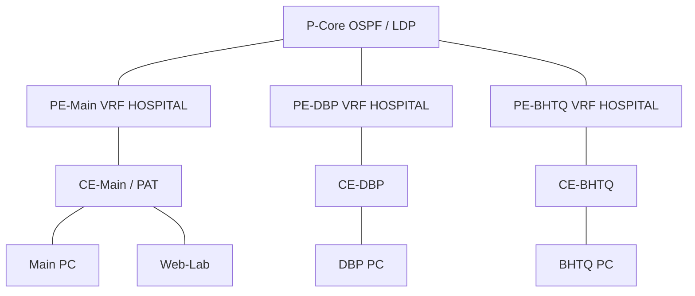

# MPLS L3VPN cho ba cơ sở

**Đã kiểm thực thi: 28/28 và 28/28 sau dựng lại trên Linux namespaces/QEMU.** [Evidence và giới hạn môi trường](../../test_results/mpls/README.md). Module mở rộng độc lập với mô hình tổng đã kiểm thử. Bốn router provider (ba PE, một P) kết nối ba CE Main/DBP/BHTQ, ba PC đại diện và Web-Lab: tổng 11 nút, 10 liên kết. `mpls_runtime.py` sinh chung cấu hình cho Linux namespaces và node Docker GNS3.

- Transport provider: OSPF area 0, loopback 172.31.255.1–4, LDP phân phối nhãn.
- VPN: MP-BGP AS65000 giữa ba PE, RD65000:1/2/3, RT65000:100, VRF HOSPITAL/table1001; CE eBGP AS65101–65103.
- LAN: Main10.10.10.0/25, DBP10.20.10.0/25, BHTQ10.30.10.0/25; hai Aux nhận default từ Main qua VPN. Web-Lab192.0.2.100 mô phỏng Internet, PAT tại CE-Main198.51.100.2.
- Đây là mô hình MPLS L3VPN; không triển khai controller/overlay SD-WAN. MPLS không tự mã hóa gói tin.

## Chạy bằng Linux namespaces

Cần Linux root, kernel hỗ trợ `mpls_router`, `mpls_iptunnel`, `vrf`, iproute2, FRR với zebra/ospfd/ldpd/bgpd, Python3, iptables, curl và tcpdump. Máy ảo Alpine3.22.7/kernel6.12.114-lts được dùng để kiểm khả năng trên Windows; không thay đổi mạng Windows.

```sh
sudo python3 simulation/mpls/mpls_runtime.py create
sudo python3 simulation/mpls/test_mpls.py --run initial --out /tmp/mpls-evidence
sudo python3 simulation/mpls/mpls_runtime.py cleanup
```

Chỉ chạy trong compute/lab riêng; cleanup dùng đúng namespace `hospmpls-*` và veth `hm0a/b` đến `hm9a/b` do module tạo. Không chạy chồng hai instance. Bộ thử lưu raw CLI, sáu ping hai chiều giữa ba site, ba HTTP qua Main PAT, MP-BGP/VRF/LDP, cách ly provider và PCAP có nhãn MPLS. Lỗi được giữ; không dùng cấu hình hoặc kết quả static thay runtime.

## GNS3

Project [hospital-mpls.gns3](hospital-mpls.gns3) được tạo bằng `python scripts/build_mpls.py`. Trên Linux/GNS3 VM compute:

```sh
sudo modprobe mpls_router
sudo modprobe mpls_iptunnel
sudo modprobe vrf
docker build -t hospital-mpls:20261104 simulation/mpls
```

Mở project bằng GNS3 2.2.55, chọn compute có image, start nodes rồi kiểm bằng vtysh/ping/curl qua `docker exec -it <container_id> /bin/sh` trên compute (container_id nằm trong properties của node/API GNS3). Console attach mặc định hiển thị tiến trình node, không tự mở shell quản trị. Kernel compute phải hỗ trợ MPLS/VRF trong Docker; image không tự bổ sung module kernel. Việc sinh project không chứng minh nó đã được mở/chạy bằng GNS3. Evidence namespace và kiểm native GNS3 phải ghi đúng môi trường riêng.

Nguồn: [FRR LDP](https://docs.frrouting.org/en/stable-10.4/ldpd.html), [FRR MPLS L3VPN](https://docs.frrouting.org/en/stable-10.4/bgp.html#layer-3-vpn-configuration). Module không mang theo Cisco image hoặc bộ cài QEMU/ISO; người nhận dùng nguồn phần mềm chính thức theo giấy phép.

## Sơ đồ MPLS riêng



Ba PE có MP-BGP VPNv4 full mesh qua loopback. P chỉ chuyển nhãn transport, không có route LAN bệnh viện; mỗi PE có nhãn VPN và bảng HOSPITAL riêng. Các nét PE–CE là handoff eBGP, các link P–PE chạy OSPF/LDP.

## Demo nhanh trên máy Windows hiện tại

Máy ảo MPLS phiên làm việc này giữ serial console tại localhost4556; không chạy đồng thời nhiều lệnh console. Từ root repository:

```powershell
python scripts/mpls_vm_console.py
python scripts/mpls_vm_console.py --node PC-DBP -- ping -c 3 10.10.10.10
python scripts/mpls_vm_console.py --node PC-BHTQ -- curl --noproxy '*' http://192.0.2.100/demo
python scripts/mpls_vm_console.py --node PE-Main -- vtysh -N hospmpls-PE-Main -c 'show bgp ipv4 vpn'
python scripts/mpls_vm_console.py --node P-Core -- vtysh -N hospmpls-P-Core -c 'show mpls ldp neighbor'
```

Helper này chỉ dùng VM còn chạy và state local trong `tmp/wan-tools/`; không phải trình cài QEMU hoặc snapshot được đóng gói. Sau khi tắt máy ảo/khởi động lại Windows, dựng lại bằng runbook Linux/GNS3 ở trên. Bộ nộp có source và evidence, không kèm ISO/binary của công cụ.
